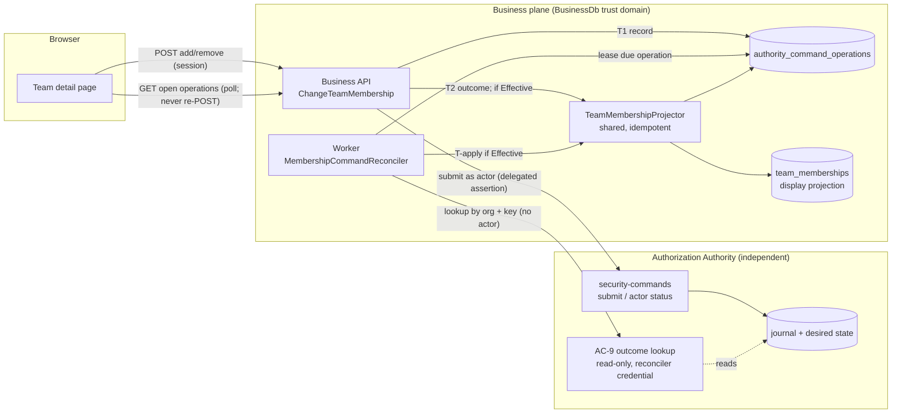
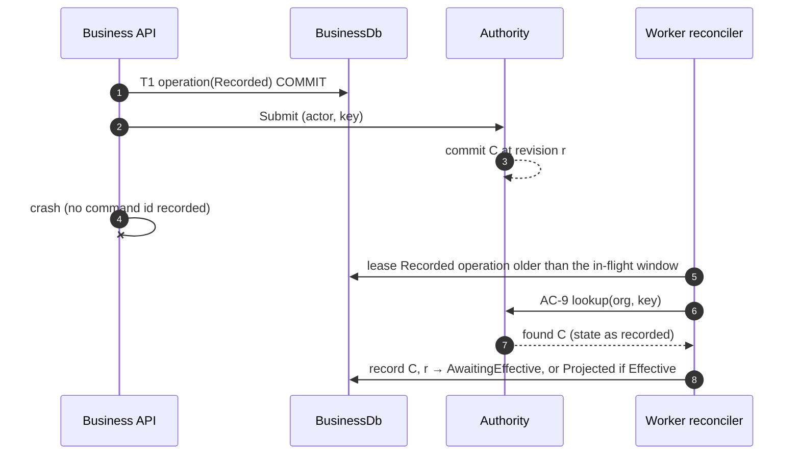
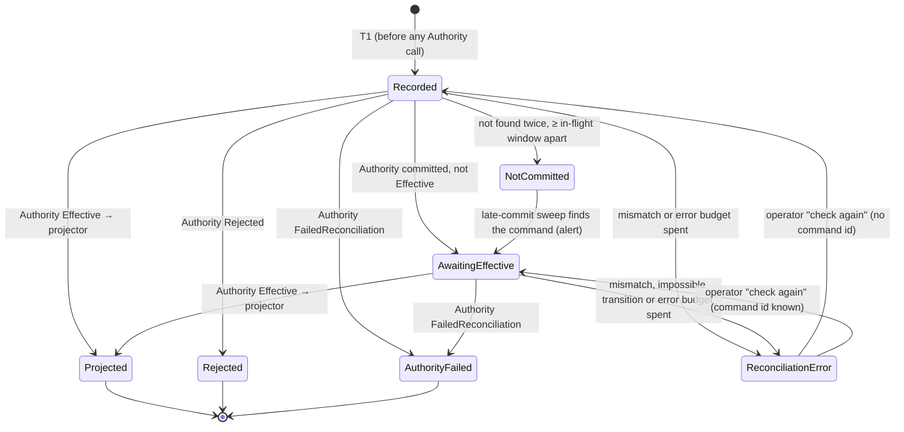

# Phase C8 — C8-M1-01 durable Authority command reconciliation: architecture proposal

- **Status update (C-85, 2026-10-30):** the owner answered Q-O1…Q-O4 (D8-20…D8-23). The package is now the final independent-review submission. It adds correction **R-6** (a stale answer behind the watermark is retried once, not alerted). **Not reviewed; not implemented;** C8-M1-01 stays open.
- **Status update (C-84, 2026-10-30):** the owner approved **Design R** as the direction, **subject to independent security review of AC-9**, and recorded D8-11…D8-19. The review package is `docs/architecture/PHASE_C8_AC9_SECURITY_REVIEW_PACKAGE.md`. Its refinements **R-1…R-5 supersede this document where they differ**:
  * R-1: the projected value is the Authority's effective membership of the command's own (team, member) pair at revision P, replacing the operations-ledger guard of §6.3;
  * R-2: a new per-pair watermark table, `team_membership_projection_states`;
  * R-3: the Worker is the only projection writer; the API no longer writes the roster;
  * R-4: the browser polls and never re-POSTs;
  * R-5: RO-2 covers 12 handlers, not 11.

  Still not implemented; C8-M1-01 stays open.
- **Original status:** **Proposal only; stopped at the C8-M1-01 architecture approval checkpoint (C-83, 2026-10-30).** Nothing here is implemented. No database, Authority, SpiceDB, OpenAPI or UI change has been made, nothing was deployed or merged, and M2 has not started.
- **Candidate commit reviewed:** `160efdbdacd8b70977bc914dcaf741eaeba79326` on `phase-c8/administration-governance`.
- **Parent documents:** `docs/architecture/PHASE_C8_ADMINISTRATION_AND_GOVERNANCE.md` §10 (summary and decisions); `docs/PHASE_C8_STATUS.md` §8–§10; decision log C-81…C-83.
- **Normative inputs:** `CLAUDE.md` §4B, §4D, §4L, §4M–§4N, §4Q (G08), §4T, §4U; `trust_authority/CROSS_SYSTEM_CONSISTENCY_PROTOCOL.md`; ADR-PB-006 (API), ADR-PB-007 (durable jobs); C-82 (the client-side remediation this replaces).

## 0. Summary

C-82 made a Pending team-membership command reconcile to Effective, but only while the administrator's browser tab stays open. The owner asked for a durable, server-side reconciler that does not depend on the browser.

Reading the code at `160efdb` gives one decisive constraint:

> **The Authority's only command-status read answers the originating actor alone.** `SecurityCommandService.GetStatusAsync` binds the delegated user assertion and returns a generic 404 unless that binding equals the command's `ActorIdentityBindingId`. No workload-only status read exists, and the Authority exposes no team-roster read.

A background worker therefore cannot learn that a command became Effective through any existing Authority interface without carrying the original actor's assertion, which would be impersonation. **Two of the owner's requirements cannot be met together:** "reconcile without depending on the browser or the actor" and "no Authority change or privilege expansion". This document proposes:

| Design | Authority change | Closes C8-M1-01 | Recommendation |
|---|---|---|---|
| **R — durable operation record + Worker reconciler + AC-9 narrow read-only outcome query** | Yes. One new **read-only** internal query, no new command, under a separate Worker-only credential (the OD-1 pattern) | Fully. Survives browser closure, API and Worker restarts, and the actor never returning or being disabled | **Recommended** |
| **F — durable operation record + actor-present reconciliation** | None | Partly. Survives browser closure and restarts, but completes only when the *same administrator* next signs in. Stuck if they never return or are disabled (AC-7 R7) | Fallback if AC-9 is refused |

Both designs share the same business-side operation table, state machine, projection rules and tests. Only the component that asks the Authority differs.

Two further observations came out of the review. They need owner triage (§12):

- **C8-M1-02 (proposed finding): a stale Effective observation can resurrect a removed membership in the display roster.** At `160efdb` the projection step inserts a membership whenever it observes an Effective add with no active row. If an older add is observed after a later remove has been projected, the removed member reappears in the roster. This is reachable today through a duplicated browser tab (duplication copies session storage) or a direct API retry with the old key. It is display-only and confers nothing, because the Authority still decides access. A durable reconciler makes late observations routine, so both designs include a revision guard (§6.3).
- **RO-2 (proposed finding): the same "project only in the request that observes Effective" pattern exists in 11 other handlers.** These are `CreateTeam`, `CreateFormDefinition`, `FormAccess`, `FormDesigner`, `CreateFormRecord`, `TransferOwnership`, `SecurityAdministrators`, `SecurityPolicy`, `ChildRecord`, `FieldSearchPolicy`, `CreateShare` and `RevokeShare`. The table is designed so that more command kinds can be added later. The scope of this proposal stays limited to `AddTeamMember` and `RemoveTeamMember`.

## 1. Baseline at `160efdb` (verified by reading the code)

### 1.1 Authority (source of truth; unchanged)

- **Idempotency** (`SecurityCommandService.SubmitAsync`): a command's identity is the organization, the idempotency key, the actor's identity binding and the canonical request digest. The digest excludes the CAS revision. A replay with the same key returns the existing command's status, and a different request or actor with that key returns 409 `IDEMPOTENCY_CONFLICT`. **Rejected commands are persisted too** (with the key and a rejection code), so a key lookup also finds them. Keys are 8–128 characters.
- **Commit:** the desired state, the immutable command, the outbox and the journal are written in one AuthorityDb transaction under the organization lock, with a CAS on `ExpectedAuthorizationRevision`. Each committed command carries a `CommittedAuthorizationRevision`, which is monotonic per organization.
- **States:** `CommittedAwaitingProjection` → `Effective`. `ProjectionProcessor` sets `Effective` after the SpiceDB projection and the archive receipt, and sets `FailedReconciliation` on projection divergence. `Rejected` is set at submit. `Pending` is declared but is not reached on this path.
- **Status read** (`GetStatusAsync`): only the originating actor; anyone else gets 404. No workload variant exists.
- **Team rules** (`CommandPlanner.TeamMembershipAsync`): the actor must be an organization administrator (owner or Security Administrator). A Security Administrator cannot add themself (G25). "Already a member" and "not a member" are rejected against the desired-state graph.
- **Gate:** while a command is not yet Effective, the organization gate is not Ready. Permission checks fail closed, and the business handler's `CheckPermissionAsync` call fails before submit. Through the business API, **at most one team command per organization is therefore in flight**, and commands become Effective in revision order.
- **Workload-only precedents:** content reprotection (`TryActor`, authorized by an effective `PublishFormSecurityRevision` command) and the separate field-protection **verifier** credential (OD-1). The verifier has its own scheme and role, is registered in the Worker only, and its policy denies everything when it is unconfigured.

### 1.2 Business API and Worker

- `ChangeTeamMembershipHandler` calls `CheckPermissionAsync`, then `AuthorityCommandAwaiter.SubmitAndAwaitAsync`, which allows a 15 s budget. The Authority idempotency key is `team-add:` or `team-remove:` followed by the client key. The handler writes `team_memberships` **only if it observes Effective inside that same request**. Nothing is recorded before submit, and nothing remains afterwards for a non-Effective outcome.
- `team_memberships` is an untrusted display projection. It has `authority_command_id`, `removed_on` and the unique active index `uq_team_memberships_active` on `(team_id, user_id) WHERE removed_on IS NULL`. It has no revision column.
- Runtime grants (`BusinessRuntimeGrants`): projection tables get SELECT, INSERT and UPDATE; no table allows DELETE or DDL.
- Business RLS is **not deployed** (G08 open). Tenant isolation is enforced by explicit `tenant_id` filters and by the Authority's actor-to-organization binding.
- The Worker host already runs leased reconcilers: `FieldProtectionReconciliationService` uses `FOR UPDATE SKIP LOCKED`, a lease owner and expiry, `next_attempt_on`, and a Blocked/terminal-state taxonomy. The Worker holds the business-API workload credential and, under OD-1, the verifier credential.
- C-82 (client): the browser keeps the original key in tab session storage and **re-POSTs** the same add or remove. If the original request never reached the Authority, that re-POST would create a new command at that moment. This is acceptable only because the actor is present, and it is addressed in §6.1.

## 2. Options considered

| # | Option | Verdict | Reason |
|---|---|---|---|
| O1 | Store the actor's delegated assertion and poll as the actor | **Rejected** | Impersonation. A bearer credential would sit at rest in BusinessDb. Assertions expire. Forbidden by the brief. |
| O2 | The Worker reads AuthorityDb, the archive or SpiceDB directly | **Rejected** | Crosses the G08/§4M boundary. Business identities must hold no Authority-store access. |
| O3 | The Worker re-submits the command with the same key | **Rejected** | Needs the actor's assertion (O1). If the original was never committed, it **creates a new command later**, which is an unsafe replay. |
| O4 | The Authority pushes outcomes to a business callback | **Rejected** | Reverses the dependency direction and adds Authority egress to the business plane. |
| O5 | **F:** durable record plus reconciliation whenever the initiating actor is present | Acceptable fallback | No Authority change, but it depends on the actor (§9). |
| O6 | **R:** durable record plus a Worker reconciler over a narrow read-only Authority outcome query (AC-9) | **Recommended** | Smallest change that removes every dependency on the browser and the actor. Read-only, with no new command. |
| O7 | An Authority team-roster read or change feed, with full mirror reconciliation | Deferred | Would also catch operator-plane changes and BusinessDb restore drift (§8, T16), but needs a larger contract. A candidate for RO-2 or a later phase. |

## 3. Architecture (design R)



- **The API path** keeps today's synchronous behaviour. The only difference is that the intent is recorded first (T1), so no outcome is lost.
- **The Worker path** finishes everything the API did not: a non-Effective outcome after 15 s, a lost response, an API crash, a closed browser.
- **One projector**, used by both paths. It is idempotent, revision-guarded and serialized per team (§6.3).
- **The reconciler has no submit capability.** It depends only on the outcome-lookup port. An architecture test forbids the reconciler from calling `SubmitSecurityCommandAsync` or `IAuthorizationAuthorityClient`.

### 3.1 Normal path, then browser closed while Pending

```mermaid
sequenceDiagram
  autonumber
  actor Admin
  participant UI as Browser
  participant API as Business API
  participant DB as BusinessDb
  participant AA as Authority
  participant W as Worker reconciler
  Admin->>UI: Add Casey to team
  UI->>API: POST /teams/{t}/members (Idempotency-Key K)
  API->>AA: CheckPermission (actor) — gate must be Ready
  API->>DB: T1 INSERT operation(Recorded, key "team-add:K", actor, team, member) COMMIT
  API->>AA: Submit AddTeamMember (actor, key) 
  AA-->>API: 202 CommittedAwaitingProjection (command C, revision r)
  API->>AA: poll as actor ≤ 15 s — still not Effective
  API->>DB: T2 UPDATE operation → AwaitingEffective(C, r) COMMIT
  API-->>UI: 200 {operationId, state: Pending}
  Admin-xUI: closes the browser
  Note over AA: archive recovers → projector marks C Effective
  W->>DB: lease due operation (SKIP LOCKED) COMMIT
  W->>AA: AC-9 lookup(org, "team-add:K", AddTeamMember)
  AA-->>W: found, Effective, C, r, team t, member Casey
  W->>DB: T-apply: lock row + team; verify match and guard; INSERT membership; operation → Projected COMMIT
  Note over Admin,DB: Any administrator now sees Casey in the roster. No browser was involved.
```

### 3.2 API crash after the Authority committed but before T2



If the lookup says **not found**, the operation becomes `NotCommitted` only after two not-found lookups at least the in-flight window apart (§5, §7). **Nothing is ever re-submitted.**

## 4. Proposed table and indexes (not created)

One new business table, owned by the `Teams` feature (§4U). It needs no change to `team_memberships`: the operation table itself is the per-membership revision ledger used by the guard in §6.3. Every column name follows the descriptive multiword rule, and the primary key follows the entity-name rule.

```sql
-- PROPOSAL ONLY: to be delivered as an EF Core migration after approval.
CREATE TABLE authority_command_operations (
  authority_command_operation_id   uuid PRIMARY KEY,                 -- UUID v7, generated in .NET
  tenant_id                        uuid NOT NULL REFERENCES tenants (tenant_id),
  initiated_by_user_id             uuid NOT NULL REFERENCES users (user_id),   -- original actor (local id); never used to act
  command_kind_name                varchar(40) NOT NULL
      CHECK (command_kind_name IN ('AddTeamMember','RemoveTeamMember')),     -- extended only by an approved migration
  team_id                          uuid NOT NULL REFERENCES teams (team_id),
  member_user_id                   uuid NOT NULL REFERENCES users (user_id),
  authority_idempotency_key        varchar(140) NOT NULL,            -- exactly as sent ("team-add:" + client key); never logged
  request_correlation_identifier   uuid NOT NULL,
  operation_state                  varchar(30) NOT NULL
      CHECK (operation_state IN ('Recorded','AwaitingEffective','Projected','Rejected','AuthorityFailed','NotCommitted','ReconciliationError')),
  authority_command_id             uuid NULL,
  committed_authorization_revision bigint NULL CHECK (committed_authorization_revision > 0),
  authority_command_state_name     varchar(40) NULL,                 -- last observed Authority state
  authority_rejection_reason_code  varchar(80) NULL,
  projection_outcome_name          varchar(40) NULL
      CHECK (projection_outcome_name IN ('MembershipAdded','MembershipRemoved','AlreadyProjected','SupersededByLaterRevision','NoActiveMembership')),
  reconciliation_attempt_count     integer NOT NULL DEFAULT 0,
  consecutive_error_count          integer NOT NULL DEFAULT 0,
  last_error_code                  varchar(80) NULL,                 -- sanitized stable code only
  next_attempt_on                  timestamptz NOT NULL,
  lease_owner_name                 varchar(200) NULL,
  lease_expires_on                 timestamptz NULL,
  first_not_found_on               timestamptz NULL,                 -- first Authority "not found" for the key
  needs_attention_since            timestamptz NULL,
  attention_resolved_on            timestamptz NULL,
  attention_resolved_by_user_id    uuid NULL REFERENCES users (user_id),
  operation_created_on             timestamptz NOT NULL,
  operation_modified_on            timestamptz NOT NULL,
  operation_completed_on           timestamptz NULL,
  CONSTRAINT ck_command_operations_command_fields
      -- Rejected may lack a command id: a refusal at submit is an error response without one (the Authority still persists it).
      CHECK (operation_state IN ('Recorded','NotCommitted','Rejected','ReconciliationError') OR authority_command_id IS NOT NULL),
  CONSTRAINT ck_command_operations_projected
      CHECK (operation_state <> 'Projected' OR (projection_outcome_name IS NOT NULL AND committed_authorization_revision IS NOT NULL))
);

CREATE UNIQUE INDEX uq_command_operations_tenant_key
  ON authority_command_operations (tenant_id, authority_idempotency_key);
CREATE UNIQUE INDEX uq_command_operations_command
  ON authority_command_operations (authority_command_id) WHERE authority_command_id IS NOT NULL;
CREATE INDEX ix_command_operations_due
  ON authority_command_operations (next_attempt_on) WHERE operation_state IN ('Recorded','AwaitingEffective');
CREATE INDEX ix_command_operations_team_open
  ON authority_command_operations (tenant_id, team_id, operation_state);
CREATE INDEX ix_command_operations_member_revision
  ON authority_command_operations (tenant_id, team_id, member_user_id, committed_authorization_revision)
  WHERE operation_state = 'Projected';
CREATE INDEX ix_command_operations_attention
  ON authority_command_operations (tenant_id, needs_attention_since) WHERE needs_attention_since IS NOT NULL;
```

- **Grants:** the projection-table class (SELECT, INSERT, UPDATE; **no DELETE**) for the runtime role. The Worker uses the same runtime role, as today.
- **Retention:** terminal rows are kept for the period decided under D8-16 and purged only by a privileged retention job (the runtime has no DELETE). The rows hold no record content or secrets: ids, codes, timestamps, and the idempotency key, which cannot submit anything without the actor's assertion and request digest.
- **Integrity classification:** an **untrusted projection-class table**, like `team_memberships`. It carries no `RowSignature` because it confers nothing, and every Authority answer is checked against it rather than trusted from it (§6.3, T4). It must be added to the §4L coverage inventory with that justification (D8-18).
- **Tenant filters:** every query filters on `tenant_id`. If business RLS (G08) is later deployed, the table joins the RLS set, and the Worker sets the transaction-scoped tenant context per operation.

## 5. Reconciliation state machine



| State | Meaning | Terminal | UI outcome (C-82 vocabulary) |
|---|---|---|---|
| `Recorded` | Intent durable; Authority answer unknown | No | **Pending** |
| `AwaitingEffective` | Authority committed command C at revision r; not Effective yet | No | **Pending** |
| `Projected` | Authority reported Effective, and the projector ran (outcome recorded) | Yes | **Effective** |
| `Rejected` | Authority rejected the command; nothing projected | Yes | **Rejected** |
| `AuthorityFailed` | Authority `FailedReconciliation`; nothing projected; Authority operator needed | Yes | **Failed** |
| `NotCommitted` | The Authority never received the command (bounded proof, §7); nothing projected, **never re-sent** | Yes, subject to the late sweep | **Failed** ("not received; nothing was changed; start again") |
| `ReconciliationError` | The answer did not match the row, an impossible transition occurred (for example committed → Rejected), or retries were exhausted | Parked | **Failed** (needs attention) |

- **Effective is the only path into `Projected`.** No operator action, timeout or error forces a projection.
- `needs_attention_since` is set, and continued polling is kept, when a non-terminal operation is older than the attention threshold (D8-16). An archive outage can legitimately keep a command `CommittedAwaitingProjection` for a long time, so the reconciler does not give up while the Authority reports the command committed.

## 6. Transaction boundaries and failure recovery

### 6.1 API path

| Step | Boundary | Content |
|---|---|---|
| P0 | none | Session and actor from the authenticated request. `CheckPermissionAsync(ManageOrganization)` (gate must be Ready). |
| T1 | BusinessDb transaction | Look up `(tenant_id, authority_idempotency_key)`. **Exists with a different kind, team or member** → 409 `IDEMPOTENCY_CONFLICT`, no submit. **Exists, same intent, past `Recorded`** → return its state, no submit; at most one actor status read if a command id is known. **Exists and `Recorded`, same initiating user** → continue to N1 with the same key; the Authority deduplicates. **Absent** → INSERT `Recorded`, COMMIT. If T1 fails → 503 and **no Authority call**. |
| N1 | network, no DB transaction | Submit as the actor with the recorded key; await at most 15 s (unchanged). |
| T2 | BusinessDb transaction | Lock the operation row `FOR UPDATE`. If its state is already past the submit outcome (the Worker won), return it. Otherwise record the command id, revision and Authority state. If **Effective**: run the projector in this same transaction, then set `Projected`. A **definitive** Authority refusal (422/403/409 with a stable code, e.g. G25 self-add, stale revision, already a member) sets `Rejected` with the reason code; the error response carries no command id. An **ambiguous** failure (timeout, transport, 5xx, `AUTHORITY_NOT_READY`) changes nothing: the row stays `Recorded` for the Worker. COMMIT. |
| — | response | `200 {operationId, operationState, command}`. Additive OpenAPI change: the existing `command` object remains. |

Re-POST semantics change from C-82. After this proposal the browser **polls a read endpoint** and never re-POSTs to check. A re-POST with the same key while the row is past `Recorded` returns the stored state. **No path re-submits an operation that is past `Recorded`.**

### 6.2 Worker path

| Step | Boundary | Content |
|---|---|---|
| L | BusinessDb transaction | `SELECT … WHERE operation_state IN ('Recorded','AwaitingEffective') AND next_attempt_on <= now AND (lease_expires_on IS NULL OR lease_expires_on < now) ORDER BY next_attempt_on LIMIT n FOR UPDATE SKIP LOCKED`. Set lease owner and expiry (2 min), COMMIT. Rows still inside the in-flight window (created < 5 min ago and `Recorded`) are skipped: the API still owns them. |
| N2 | network, no DB transaction | AC-9 lookup `(organization = row.tenant_id, idempotency key, expected kind)` under the reconciler credential (R), or nothing (F; see §9). |
| T-apply | BusinessDb transaction | Re-read the row `FOR UPDATE`. Abort with no change if the lease is no longer ours or the state has changed (the API won). Validate the answer against the row (§6.3). Then apply the transition and, if Effective, run the projector. Update the counters and `next_attempt_on`. COMMIT. |

### 6.3 Projector (shared, idempotent, concurrency-safe)

1. **Match:** the answer's organization, command kind, resource team and member must equal the row; otherwise `ReconciliationError` (`OPERATION_MISMATCH`) plus an alert, and nothing is projected. The values written are the **Authority's** values, which the row must match.
2. **Serialize:** `SELECT … FROM teams WHERE tenant_id = $t AND team_id = $team FOR UPDATE`, so all projections for one team are serialized across the API and the Worker. The volume is low.
3. **Revision guard (fixes C8-M1-02):** compute `latest = max(committed_authorization_revision)` over `Projected` operations for `(tenant_id, team_id, member_user_id)`, with 0 when none exist. If `r <= latest`, the outcome is `SupersededByLaterRevision` (or `AlreadyProjected` for the same command) and the roster is not changed.
4. **Apply:** for an add, insert the membership with `authority_command_id = C` unless an active row exists (`AlreadyProjected`; the unique active index still backs this). For a remove, set `removed_on` on the active row (`MembershipRemoved`), or record `NoActiveMembership` when none exists. A remove still advances the guard, so an older add can never resurrect the member.
5. Set the operation to `Projected`, with outcome, revision and completion time, **in the same transaction** as the roster write.

Memberships created before this change have no operation rows, so they are treated as revision 0. That is correct, because any newer command must be applied.

### 6.4 Failure catalogue

| Failure | Outcome |
|---|---|
| Crash or BusinessDb error before the T1 commit | Nothing recorded and nothing submitted; the client sees an error and may retry. Safe. |
| Crash after T1, before submit | `Recorded`; the Worker finds not-found twice → `NotCommitted`; the UI says "not received; nothing changed". **Not re-sent.** |
| Lost response or crash after the Authority commit, before T2 | `Recorded`; the Worker finds C by key → `AwaitingEffective` or `Projected` (§3.2). |
| Crash during T2 | T2 rolls back; the row stays `Recorded`; recovered as above. |
| 15 s budget elapses (archive paused) | `AwaitingEffective`; the Worker finishes it after recovery (§3.1). |
| Browser closed or session lost | Irrelevant: the state lives in BusinessDb, and any administrator sees it. |
| Worker crash after lease, or after N2 before T-apply | The lease expires (2 min); the next worker repeats a read-only lookup; idempotent. |
| Two workers, or the API racing the Worker | `SKIP LOCKED`, the T-apply row lock and state recheck, the team lock and the idempotent projector: one roster row at most. |
| Authority unavailable or 503 | `consecutive_error_count++` with backoff; no state change. Pending stays Pending. |
| Organization gate not Ready | The command is not Effective, so it stays Pending. If it is already Effective, project per D8-15. |
| Organization integrity quarantine | Defer and set needs-attention; never project during quarantine (D8-15). |
| Authority `FailedReconciliation` | `AuthorityFailed`; nothing projected; Authority operator runbook. |
| Answer does not match the row (tampered row, wrong org, wrong member) | `ReconciliationError` plus alert; nothing projected. |
| BusinessDb restored to an earlier point | Operations after the restore point are lost, so the roster can miss Effective changes. Residual risk; O7 or an operator re-sync addresses it (§8, T16). The Authority never rolls back (G14). |

## 7. Retry, backoff, dead-letter, audit and observability

- **Backoff:** 5 s, 10 s, 20 s, 40 s, 80 s, 160 s, then capped at 5 min, with ±20 % jitter. Successful Authority answers that are still Pending use the same schedule but do not increment `consecutive_error_count`.
- **In-flight window:** a `Recorded` row is left to the API for 5 min (30 × the Authority client timeout of 10 s). **`NotCommitted`** requires two not-found answers at least 5 min apart, both after the window. A daily **late-commit sweep** re-checks `NotCommitted` rows for 7 days. If it finds a command, it moves the row on and raises `LATE_COMMIT_DETECTED`, because an Authority commit that outlives the request is an anomaly worth investigating.
- **Needs attention:** a non-terminal operation older than 30 min is flagged (metric plus alert) and polling continues every 5 min.
- **Dead-letter:** `ReconciliationError` after 20 consecutive unexpected errors, or immediately on a mismatch. Parked rows are listed for owners and Security Administrators of the same organization. The only operator actions are **"Check again"** (sets `next_attempt_on = now` and clears the error state, never submits) and **"Mark reviewed"** (sets `attention_resolved_*` with a reason). Both are audited, and **no action can force a projection**.
- **Audit:**
  * The Authority journal remains the canonical record of the security command (ADR-SEC-2026-10-16-01). This design adds no security-event writer.
  * Business `audit_events` (a projection) gains only: `TEAM_MEMBERSHIP_RECONCILIATION_FAILED` for `ReconciliationError`, `AuthorityFailed`, `NotCommitted` and `LATE_COMMIT_DETECTED` (`ActorType = Service`); and `TEAM_MEMBERSHIP_OPERATION_RECHECKED` and `TEAM_MEMBERSHIP_OPERATION_REVIEWED` for operator actions (`ActorType = User`).
  * The original initiator is recorded as `initiating_user_id` in metadata, **never as `ActorUserId`** of a service event, so the audit never claims the actor performed the reconciliation.
  * Successful projections are evidenced by the operation row and `team_memberships.authority_command_id` (D8-17).
- **Metrics:** gauges for open operations by state and age, needs-attention count and oldest pending age; counters for lookups by outcome, projections by outcome, mismatches, not-committed and late commits; lookup latency.
- **Logs:** operation id, state and stable codes only. **Never** the idempotency key, display names or assertions.

## 8. Security threat analysis

| # | Threat | Mitigation |
|---|---|---|
| T1 | Impersonation of the original actor | The reconciler holds no user assertion. R uses its own workload credential and asks only "what happened to command key K in org O". F calls the Authority only within the actor's own live request. |
| T2 | The Worker initiates a membership change | The reconciler code path has no submit capability (port-level separation plus an architecture test). No path re-submits an operation past `Recorded`, and `NotCommitted` is terminal for automation. |
| T3 | Cross-organization reconciliation | The organization comes from the row's `tenant_id`. The AC-9 lookup is scoped to (org, key) and returns `found:false` for any other organization. The answer's organization must equal the row's. Every query is tenant-filtered, and each operation is processed separately. |
| T4 | Hostile BusinessDb writer forges or alters operation rows | Cannot create Authority commands (no assertion). A forged key finds nothing. Altering team or member on a real row produces a mismatch → `ReconciliationError`, no projection. The same writer could edit `team_memberships` directly anyway: the roster is untrusted display data (G21 family), and the Authority decides access. |
| T5 | Stale replay resurrects or reorders memberships (C8-M1-02) | Revision guard over `Projected` operations, plus the team-row lock (§6.3). |
| T6 | The actor is disabled or loses administrator rights while their command is pending | The Authority committed the command when the actor was authorized. Whether it becomes Effective is the Authority's decision, and the reconciler only mirrors it. No new command is ever created on the actor's behalf. A disabled actor (AC-7 R7) cannot submit, and R still reconciles because it does not use the actor. Under F, the operation stays Pending and needs attention. |
| T7 | Unsafe re-submission after not-found | Forbidden. `NotCommitted` tells the administrator nothing changed and to start again, which is a new, fully authorized action under their current rights. |
| T8 | Idempotency keys exposed in BusinessDb | A key alone cannot submit (actor assertion and digest are bound). Under R it reveals a team-membership outcome only to holders of the reconciler credential, and that outcome is already present in the projection. Keys are never logged. |
| T9 | Abuse of the AC-9 query (enumeration, scope creep) | Separate credential and policy (fail closed when unconfigured); command-kind allowlist; organization and key must both match; no actor identity, reason text or payload beyond team and member in the answer; rate limit; Authority telemetry. |
| T10 | Reconciler credential compromised | Read-only. Discloses team-membership outcomes for known keys; cannot mutate, sign, or read content. Rotation follows the OD-1 runbook. |
| T11 | Backlog or denial of service | Batch bound, lease, backoff cap, metrics and alerts. The API path keeps its 15 s bound, so user latency does not change. |
| T12 | Audit misattribution | Service events carry `ActorType = Service`, and the initiator appears only as metadata. The Authority journal is unchanged and canonical. |
| T13 | Projection while the integrity gate is closed or the organization is quarantined | Deferred per D8-15. Projection never grants anything in any case. |
| T14 | Authority `FailedReconciliation` | No projection; terminal; operator runbook. |
| T15 | Lease expiry causes double processing | The row lock and state recheck in T-apply, the idempotent projector and the unique active index. |
| T16 | Disaster recovery | An Authority restore never rolls back revisions (G14). A BusinessDb restore can lose operations, leaving the roster missing Effective changes (residual; O7 or operator re-sync). An old roster can never grant access, because it confers nothing. |

**Residual risks** (stated, not mitigated here):
- The roster reflects only commands that pass through this path. Operator-plane changes and BusinessDb restores need O7.
- Under F, operations can stay Pending indefinitely if the actor never returns.
- AC-9 is a new read privilege and must join the independent Authority review package (AC-5…AC-8).

## 9. Fallback F: no Authority change

The table, state machine, projector, API path and tests are the same as in R. The differences:

- **No Worker lookup.** Reconciliation runs inside the **initiating actor's own authenticated requests**:
  * when they open any organization administration page;
  * through a lightweight `POST /api/v1/organization/command-operations/reconcile-mine` called at app start.
  For each open operation with a known command id, the API calls the existing actor-bound `GetSecurityCommandStatusAsync`, then runs the T-apply step.
- **Unknown command id** (`Recorded` past the window): the operation becomes needs-attention. The actor sees "This change may not have reached the Authority. Send it again?", and only an **explicit confirmation** re-sends with the same key. The Authority deduplicates if the command exists; otherwise this is a fresh, currently authorized action.
- **The Worker does housekeeping only:** needs-attention flagging, metrics and the late sweep's alerting. It makes no Authority calls.
- **Limitation (C8-M1-01 not fully closed):** if the initiator never returns, is disabled (AC-7 R7 makes `ActorResolver` refuse them), or leaves the organization, the operation remains Pending with needs-attention. Other administrators see it, but cannot complete it.

## 10. Proposed AC-9: read-only security-command outcome lookup (design R only; Authority change)

- **Route:** `POST /internal/v1/security-command-outcomes/lookup` (internal Authority contract; never in the browser-facing OpenAPI).
- **Authentication:** new scheme and policy `ProjectionReconcilerCaller` with `workload_role = business-projection-reconciler`, configured **only in the Worker host**. The business-API credential can never satisfy it. When unconfigured, the policy denies everything (the OD-1 verifier pattern). D8-12 offers reusing the business-API credential instead.
- **Request:** `{ organization_id, idempotency_key, expected_command_kind }`. The kind must be in the allowlist `AddTeamMember | RemoveTeamMember`; anything else is 422 `KIND_NOT_RECONCILABLE`.
- **Response:** `{ found, security_command_id, command_kind, command_state, committed_authorization_revision, resource_team_id, member_user_id, rejection_reason_code, projection_gate_state, integrity_quarantined, correlation_id }`. The answer is `found:false` when no command exists for that (organization, key), and also when the kind differs. It never includes actor identity, reason text or any other payload.
- **Semantics:**
  * Read-only. No journal entry, revision or lock; no gate bypass. It reports the state the Authority recorded.
  * Rejected commands are reported, because they are persisted.
  * A lookup does not create, renew or alter anything.
- **Tests (with the implementation; real Authority):**
  * the business-API credential, the verifier credential, no credential and an expired credential are all refused;
  * an unconfigured deployment denies;
  * the wrong organization for an existing key gives `found:false`;
  * a non-allowlisted kind is refused;
  * the response carries no actor fields;
  * a lookup never changes command state or revision;
  * concurrent lookups are harmless;
  * the rate limit applies.

## 11. Real-stack test plan (security-test stack only; Playwright guard; never the development stack)

The deterministic Pending mechanism is unchanged: pause the mandatory audit archive (the SEC-P12 mechanism) and always unpause it in `finally`. A business-side Testing-only fault point is needed for crash windows. It follows the existing Authority `FaultNames` pattern, is refused outside Testing, and is named `CrashAfterAuthoritySubmit` or `CrashBeforeAuthoritySubmit`.

| ID | Scenario | Pass criteria |
|---|---|---|
| RC-01 | Add Pending → **browser context closed** → archive unpaused | The roster shows the member exactly once, read by **another** administrator's fresh session, with no browser action by the initiator. Operation `Projected/MembershipAdded`. |
| RC-02 | Remove Pending → browser closed → recovery | Member removed; `Projected/MembershipRemoved`. |
| RC-03 | **API restart** while Pending | No loss and no duplicate; the Worker completes it. |
| RC-04 | **Worker stopped** throughout Pending; started after recovery | Completes after start; the API path alone never wrote a non-Effective projection. |
| RC-05 | **Worker restart** mid-lease (killed after lookup, before T-apply) | The lease expires and the next worker completes it; one roster row. |
| RC-06 | Fault `CrashAfterAuthoritySubmit` (committed; command id not recorded) | The Worker finds it by key and completes it; the Authority command count for the key is 1. |
| RC-07 | Fault `CrashBeforeAuthoritySubmit` | `NotCommitted` after the window (shortened in Testing); **the Authority command count is 0**; UI "not received; nothing changed"; never re-sent. |
| RC-08 | Rejected: G25 self-add; already a member; unknown member | `Rejected`; roster unchanged; no projection. |
| RC-09 | Authority `FailedReconciliation` (Authority fault injection where available, otherwise service-level test) | `AuthorityFailed`; nothing projected; audit event. |
| RC-10 | **Revision guard (C8-M1-02):** Worker paused; add Pending; recovery makes it Effective in the Authority; remove the member through the API (synchronously Effective → `NoActiveMembership` at r2); start the Worker | The add (r1 < r2) is `SupersededByLaterRevision`; the roster stays empty, matching the Authority. |
| RC-11 | API T2 and Worker T-apply race on the same operation (3 workers, 6 concurrent re-POSTs) | One roster row; one terminal state; no 500. |
| RC-12 | Same key, different member (re-POST) | 409 `IDEMPOTENCY_CONFLICT`; no second operation; no Authority call. |
| RC-13 | Tampered row (direct SQL in the test harness): member changed / team changed to another organization's team | `ReconciliationError/OPERATION_MISMATCH`; nothing projected; alert or audit present. |
| RC-14 | Cross-organization: an organization B operation with organization A's key | `found:false` → treated as not found; nothing projected in either organization. |
| RC-15 | **Actor's Security Administrator role removed while Pending** (existing C-70 removal) | The command result is as the Authority decides; the Worker mirrors it; the Authority command count is unchanged (no new command). After AC-7: the same test with the actor disabled. |
| RC-16 | Second administrator, second browser | Sees Pending, then Effective by polling the read endpoint; never re-POSTs (asserted on the API request log). |
| RC-17 | Needs-attention threshold (shortened in Testing) | Flag set, metric emitted, polling continues; "Check again" audited and never submits. |
| RC-18 | AC-9 negative suite (§10) | All refusals as specified. |
| RC-19 | Migration | Up and down on a disposable PostgreSQL 18; naming test (multiword columns); grants test (no DELETE); feature-ownership test (one owning migration). |
| RC-20 | Fallback F only: actor returns after closure | Reconciled on the actor's next administration request; another administrator cannot complete it. |

**Unit and contract tests:** the state-transition table (including the impossible transitions), backoff and jitter bounds, the `NotCommitted` rule, mismatch detection, guard arithmetic, OpenAPI drift (additive fields and the read endpoint), axe on the new Pending and Needs-attention UI, and Vitest for the polling client. The C-82 session-storage tests are retired with that code.

**Evidence:** recorded per milestone with SHA and counts, as before. Hosted workflows run on the final commit. Unrun tests are never reported as passing.

## 12. Migration and rollout

1. **Approvals** (§13). AC-9 also enters the independent Authority review package.
2. **AC-9 (R only)**, behind configuration: with no reconciler credential configured, the lookup is unavailable and the Worker reconciler stays idle and alerts (fail closed). Authority tests follow §10.
3. **Expand migration:** create `authority_command_operations`. It is additive, nothing changes in `team_memberships`, and it is not destructive.
4. **API path:** T1/T2 and the shared projector. The reconciler stays disabled by a feature flag, so behaviour equals `160efdb` except that the intent is recorded and the guard applies.
5. **Enable the reconciler** on the security-test stack and run RC-01…RC-19.
6. **UI:** poll `GET /api/v1/teams/{teamId}/membership-operations?open=true` (owners and Security Administrators; tenant-filtered; generic 404 for another organization's team); show the Needs-attention list; remove the C-82 session-storage loop. New Pending wording: "The Authorization Authority has not yet confirmed …. This finishes automatically, even if you close this page." Under F the wording instead reads: "… finishes the next time you sign in."
7. **No backfill:** existing memberships act as revision 0. Pending C-82 tab operations at upgrade time remain browser-driven until those tabs close. This is a development and testing residual only.
8. **Rollback:** disable the reconciler flag; rows stay and are harmless; revert the UI to C-82 if needed. The table is dropped only through a later contract migration.
9. **No development-stack deployment** until the C-74 condition (C-78) is met. **No production claim:** G08, G21, PB-08, Level 2 and the AC review remain open.

## 13. Decisions required before implementation

| ID | Decision | Recommendation |
|---|---|---|
| D8-11 | Design: **R** (AC-9 read-only outcome lookup; full closure) or **F** (no Authority change; closure depends on the actor) | **R** |
| D8-12 | AC-9 credential: a separate Worker-only `business-projection-reconciler` credential (OD-1 pattern), or reuse the business-API workload credential | **Separate credential** |
| D8-13 | Scope: `AddTeamMember` and `RemoveTeamMember` only, with `RegisterTeam` and the other 11 handlers (RO-2) registered as a separate finding for a later phase | **Approve as stated**; register RO-2 |
| D8-14 | Register **C8-M1-02** (stale Effective replay resurrects a removed membership; display-only) and fix it through this design's revision guard rather than with a separate patch to the C-82 code | **Approve** |
| D8-15 | Projection when the command is Effective but the organization gate is not Ready: project (it confers nothing), but **never during integrity quarantine** (defer and flag) | **Approve** |
| D8-16 | Parameters: in-flight window 5 min; backoff 5 s → 5 min cap; needs-attention 30 min; error budget 20; late sweep daily for 7 days; terminal-row retention 400 days (privileged purge) | **Approve** (Testing may shorten the windows) |
| D8-17 | Business audit: only failure outcomes and operator actions become `audit_events` (service actor; initiator in metadata); success is evidenced by the operation row and the Authority journal | **Approve** |
| D8-18 | Classify `authority_command_operations` as an untrusted projection-class table (no `RowSignature`, every Authority answer checked against it) and add it to the §4L coverage inventory | **Approve** |
| D8-19 | C8-M1-01 closure criterion: closes when R (or F, with its documented limitation accepted) is implemented, RC tests pass on the security-test stack, and the hosted workflows have run on that commit. C-82 stays in place until then | **Approve** |

Each approval will be recorded as a decision-log entry before implementation starts. Until then, C8-M1-01 stays **open, mitigated by C-82 (browser-driven)**.
