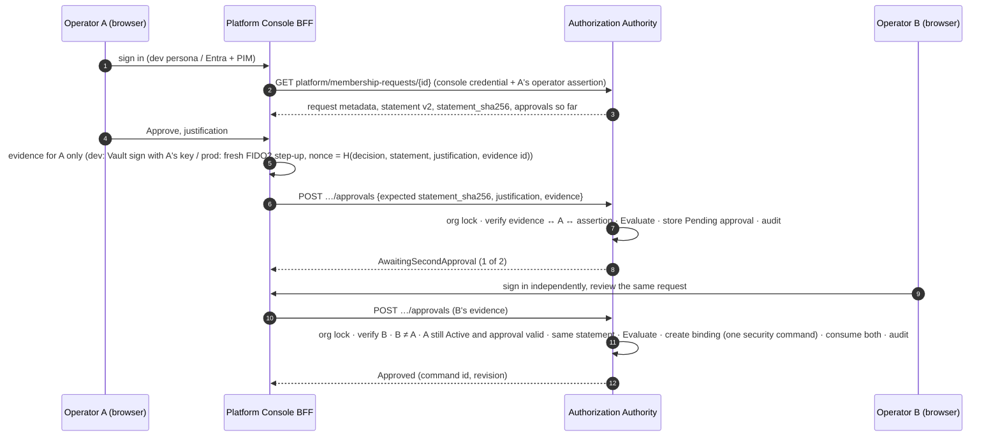
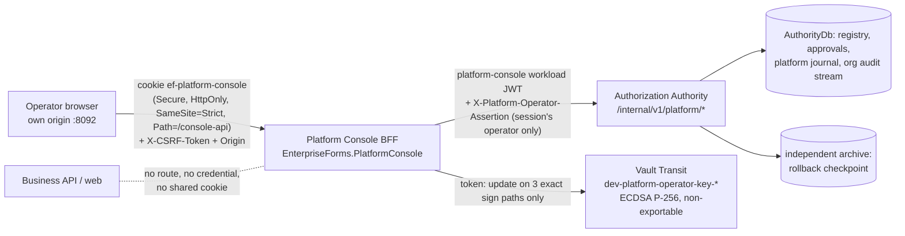

# Phase C8 M2 — Platform Operator administration and two-person operator approvals (architecture proposal)

- **Status:** **D8-33…D8-44 approved by the owner for Development/Testing implementation (C-97, 2026-10-31), with the added
  condition of a separately protected rollback checkpoint; Stages 1 and 2 (Authority only) implemented for Development/Testing
  (C-98) — see §16. Stage 3 (Platform Console BFF, development sessions, Vault Transit signing, development-stack activation) approved
  (C-99) and implemented for Development/Testing — see §17;** the web UI (PG-070 pages) is Stage 4. Production stays closed. Not independently
  reviewed; work by Claude or the owner is never an independent review (C-85). (Original status: proposal, C-96.)
- **Date / branch:** 2026-10-31, `phase-c8/m2-user-management`, starting commit `18b471c`.
- **Audience:** the project owner (decisions), the future independent Authority reviewer (this joins the AC-5/AC-6/AC-7/AC-9
  package), implementers.
- **Scope:** replace the development CLI membership approval (`devstack.py membership approve`) with a browser workflow in
  which two distinct, individually authenticated Platform Operators each approve the exact request, and the Authority
  verifies both. Introduce a platform-scoped Platform Operator role that is strictly separate from organization roles.
- **Not in scope:** DR-C7-3 Security Administrator first appointment and recovery (they stay on the CLI), operator UI for
  other operator-plane operations, M3, any production activation.

---

## 0. Summary and recommendation

The existing two-approval machinery is sound and reusable: the Authority holds **public keys only**, verifies two ES256
approvals over a canonical statement, re-checks the request inside the organization lock and creates the binding as one
journaled security command. What it lacks is **people**. Today an "operator" is a shared HS256 workload credential with no
human identity, the two approver keys sit in one custody file, both approvals are submitted in one call by whoever holds both
keys, and the statement includes a single justification, so two independent people could not even sign the same statement.

Recommended architecture:

1. A new **Platform Operator registry** inside the Authority (platform-scoped, not an organization edge), with its own
   **platform journal stream** so suspensions and removals survive restores (G14).
2. A separate, small **Platform Console** deployable (BFF + SPA reusing `packages/ui` and the design tokens) where operators
   sign in. The business API and business web app gain **no** operator route, consistent with AC-7.4 ("never reachable from
   the business API") and CLAUDE-DESIGN.MD's screen-coverage rule (controlled operational screens "may live in a separate security-operator frontend").
3. A **two-step approval protocol**: each operator submits *one* approval, bound to *their* verified identity, the exact
   request (statement v2) and their own justification. The Authority stores the first as pending evidence and executes the
   membership only when a second, different, still-active operator approves the identical statement.
4. **Evidence is per operator and never produced in the browser.** Development/Testing: per-operator synthetic ES256 keys in
   the local Vault Transit, signed by the console only for the signed-in operator, recorded as synthetic. Production:
   **Entra transaction-bound step-up** (fresh FIDO2 authentication whose OIDC `nonce` commits to the statement and
   justification), verified by the Authority against Entra's keys — no application-held private keys at all. Production stays
   **Unavailable** (fail closed) until PB-08, PIM and the independent review exist.

---

## 1. Existing operator mechanism (verified 2026-10-31)

### 1.1 Facts

| # | Fact | Where |
|---|---|---|
| F-1 | The operator plane (`/internal/v1/operator/*`) requires the `OperatorCaller` policy: an **HS256 shared-secret bearer** with `workload_role=authority-operator`. The only identity it carries is a `workload_name` string (default `"operator"`). It names no human. | `InternalAuthentication`, `OperatorEndpoints` |
| F-2 | Approvals are compact JWS, `alg=ES256`, `kid`=`sub`=approver id, claims `iss`, `aud`, `jti`, `iat`, `nbf`, `exp`, `statement_sha256`, `operation_id`, `operation_kind`, `organization_id`, `target_authority_user_id`. Lifetime ≤ `MaxApprovalLifetimeSeconds` (default 900 s), 30 s skew. | `OperatorApprovalVerifier`, `OperatorApprovalClaims` |
| F-3 | Approver public keys come from deployment configuration (`OperatorApprovals:Approvers[]`); the Authority never holds a private key. Mode `Unavailable` (default; the only mode outside Development/Testing — startup refuses `SyntheticDevelopment` elsewhere) or `SyntheticDevelopment`. | `OperatorApprovalVerifier.Create` |
| F-4 | Exactly two approvals, from two **different approver ids**, must be submitted **together in one call**. Approvals are not stored beforehand; `jti` is not recorded. Replay is prevented only by the single-use operation id (the request id) and the idempotency key `membership-approve:{requestId}`. | `MembershipProvisioningService.ApproveAsync` |
| F-5 | `MembershipApprovalStatement` v1 = version, request id, kind, organization, requested user id, issuer, subject, initial role, requester, request expiry **and the operator's justification**. The display-name hint, the owner's reason and the AC-7.5 `RequestDigest` are not in it. | `MembershipContracts` |
| F-6 | At execution the Authority re-checks, inside the organization lock: not quarantined, request `Pending`, unexpired, requester still an enabled owner, identity not yet bound, issuer still the organization's identity issuer (`Evaluate`). Approval commits one security command (binding + optional designer edge) plus an `OrganizationMembershipApproved` audit-journal event with approver ids and approval digests. | `MembershipProvisioningService` |
| F-7 | Rejection is one operator, a 3–500 character reason, no signature; records `request_decided_by_operator_name` = the workload name. | `RejectAsync` |
| F-8 | The two synthetic approver key pairs are generated once into `%USERPROFILE%\.enterpriseforms\dev-vault\enterpriseforms-dev\operator-approvers.json` and passed (private halves) on stdin to the dev-seed container, which signs both approvals for every execution. One person holds both keys. | `devstack.py`, `OperatorMembershipTool`, `OperatorSecurityAdministratorTool.Sign` |
| F-9 | The security and audit journals are **per organization** (`JournalChain.Append(OrganizationAuthorizationState …)`), hash-chained, archived and replayable. There is no platform-scoped stream. | `JournalChain`, `AuditJournal` |
| F-10 | Business sessions are organization-bound: every development persona has an `OrganizationId`, the BFF session, Authority sessions (`SessionService.CreateAsync`) and `ActorResolver` all resolve an identity binding **inside one organization**. | `DevelopmentIdentity`, `SessionService` |
| F-11 | The operator membership list is per organization (`GET …/organizations/{id}/membership-requests`), unpaged, unaudited reads. There is no cross-organization view. | `ListAsync` |
| F-12 | Owner cancel/replace (AC-7.5) moves a request out of `Pending` under the organization lock; a replacement has a new id, so no approval for the old request verifies against it. | edit/cancel proposal §2.4 |
| F-13 | Focused baseline executed for this proposal: Authority `MembershipAdministrationTests` + `SecurityAdministratorProvisioningTests` — **41 / 41 passed** (2026-10-31). | `tests/authority` |

### 1.2 Reusable as is

- `OperatorApprovalVerifier`'s JWS verification (signature, `alg`, issuer/audience, claim binding, lifetime, skew, distinct
  approvers) and its mode/startup guard pattern.
- `MembershipProvisioningService.Evaluate` and the execution path that creates the binding as one journaled command.
- Canonical JSON + SHA-256 statement digests; the dry-run "consequences" list.
- The per-organization hash-chained audit journal and its archive/replay path (G14).
- The AC-7.5 request digest and the cancel/replace state machine.
- `packages/ui`, `packages/design-tokens`, `packages/work-queue`, the generated-client pattern (PB-06/PB-07).
- Local Vault Transit (already in the dev and security-test stacks).

### 1.3 Gaps that must be addressed

| # | Gap | Consequence if unaddressed |
|---|---|---|
| G-1 | No human operator identity; the operator credential is a shared secret | Two "operators" cannot be told apart; the dev CLI credential is **not** suitable for browser authentication |
| G-2 | No operator registry, role, suspension or removal (only redeploy with changed config) | Cannot revoke one operator quickly; no link between an approval key and a person |
| G-3 | Both approvals submitted in one call by one caller | One person holding both keys is indistinguishable from two people |
| G-4 | Statement v1 contains one shared justification | Two independent operators with their own justifications cannot sign the identical statement |
| G-5 | No persisted pending approval; `jti` not recorded | Asynchronous approval impossible; a stolen approval could be replayed within its lifetime if an operation id were reused |
| G-6 | No platform journal stream | Operator suspension/removal would not be replayable; a restore could resurrect a suspended operator |
| G-7 | Organization-bound sessions and identities | An operator persona does not fit the business session model; operator rights must never become organization rights |
| G-8 | Per-organization, unaudited, unpaged operator reads | No cross-organization queue; operator viewing is not evidenced |
| G-9 | Rejection unsigned, recorded with a workload name | No attributable, non-repudiable rejection |
| G-10 | No conflict-of-interest rule | An operator who is also an owner/member of the organization could approve their own organization's request |

---

## 2. Five distinct layers

| Layer | Question it answers | Development/Testing | Production (blocked) |
|---|---|---|---|
| **Development authentication** | How does a person get a console session locally? | Synthetic operator persona login in the console (no password), only when `PlatformOperators:Mode=SyntheticDevelopment` in a Development/Testing host | Not present (startup refuses) |
| **Operator identity** | Who is this person? | Synthetic `(issuer, subject)` under a dedicated platform issuer, distinct from every organization issuer | Entra workforce identity `(tid, oid)` in the **platform's own** Entra tenant (never a customer tenant) |
| **Operator authorization** | May this identity act as a Platform Operator now? | Authority registry entry `Active` | Authority registry entry `Active` **and** an active Entra PIM assignment claim **and** fresh PB-08 session |
| **Approval signing (evidence)** | Did *this* operator decide *this exact* request? | ES256 JWS from the operator's own synthetic key in Vault Transit (console signs only for the signed-in operator) — **synthetic, never two-human evidence** | Entra-signed ID token from a forced fresh FIDO2 sign-in whose `nonce` commits to decision + statement + justification; no app-held private key |
| **Authority verification** | Is the evidence valid and does current state allow the effect? | Authority verifies evidence, binds it to the registry entry and the session identity, records it, and executes only with two distinct operators | Same verifier contract, Entra evidence kind |

An ordinary application session is **never** treated as approval evidence. The session establishes *who is asking*; the
evidence establishes *what that person decided*; the Authority checks that both name the same registered operator.

---

## 3. Platform Operator identity and permission model

### 3.1 Registry (Authority-owned)

A `platform_operators` row is the only source of the role. Fields (§8): stable `platform_operator_id`, verified
`(operator_issuer_uri, operator_subject_identifier)`, display name (display only), status `Active | Suspended | Removed`,
evidence kind, and (Development/Testing) the id of the operator's synthetic approval key. One row per human identity; an
identity can never be registered twice, and a removed identity is never reused.

### 3.2 Permission catalogue (platform scope)

| Permission | Allows |
|---|---|
| `platform.membership_requests.review` | Cross-organization list and detail of membership-request metadata (§9) |
| `platform.membership_requests.decide` | Record an approval, withdraw one's own pending approval, reject |
| `platform.operators.view` | List operators and their status |
| `platform.operators.manage` | Participate in operator add/suspend/reinstate/remove (§4) |

In V1 every `Active` operator holds all four (one role); the catalogue lets a later decision split read-only reviewers
without a contract change. Checks run in the Authority on every call; the console's hidden buttons are convenience only.

### 3.3 Separation invariants

| # | Invariant | Enforced by |
|---|---|---|
| S-1 | Never inherited from `organization_owner`, `system_administrator` (Security Administrator), `designer` or membership; never written as a SpiceDB edge | Registry is a separate table; no planner rule creates it from organization state |
| S-2 | Confers **no** organization permission: no records, documents, search, roster, branding, sessions | Operator identity is presented with a different header, key and scheme (§7.1); `ActorResolver` resolves only organization identity bindings; organization endpoints never accept the operator assertion |
| S-3 | No self-grant: no operator can add, reinstate or change themself, and adding/reinstating needs a second operator | Registry commands (§4) |
| S-4 | No self-approval through multiple sessions: distinctness is by **registry id and verified identity**, never by session | Approval rules (§5.3) |
| S-5 | Conflict of interest: an operator cannot decide a request for an organization in which their identity is bound, nor one where they are the requester or the requested identity | Approval rules (§5.3) |
| S-6 | Read endpoints return only the metadata in §9; no record, document, team, share or audit content | Response contracts |
| S-7 | Operators cannot change request identity, organization or requested role — the Authority builds the statement from its own row; the console only echoes its digest | Statement v2 (§5.1) |

---

## 4. Provisioning, suspension, removal and recovery

| Operation | Who | Evidence | Effect |
|---|---|---|---|
| **Initial provisioning / quorum recovery** | Operator-plane ceremony (existing `OperatorCaller` credential) with **two DR-C7-3 custodian approvals** (existing verifier, existing custodian keys) | Two ES256 custodian approvals over a `PlatformOperatorBootstrap` statement | Registers named operators. Allowed only while fewer than two operators are `Active`. Critical alert; platform journal |
| Add an operator | Operator A proposes, operator B (≠ A, ≠ target) confirms | Each with their own evidence | Target becomes `Active` |
| Suspend | Any one `Active` operator (including self) | Evidence | Immediate. Invalidates the target's pending approvals in the same transaction; revokes their console sessions. Alert |
| Reinstate | Two operators, neither the target | Evidence | `Active` again; earlier invalidated approvals stay invalid |
| Remove | Two operators, neither the target | Evidence | Terminal; identity never reusable; history kept |

Rules: at least **three** operators should be provisioned so one suspension does not stop approvals; the console shows a
warning below three. Suspension is deliberately single-operator (fast containment beats availability); its abuse is a
denial of service that the bootstrap ceremony repairs. All registry changes are events on the **platform journal stream**
(hash-chained, archived, replayed during G14 recovery), so restoring AuthorityDb from before a suspension does not
reactivate the operator.

Production: the Entra PIM *eligible* assignment ("EnterpriseForms Platform Operator") is managed by platform identity
administrators; activation is time-boxed and justified in PIM. The Authority registry is still required — PIM membership
alone never registers an operator, and registry membership alone never suffices without the active PIM claim. Staged:
Development/Testing Stage 1 implements bootstrap + suspend + reinstate on the Authority; the operator-management UI can
follow once the approvals page is accepted (§14).

---

## 5. Authenticated two-person approval workflow



### 5.1 Statement v2 (built by the Authority from its own rows)

```json
{
  "statement_version": 2,
  "operation_kind": "MembershipApproval",
  "operation_id": "<membership request id>",
  "organization_id": "…", "organization_display_name": "…",
  "target_authority_user_id": "…", "target_issuer_uri": "…", "target_subject_identifier": "…", "target_display_name_hint": "…",
  "initial_role_name": null,
  "requested_by_authority_user_id": "…", "requested_by_issuer_uri": "…", "requested_by_subject_identifier": "…",
  "request_reason_sha256": "…",
  "request_created_on": "…", "request_expires_on": "…",
  "request_digest": "<AC-7.5 digest>",
  "replaces_membership_request_id": null
}
```

No justification and no operator: both operators sign the **identical** statement. Every approval-relevant immutable
field — including what the operator actually reads (display-name hint, organization name, requester identity) — is
committed. v1 stays readable for history; new approvals require v2.

### 5.2 Per-approval evidence

| Kind | Content | Binding |
|---|---|---|
| `SyntheticDevelopmentJws` (Development/Testing) | Existing JWS format plus claims `platform_operator_id`, `decision` (`approve`/`reject`), `justification_sha256`, `statement_version=2`; `kid`/`sub` = that operator's registered synthetic key id; lifetime ≤ 10 min | Authority checks `kid` belongs to the registry entry of the asserted operator |
| `EntraTransactionStepUp` (production, not implemented) | Entra ID token from an authorization request with `max_age=0`, the FIDO2 authentication-context `claims` challenge, and `nonce = base64url(SHA-256("EnterpriseForms/OperatorDecision/v1" ‖ 0x00 ‖ decision ‖ 0x00 ‖ statement_sha256 ‖ 0x00 ‖ justification_sha256 ‖ 0x00 ‖ evidence_id))` | Authority validates signature against the pinned platform-tenant keys, `iss`/`aud`/`tid`, `oid` = registry entry = asserted operator, required `acrs`, `auth_time` ≤ 5 min, PIM claim, recomputed `nonce` |

Both kinds: the evidence id (`jti` / `evidence_id`) and the evidence SHA-256 are **single use** (unique in the database).
Stored: digests, evidence kind, verified claim summary (issuer, operator id, key id or `oid`, `acrs`, `auth_time`, times).
The raw JWS is stored for synthetic evidence (no personal data); whether a raw Entra token is archived in Restricted
evidence storage for independent re-verification is part of D8-35.

### 5.3 Submission rules (inside the organization lock)

1. Operator resolved from the operator assertion → registry entry `Active` (else 403 `PLATFORM_OPERATOR_NOT_ACTIVE`).
2. Evidence verifies and names the **same** registry entry (else `OPERATOR_EVIDENCE_IDENTITY_MISMATCH`); unused evidence id.
3. `expected_statement_sha256` equals the freshly built statement (else 409 `APPROVAL_STATEMENT_CHANGED`).
4. Justification 10–500 characters, its digest matches the evidence.
5. Conflict of interest (S-5) → 403 `OPERATOR_CONFLICT_OF_INTEREST`.
6. `Evaluate` (F-6) passes.
7. No valid pending approval → store this one as `Pending` → **AwaitingSecondApproval**.
8. A valid pending approval by **this** operator → 409 `OPERATOR_ALREADY_APPROVED`.
9. A valid pending approval by a **different** operator whose registry entry is still `Active`, whose evidence key is still
   registered, within its pending window, over the identical statement digest → execute the existing approval path with both
   approval records in the command payload, mark both `Consumed` → **Approved**.

Two operators submitting at the same moment are serialized by the organization lock: one becomes the first approval, the
other the completing one; a late third gets `MEMBERSHIP_REQUEST_NOT_PENDING`. Each submission carries an idempotency key
`(operator, request)`; a retry returns the recorded outcome.

### 5.4 Rejection and withdrawal

- **Reject:** one `Active` operator, mandatory justification (10–500), `decision=reject` evidence, same statement check.
  The request becomes `Rejected`; any pending approval is invalidated (`RequestRejected`). Grants nothing.
- **Withdraw:** an operator may withdraw their own pending approval (`Withdrawn`), with a reason. Nobody can withdraw
  another operator's approval.

---

## 6. Pending approval persistence, expiry and invalidation

A pending approval is evidence, not authorization: it grants nothing, changes no revision and is never projected to
SpiceDB. It is stored in `platform_operator_approvals` and recorded on the **organization's** audit stream
(`OperatorMembershipApprovalRecorded`), so it is archived and replayable with the rest of that organization's history.

| Rule | Value |
|---|---|
| At most one `Pending` approval per request | Partial unique index (§8) |
| Pending window | 24 h from recording (configurable 1–72 h), never beyond the request's expiry. Expiry is a time comparison, as for owner proposals |
| Evidence freshness at submission | JWS `exp − iat` ≤ 10 min; Entra `auth_time` ≤ 5 min |
| Invalidated, in the same transaction, when | the request is cancelled, replaced, rejected or recorded expired; the approving operator is suspended or removed; (synthetic) the operator's approval key is deregistered; the organization is quarantined |
| Also checked at completion (defence in depth) | approving operator still `Active`; statement digest unchanged; request still `Pending` |
| After a restore | A lost pending approval only means a further approval is needed (fails safe). A suspension is replayed from the platform journal before the console is readmitted |

Closure states: `Consumed`, `Withdrawn`, `Invalidated` (reason: `RequestCancelled`, `RequestReplaced`, `RequestRejected`,
`RequestExpired`, `OperatorSuspended`, `OperatorRemoved`, `EvidenceKeyRevoked`, `OrganizationQuarantined`). A closed row
never changes again (check constraint).

---

## 7. Authority commands and API contracts

### 7.1 Platform plane authentication

- New route group `/internal/v1/platform/*`, policy `PlatformConsoleCaller`: a **new** credential scheme `PlatformConsole`
  (own issuer, audience, key; `workload_role=platform-console`), validated like the verifier and reconciler schemes —
  complete-or-absent, distinct from every other credential, fail closed when absent. Production: Entra workload identity
  + mTLS (same existing gap as all internal credentials).
- Every call also carries `X-Platform-Operator-Assertion`: Development/Testing an HS256 assertion signed with a separate
  `Identity:OperatorAssertion` key (distinct from the business user-assertion key, so the business API cannot mint one);
  production the operator's Entra token validated by the Authority itself.
- The existing `OperatorCaller` plane is unchanged and is **not** accepted on `/platform/*`; the business workload
  credential is accepted on neither.

### 7.2 Endpoints

| Method and path | Permission | Purpose |
|---|---|---|
| `GET /internal/v1/platform/operator/me` | Active operator | Own profile, status, evidence kind, mode, capabilities |
| `POST /internal/v1/platform/membership-requests/search` | `review` | Cross-organization page: `q`, `status`, `cursor`, `limit` (default 15, max 50); opaque keyset cursor bound to operator and filter |
| `GET /internal/v1/platform/membership-requests/{requestId}` | `review` | Detail, statement v2 + SHA-256, consequences, recorded approvals, my eligibility. Audited (platform stream, view event) |
| `POST /internal/v1/platform/membership-requests/{requestId}/approvals` | `decide` | §5.3 |
| `POST /internal/v1/platform/membership-requests/{requestId}/approvals/withdraw` | `decide` | Own pending approval |
| `POST /internal/v1/platform/membership-requests/{requestId}/reject` | `decide` | §5.4 |
| `GET /internal/v1/platform/operators` | `operators.view` | Registry (identity, status) |
| `POST /internal/v1/platform/operators/{id}/suspend` · `/reinstate` · `/remove`, `POST /internal/v1/platform/operators/proposals` | `operators.manage` | §4 |
| `POST /internal/v1/operator/platform-operators/bootstrap` | existing `OperatorCaller` + two custodian approvals | §4 initial / recovery |

Commands (platform kinds, journaled on the platform stream): `ProvisionPlatformOperator`, `SuspendPlatformOperator`,
`ReinstatePlatformOperator`, `RemovePlatformOperator`, `BootstrapPlatformOperators`. Approval/rejection reuse the
organization security-command pipeline (`ApproveOrganizationMembership` command; rejection and pending approvals as
organization audit events).

### 7.3 Contracts (wire names)

```json
// POST …/approvals
{ "idempotency_key": "…", "expected_statement_sha256": "…", "justification": "Verified with the requesting owner by phone.",
  "evidence_kind": "SyntheticDevelopmentJws", "evidence": "<compact JWS or Entra ID token>" }

// response
{ "request_id": "…", "organization_id": "…", "outcome": "AwaitingSecondApproval | Approved",
  "approvals_recorded": 1, "approvals_required": 2, "my_approval_id": "…",
  "security_command_id": null, "command_status": null, "authorization_revision": 57,
  "approval_assurance": "SyntheticDevelopment (development-only operator keys; not two-human approval evidence)", "correlation_id": "…" }
```

List item: `request_id, organization_id, organization_display_name, display_name_hint, target {issuer_uri,
subject_identifier}, initial_role_name, requested_by {authority_user_id, issuer_uri, subject_identifier}, requested_on,
expires_on, request_state, approval_status {recorded, required, approved_by_me, awaiting_other_operator,
pending_approval_expires_on}, available_actions[]`. Detail adds `request_reason`, `statement_json`, `statement_sha256`,
`consequences[]`, `approvals[] {operator_display_name, operator_identity, recorded_on, justification, state}`,
`my_eligibility {can_approve, can_reject, can_withdraw, refusal_code}`. No record, document, team or share data.

### 7.4 New error codes

`PLATFORM_OPERATORS_UNAVAILABLE` (403, mode Unavailable), `PLATFORM_OPERATOR_NOT_ACTIVE` (403),
`OPERATOR_EVIDENCE_INVALID` (403), `OPERATOR_EVIDENCE_IDENTITY_MISMATCH` (403), `OPERATOR_EVIDENCE_REPLAYED` (409),
`APPROVAL_STATEMENT_CHANGED` (409), `OPERATOR_ALREADY_APPROVED` (409), `OPERATOR_CONFLICT_OF_INTEREST` (403),
`OPERATOR_QUORUM_UNAVAILABLE` (409, fewer than two active operators). Reused: `MEMBERSHIP_REQUEST_NOT_PENDING`,
`MEMBERSHIP_REQUEST_EXPIRED`, `OPERATOR_APPROVALS_NOT_INDEPENDENT`, `IDEMPOTENCY_CONFLICT`.

### 7.5 Changes to existing endpoints

- Owner cancel/replace commands also close pending approvals (`Invalidated`) in their transaction.
- AC-7.3 roster: each pending membership request gains `operator_approval_count` (0 or 1) — a count only; owners never see
  operator identities.
- The single-call two-JWS `…/operator/organizations/{id}/membership-requests/{id}/approve` endpoint and the CLI `membership
  approve` path are **retired** once the console's real-stack tests pass (D8-42); DR-C7-3 CLI operations are unchanged.

---

## 8. Database changes and migration strategy

AuthorityDb only (the console has no database; BusinessDb unchanged). One additive EF migration
`PlatformOperatorApprovals`; UUIDv7 keys; descriptive multiword snake_case columns.

| Table | Columns (abridged) | Constraints |
|---|---|---|
| `platform_operators` | `platform_operator_id`, `operator_issuer_uri`, `operator_subject_identifier`, `operator_display_name`, `operator_status_name`, `operator_evidence_kind_name`, `synthetic_approval_key_identifier` (null in production), `operator_provisioned_on`, `provisioned_by_platform_operator_id` (null for bootstrap), `operator_status_changed_on`, `operator_status_reason_text`, `operator_row_revision` | unique `(operator_issuer_uri, operator_subject_identifier)` forever; unique key identifier; status check |
| `platform_operator_approvals` | `platform_operator_approval_id`, `organization_id`, `organization_membership_request_id`, `platform_operator_id`, `approval_statement_sha256`, `approval_statement_version`, `approval_justification_text`, `approval_evidence_kind_name`, `approval_evidence_sha256`, `approval_evidence_identifier`, `approval_evidence_claims_json`, `approval_recorded_on`, `approval_valid_until`, `approval_state_name`, `approval_closed_on`, `approval_closure_reason_name`, `consumed_by_security_command_id` | FKs to request and operator; unique evidence sha256 and identifier; partial unique `(organization_membership_request_id) WHERE approval_state_name = 'Pending'`; closed rows immutable (check + trigger) |
| `platform_journal_entries`, `platform_journal_heads` | same envelope as `security_journal_entries` with domain `DynamicForms/PlatformJournal/v1`, stream revision, previous digest, archive delivery state | hash chain; archived by the existing forwarder |
| `organization_membership_requests` | + `request_decided_by_platform_operator_id` (nullable FK) | set for decisions made through the console |

Runtime grants: `SELECT, INSERT` on the new tables; column-level `UPDATE` only on status/closure columns; no `DELETE`.
Replay (G14): registry state is rebuilt from the platform journal; pending approvals from the organization audit stream.
Migration is additive and reversible on a disposable database; no existing row changes; existing operator-plane
behaviour is untouched until the retirement step.

---

## 9. Platform Console and the Operator Approvals UI

### 9.1 Deployment shape (D8-33)

| | **A. Separate Platform Console (recommended)** | B. Inside the business app |
|---|---|---|
| Runtime | New `EnterpriseForms.PlatformConsole` (.NET 10 minimal-API BFF) + `apps/platform-console` SPA; own container, origin, cookie | New `/api/v1/platform/*` in the business API; `platform-operations` feature in `apps/web` |
| Business compromise | No path to platform plane or cross-organization metadata | Compromised business API reads every organization's pending requests and controls what operators see (substitution attack on both operators) |
| Pipeline (PB-11) | Security pipeline, separately approved | Business deployers ship operator UI |
| Conformance | AC-7.4 "never reachable from the business API"; CLAUDE-DESIGN.MD screen-coverage rule (separate security-operator frontend) | Reverses AC-7.4 |
| Cost | One more host and Vite app; shares `packages/*` | Smaller |

### 9.2 Console BFF

Features: `Session` (dev persona login, logout; HttpOnly, Secure, SameSite=Strict cookie; CSRF token; 15 min idle,
2 h absolute), `OperatorApprovals` (proxy of §7.2 with generated client), `Evidence` (Development/Testing: Vault Transit
`transit/sign/platform-operator-approval-<key>` with `marshaling_algorithm=jws`, Vault policy limited to those keys,
signs only for the session's operator; production: Entra step-up redirect). It holds no private key in its own memory or
configuration, no business credential and no database. Startup refuses to run outside Development/Testing until the Entra
mode exists. Dev port proposal: `:8092` (Vite `:5174`), so Playwright isolation rules extend to it.

### 9.3 Navigation and list page — PG-070 "Operator approvals" (D8-43)

Navigation: **Platform administration → Operator approvals** (later: Operators). Route `/platform/approvals`.

- Header: "Operator approvals", one-line description; signed-in operator name with verified identity beneath.
- Environment banner in Development/Testing: "Development operators — approvals here are synthetic and are not two-person
  evidence."
- Toolbar: search (40 px input, "Search organization, person or identity"), status select — *Needs a decision*
  (default: pending with 0 or 1 approvals), Awaiting first approval, Awaiting second approval, Approved, Rejected, Expired,
  Cancelled or replaced, All.
- Table (12 px card, 14 px control text, sentence-case headers): Organization · Requested person (display name, verified
  identity `subject · issuer` beneath, as on People) · Requested role · Requested by (verified identity) · Requested ·
  Expires · Approval status · Actions.
- Approval status chips: "0 of 2", "1 of 2 · awaiting another operator", "1 of 2 · you approved", Approved, Rejected,
  Expired, Cancelled, Replaced.
- Actions: **Review details** button (8 px radius); overflow menu: Copy request ID.
- Server-side pagination, 15 per page, "Showing 1–15 of N", Previous/Next; cards instead of rows below 768 px.

### 9.4 Review details page

Route `/platform/approvals/:requestId` (deep-linkable; more robust than a dialog at 400 % zoom).

1. **Request** — organization, requested person, verified identity, issuer, requested role, requested by, owner's reason,
   requested, expires, request ID, replaced-request link.
2. **What approval does** — the Authority's consequences list (including "Membership is not sign-in until PB-08").
3. **Approvals** — each recorded approval: operator, verified identity, time, justification, state; "You" marked.
4. **Exact statement** — collapsible canonical JSON and a short SHA-256 fingerprint (first 16 hex, full on expand).
5. **Decision** — mandatory justification (textarea, 10–500, live count); primary **Approve** (black `#111111`, white
   label) and secondary **Reject**; **Withdraw my approval** when applicable. Disabled controls always state why (already
   approved by you; conflict of interest; request no longer pending; fewer than two active operators).
   Approve and Reject open a confirmation dialog repeating the organization, person, role and fingerprint; in production
   the step-up follows. Outcome announced in an `aria-live` region and the page refreshes from the Authority.

### 9.5 States, accessibility, responsiveness

Loading, empty ("No requests need a decision"), error (safe code + correlation id), stale (`APPROVAL_STATEMENT_CHANGED`
reloads with an explanation), unavailable (mode Unavailable). WCAG 2.2 AA; keyboard-only flow; visible focus; labels
match accessible names (axe `label-content-name-mismatch`); justification text rendered as text, never HTML; 320 / 768 /
1440 px and 200 % / 400 % zoom with no horizontal scroll.

### 9.6 Owner side (business app)

People → Membership requests shows "Awaiting operators (1 of 2)" from the roster count. Nothing else changes.

---

## 10. Threat model and security tests

### 10.1 Threats

| # | Threat | Control | Residual |
|---|---|---|---|
| T-1 | One person approves twice with two sessions | Distinctness by registry id + verified identity (S-4); one pending approval per operator | — |
| T-2 | One operator submits evidence of another (stolen JWS/token) | Evidence identity must equal the session's operator assertion; single-use evidence id; short lifetime | Theft of both a session and the other's evidence |
| T-3 | One human registered as two operators ("sock puppet") | Registration needs two operators or the custodian ceremony; production identities are Entra workforce accounts under PIM, one per person | Procedural: cannot be proven cryptographically — documented |
| T-4 | Console compromise | Production: console holds no key and cannot forge Entra evidence; it could show one request and obtain step-up for another only if **both** operators are deceived, and the Authority-built statement is shown with its fingerprint. Development: console can sign as any synthetic operator — accepted, labelled synthetic | WYSIWYS substitution (production) |
| T-5 | Business API or BusinessDb compromise | No platform route, credential or data on the business side (option A) | — |
| T-6 | Stale approval after owner edit/cancel | Statement includes request id and digest; pending approvals invalidated in the cancel/replace transaction; completion re-checks | — |
| T-7 | Replay across requests, organizations or decisions | Evidence binds operation id, organization, target, decision, statement and justification digests; single-use ids | — |
| T-8 | Suspended/removed operator completes or keeps an approval | Suspension invalidates pending approvals; completion re-checks both operators `Active` | — |
| T-9 | Race of two second approvals | Organization lock; partial unique index; exactly one command | — |
| T-10 | Restore resurrects an operator or an approval | Platform journal replay of registry state; lost approvals fail safe | Depends on G14 recovery being executed |
| T-11 | Operator reads confidential data | No organization permission (S-2); metadata-only contracts (S-6); detail views audited | Metadata (names, identities) is visible by design |
| T-12 | Self-escalation | No self add/reinstate; no route grants organization roles | — |
| T-13 | Operator colludes with the requesting owner, or is a member | Conflict-of-interest rule (S-5); second independent operator | Collusion of two operators |
| T-14 | CSRF / session fixation on the console | SameSite=Strict, CSRF token, session rotation at sign-in, short sessions | — |
| T-15 | Denial of service by rejection or suspension | Rejection grants nothing (owner can re-request); suspension alerts; bootstrap recovery | Availability |
| T-16 | Non-operators probe platform endpoints | Separate credential; 401/403 with no counts | — |
| T-17 | Markup injection via justification or display name | Rendered as text; length bounds | — |

### 10.2 Tests (to implement after approval; real Authority, both PostgreSQL databases, SpiceDB, Vault)

| Test | Scenario | Expected |
|---|---|---|
| PO-T01 | Business workload credential, business user assertion, `OperatorCaller` credential on `/platform/*` | 401/403 |
| PO-T02 | Operator assertion on organization endpoints (roster, records, search, documents) | 401; no data |
| PO-T03 | Organization owner / Security Administrator / designer identity presented as operator | `PLATFORM_OPERATOR_NOT_ACTIVE` |
| PO-T04 | Same operator approves twice (same and different sessions) | `OPERATOR_ALREADY_APPROVED`; still 1 of 2 |
| PO-T05 | Operator A's session submits operator B's evidence | `OPERATOR_EVIDENCE_IDENTITY_MISMATCH` |
| PO-T06 | Evidence replay (same `jti`), evidence for another request/organization/decision | refused; nothing recorded |
| PO-T07 | Wrong or stale `expected_statement_sha256` | `APPROVAL_STATEMENT_CHANGED` |
| PO-T08 | Owner replaces/cancels after the first approval; then B approves old and new | old refused; first approval `Invalidated`; new needs two fresh approvals |
| PO-T09 | A suspended after approving; B approves | refused; A's approval `Invalidated(OperatorSuspended)` |
| PO-T10 | Pending window or request expiry passes | refused; state recorded |
| PO-T11 | Two concurrent completing approvals | exactly one binding and one command |
| PO-T12 | Conflict of interest (operator bound in the organization; requester; target) | `OPERATOR_CONFLICT_OF_INTEREST` |
| PO-T13 | Reject with one approval pending; approve afterwards | request `Rejected`; approval invalidated; approve refused |
| PO-T14 | Withdraw own approval; withdraw another's | own `Withdrawn`; other refused |
| PO-T15 | Successful two-operator approval | binding + optional designer edge Effective; both `Consumed`; command payload and archived audit body name both operators and evidence digests; owner roster shows the member |
| PO-T16 | Operator self-add/reinstate; add with one operator | refused |
| PO-T17 | Fewer than two active operators | `OPERATOR_QUORUM_UNAVAILABLE`; bootstrap ceremony works only then |
| PO-T18 | G14: restore AuthorityDb from before a suspension | operator remains suspended after replay |
| PO-T19 | `PlatformOperators:Mode=SyntheticDevelopment` or console start in Staging/Production | startup refused |
| PO-T20 | Console credential absent or reusing another key/issuer | Authority startup refused / policy denies |
| PO-T21 | Search and detail never return record/document/team/share data; non-operator gets no counts | contract snapshot + negative test |
| PO-T22 | Cursor tampering, cursor reuse by another operator or filter | refused |
| PO-T23 | Owner roster shows `operator_approval_count` only | no operator identities in business responses |
| PO-T24 | Retired single-call endpoint after D8-42 | refused |
| PO-T25 | Console: CSRF missing/invalid, session fixation, idle/absolute expiry | refused / rotated / signed out |
| PO-UI | Vitest for list/detail states; Playwright (isolated stack only): two operators in separate browser contexts approve, keyboard-only flow, axe, 320/768/1440 px, 200 %/400 % zoom, narrow cards, 15-row paging | pass |

---

## 11. Development/Testing restrictions

- `PlatformOperators:Mode` = `Unavailable` (default; the only accepted value outside Development/Testing) or
  `SyntheticDevelopment` (Development/Testing hosts only; startup refuses elsewhere). The console refuses to start outside
  Development/Testing.
- Synthetic operators under a dedicated issuer (proposal `https://platform-operators.dev.enterpriseforms.invalid/`) that
  can never equal an organization issuer; three personas so suspension can be exercised.
- Synthetic keys: non-exportable ECDSA P-256 keys in the local Vault Transit, one per operator; the console's Vault policy
  can only sign with those keys. Every recorded approval carries `approval_assurance = SyntheticDevelopment (…not
  two-human approval evidence)`.
- Banner on every console page. Synthetic approvals are never PB-12 release evidence.
- Playwright and adversarial tests run only against the isolated security-test stack, never the dev stack (`:8091`, `:8092`,
  `:5173`, `:5174`).

---

## 12. Outstanding production dependencies

| Dependency | Needed for |
|---|---|
| PB-08 Entra OIDC sign-in for the console (platform tenant), session rules | Operator identity |
| PB-08 authentication-context step-up mapped to a FIDO2-only authentication strength; staging proof of which token carries `acrs`/`auth_time` and that `nonce` binding works as specified | `EntraTransactionStepUp` evidence |
| Entra PIM eligible role for Platform Operators, activation policy, claim in tokens (G26) | Operator authorization |
| Entra workload identity + mTLS for console → Authority (existing internal-credential gap) | Platform plane authentication |
| Separate security deployment pipeline and approvers for the console (PB-11), PB-12 evidence | Release |
| Canadian residency of console, logs and evidence (PB-10) | Release |
| Independent review of AC-7 + this design (C-85 rule) | Any production claim |
| Executed G14 replay test of the platform journal | T-10 |

Until all are met, production mode is `Unavailable` and every platform endpoint returns `PLATFORM_OPERATORS_UNAVAILABLE`.

---

## 13. Owner decisions required

| ID | Decision | Recommendation |
|---|---|---|
| D8-33 | Deployment shape: separate Platform Console (A) or inside the business app (B) (§9.1) | **A** |
| D8-34 | Introduce the Platform Operator registry and the four platform permissions (§3), one role in V1 | Approve |
| D8-35 | Evidence: Development/Testing per-operator synthetic ES256 keys in Vault Transit signed by the console for the signed-in operator; production Entra transaction-bound FIDO2 step-up; archive raw Entra evidence in Restricted evidence storage? | Approve; archive digests + verified claims, raw token only in Restricted evidence storage |
| D8-36 | Statement v2 (§5.1) with per-approval justification outside the statement; v1 kept for history | Approve |
| D8-37 | Pending window 24 h (1–72 h, never beyond request expiry); evidence freshness 10 min (JWS) / 5 min (`auth_time`) | Approve |
| D8-38 | Rejection by one operator with justification and evidence; operators may withdraw their own pending approval | Approve |
| D8-39 | Operator lifecycle (§4): add/reinstate/remove by two operators, suspend by one, bootstrap/recovery by the custodian ceremony only below two active operators; three operators recommended | Approve |
| D8-40 | Conflict of interest (S-5) | Approve |
| D8-41 | Visibility: operators see the §7.3 metadata including the owner's reason and other operators' justifications; owners see only the approval count | Approve |
| D8-42 | Retire the single-call two-JWS membership approval endpoint and CLI `membership approve` after the console's real-stack tests pass (keep `membership list` and all DR-C7-3 CLI operations) | Approve |
| D8-43 | New page PG-070 "Operator approvals" (console, feature `operator-approvals`); later PG-071 "Operators" | Approve |
| D8-44 | Platform journal stream (§8) for registry events | Approve |

Rejected alternatives, for the record: a WebAuthn relying party in the Authority for transaction signing (conflicts with
PB-08: no parallel WebAuthn RP for Entra-managed identities); signing in browser JavaScript (forbidden); treating the
console session as approval evidence; reusing the `OperatorCaller` credential for browser sessions. A possible later
production fallback is an operator-held hardware key (PIV/FIDO) signing the existing JWS offline, which the same verifier
accepts as another evidence kind.

---

## 14. Implementation sequence (after approval)

| Stage | Work | Model |
|---|---|---|
| 1 | Authority: registry entities, platform journal stream, `PlatformOperatorApprovals` migration + runtime grants, `PlatformConsole` scheme + operator-assertion validator + startup guards, bootstrap ceremony, suspend/reinstate; unit tests | **Opus** |
| 2 | Authority: statement v2, evidence verifier abstraction (`SyntheticDevelopmentJws`; `EntraTransactionStepUp` registered but refusing), pending approvals, completion reusing the existing execution path, withdraw, reject, invalidation hooks in cancel/replace, search/detail reads with cursors, roster count; unit + security tests | **Opus** (security logic, adversarial tests); Sonnet for test fixtures/builders |
| 3 | Platform Console BFF: host, session/CSRF, dev operator login, Authority client, Vault Transit synthetic signer, OpenAPI artifact | **Opus** for session, evidence and credential code; **Sonnet** for endpoint plumbing, OpenAPI and client generation |
| 4 | `apps/platform-console`: shell, navigation, Operator approvals list, Review details page, dialogs, states | **Sonnet** (established design system); Opus review of security-relevant UI states |
| 5 | Compose/devstack wiring (console service, Vault keys, three synthetic operators, sectest overlay), People "1 of 2" | **Sonnet** |
| 6 | Real-stack PO-T01…T25 (Stage B project), Playwright two-operator flow, axe, viewports/zoom | **Opus** for adversarial tests; **Sonnet** for Playwright/visual |
| 7 | Retire the single-call endpoint and CLI path (D8-42); docs, status, decision log, ownership matrix, OpenAPI snapshots | **Sonnet** |

Stages 1–2 can be reviewed on their own before any console code. Each stage ends with its focused tests executed; no full
Stage B/SEC-P run is implied.

---

## 15. What the proposal task (C-96) did not do

No code, permission, signing mechanism, authentication method or migration was implemented. Executed: inspection of the
operator plane, verifier, membership provisioning, journals, sessions and the dev tooling, and the focused Authority unit
tests in F-13. Not run: Stage B, SEC-P, Playwright, hosted CI. Nothing merged, deployed or started for M3.

---

## 16. Stages 1 and 2 implemented for Development/Testing (C-98, 2026-10-31)

Authority only. No Platform Console BFF or web UI, no People page change, no business-database change, the legacy CLI approval
path retained. Not merged, not deployed, not independently reviewed.

### 16.1 What was built

| Area | Delivered |
|---|---|
| Registry (Stage 1) | `platform_operators` (Authority-owned, platform-scoped; never an identity binding or SpiceDB edge). Four permissions (`PlatformPermissions`), one role in V1, checked by the Authority on every call. |
| Two-operator changes | `POST /internal/v1/platform/operators/proposals` (Provision, Reinstate, Remove; dry run returns the statement) and `…/proposals/{id}/confirm` by a different active operator who is not the target; single use, 24 h, proposer must still be active, target row revision bound into the statement. |
| Suspension | `POST /internal/v1/platform/operators/{id}/suspend`: one active operator (self included), immediate, closes the target's pending approvals, alerted. |
| Recovery ceremony | `POST /internal/v1/operator/platform-operators/bootstrap` (operator plane, two DR-C7-3 custodian approvals, dry run first): registers new identities only while fewer than two operators are active; never reinstates; critical alert. |
| Platform journal | `platform_journal_heads` (one locked row) + `platform_journal_entries`: hash-chained envelopes (`DynamicForms/PlatformJournal/v1`) whose bodies carry the resulting registry, proposal, approval and evidence rows; delivered to the independent archive before the answer when possible, re-delivered by the work loop; digest or archive mismatch quarantines. |
| Rollback checkpoint | Before every platform operation (read or write) the Authority asks the separately administered, create-only archive whether an event exists at `head + 1`. If so, AuthorityDb is behind already-accepted evidence (a restore) and everything fails closed with `PLATFORM_JOURNAL_BEHIND_ARCHIVE` (423, critical alert); an unreachable archive fails closed with `PLATFORM_JOURNAL_UNVERIFIABLE`. Grant-direction decisions additionally require every earlier event to be anchored. `POST /internal/v1/operator/platform-journal/replay` re-applies the archived events (digest, revision and chain verified; mismatch quarantines). |
| Credentials | New `PlatformConsole` scheme (own key, issuer, role `platform-console`) plus a separate `Identity:OperatorAssertion` key for `X-Platform-Operator-Assertion`; complete-or-absent, distinct from every other credential, client certificates required outside Development/Testing; unconfigured ⇒ the policy denies everything. |
| Evidence | `PlatformOperatorEvidenceVerifier`: ES256 JWS by the operator's own registered synthetic key, bound to operator id, decision, operation kind and id, organization, statement and justification digests, 10-minute maximum lifetime; single-use by `jti` and digest (`platform_operator_evidence_uses`). `EntraTransactionStepUp` is always refused. |
| Statement v2 (Stage 2) | `MembershipApprovalStatementV2` built by the Authority from its own rows (organization name, identity, display name, role, requester identity, reason digest, request digest, lineage); no justification, no operator. |
| Approvals | `POST /internal/v1/platform/organizations/{org}/membership-requests/{id}/approvals` · `…/approvals/withdraw` · `…/reject`; the first valid approval is `Pending` evidence (24 h, never beyond the request's expiry); a valid second approval by a different active operator creates the membership through the same journaled `ApproveOrganizationMembership` command as the legacy path (same idempotency key, so at most once) and consumes both. |
| Invalidation | Owner cancel/replace and recorded expiry (planner hook, same transaction, `PlatformOperatorApprovalsInvalidated` audit event), legacy approve/reject, platform rejection, suspension, removal; a stale pending approval (expired window, inactive operator, changed statement) is also closed at the next decision. |
| Reads | `POST /internal/v1/platform/membership-requests/search` (cross-organization, status filters, text search, 15 per page, max 50, HMAC-protected keyset cursor bound to operator and filter) and `GET …/organizations/{org}/membership-requests/{id}` (statement, consequences, approvals, eligibility; the view is journaled). Metadata only. |
| Separation | Operators resolve only from the registry; organization identities and roles never qualify; operators are refused by every organization endpoint (not bound); conflict of interest (bound in the organization, requester, proposed member) refused. |

### 16.2 Differences from the proposal (all in the safer direction)

1. **Rollback checkpoint (owner condition):** the independent archive is the separately protected checkpoint, probed at `head + 1` on every platform call, with synchronous anchoring and an operator-plane replay. The proposal only said "replayed during G14".
2. **Pending approvals, withdrawals and rejections are platform-journal events** (not only organization audit events), so a restore cannot silently resurrect a withdrawn approval or reuse evidence: both are detected and repaired by replay. Organization audit streams carry mirrors (recorded, withdrawn, invalidated, refused, approved, rejected).
3. **Every operator decision needs evidence:** propose, confirm, suspend, approve, withdraw and reject.
4. **Closed approvals are immutable through a trigger that keeps the stored row** (a concurrent second closer becomes a no-op instead of failing an owner's cancel).
5. Organization id is part of the platform request paths; the cursor key is per process (a cursor does not survive an Authority restart).
6. The roster's `operator_approval_count` for owners (§7.5) is deferred to Stage 5 with the People page work (no People change in this stage).

### 16.3 Migration `PlatformOperatorApprovals` (AuthorityDb, additive)

New tables `platform_operators`, `platform_operator_change_proposals`, `platform_operator_approvals`, `platform_operator_evidence_uses`,
`platform_journal_heads` (seeded with the single head row, revision 0), `platform_journal_entries`; new nullable column
`organization_membership_requests.request_decided_by_platform_operator_id` (FK). Unique: operator identity and key id; evidence
identifier and digest; journal revision; one `Pending` approval per request. Checks on every state, digest length, window and
two distinct operators per confirmed proposal. Trigger `trg_platform_operator_approvals_keep_closed` (SECURITY INVOKER, fixed
`search_path`, EXECUTE revoked from PUBLIC). Runtime grants: `SELECT, INSERT, UPDATE` on the six tables, no `DELETE`. No existing row
changes; `Down` drops the trigger, function, tables and column. Verified by applying it to the rebuilt isolated security-test
AuthorityDb.

### 16.4 Security findings and residual risks

| # | Finding | Status |
|---|---|---|
| PF-1 | Development/Testing: one console (and the harness) holds every synthetic operator key, so synthetic approvals are never two-human evidence; recorded as `SyntheticDevelopment (…)` in every command payload and journal event. | By design; production evidence is Entra (PB-08) |
| PF-2 | The operator assertion is an HS256 token from the console key: a compromised console can assert any operator identity. Decisions still need that operator's evidence; in Development/Testing the console would also hold the evidence keys (Stage 3). | Accepted for Dev/Testing; production uses Entra tokens |
| PF-3 | An event committed but not yet anchored (archive outage) is lost if AuthorityDb is restored before delivery. The answer then says `Pending`, and grant-direction decisions stay blocked until it is anchored. | Residual (RPO of the archive path) |
| PF-4 | Rollback detection relies on the archive being separately administered and append-only. An attacker who can both restore AuthorityDb and delete archive objects defeats it. Azurite is a test double; production needs WORM storage (G14). | Open production dependency |
| PF-5 | Platform replay restores platform state only. An organization-level AuthorityDb restore that loses a completed membership command is the existing G14 organization recovery item. | Existing gap (G14) |
| PF-6 | One human registered as two operators cannot be detected cryptographically (T-3). | Procedural; production via Entra workforce identities + PIM |
| PF-7 | All platform decisions serialize on one head row lock. Adequate at the PB-09 envelope; measured nowhere yet. | Track under PB-09 |
| PF-8 | `GET` of a request detail writes a view event (and an archive object) per call. | Accepted; revisit volume in Stage 3 |
| PF-9 | Suspension cannot revoke console sessions yet (the console does not exist); the suspended operator is refused at the next call by the registry. | Stage 3 |

### 16.5 Remaining production restrictions (unchanged by this stage)

`PlatformOperators:Mode=SyntheticDevelopment` is refused at startup outside Development/Testing; with the default `Unavailable` every
platform operation and the ceremony return `PLATFORM_OPERATORS_UNAVAILABLE`. Production needs, before any activation: PB-08 Entra
sign-in and transaction-bound FIDO2 step-up for operators (the `EntraTransactionStepUp` evidence kind is a refusal stub today),
Entra PIM for the role, Entra workload identity + mTLS for the console credential, WORM archive storage, a separate security
deployment pipeline (PB-11) and PB-12 evidence, Canadian residency of console and evidence (PB-10), executed G14 recovery, and an
independent security review of AC-7 and this design.

### 16.6 Tests executed (2026-10-31)

| Suite | Result |
|---|---|
| Authority unit tests (all; 22 new in `PlatformOperatorTests`) | **263 / 263** |
| Business + Authority contract tests (all; 13 new in `PlatformConsoleBoundaryTests`, real Authority host pipeline) | **488 / 488** |
| Architecture tests | **71 / 71** |
| Real stack — isolated security-test stack recreated from this branch (`down -v`, rebuilt images, migration applied): new `PlatformOperatorApprovalTests` (4) + `MembershipAdministrationTests` + `MembershipRequestEditCancelTests` | **11 / 12 on the first run.** The failure was the existing AC-7.5 three-way owner race (`StaleAndConcurrentChangesLoseCleanlyAndValidationHolds`): one loser answered with a code other than the two the test accepts; the response body was not captured. Re-run in isolation 21 times: 21 passed. Recorded as PF-10 (unexplained intermittent; the test involves no operator approval, and this stage only adds one read to the cancel/replace planner). |
| Internal OpenAPI artifact | Regenerated; 13 operations added, none removed or changed (semantic comparison) |

Not run: the complete Stage B and SEC-P suites, Playwright, hosted CI. The persistent development stack was not touched (no
migration, no configuration change).

PO-T coverage: T01, T02, T16 (credentials), T19, T20 — contract tests; T03, T04, T05, T06, T07, T09, T10, T12, T13, T14, T16, T17,
T21, T22 — unit tests; T04, T05, T07, T08, T11, T15, T18, T21, T22 — real stack (T08 and T18 also unit). Not applicable yet: T23
(roster count, Stage 5), T24 (legacy path retained), T25 (console sessions, Stage 3).

| # | Additional finding | Status |
|---|---|---|
| PF-10 | One intermittent failure of the existing AC-7.5 three-way owner race test on a freshly started stack (1 of 22 runs), body not captured. | Open: capture the body on the next full Stage B run before treating it as test-only |

### 16.7 Needs owner approval before Stage 3

1. Platform Console host details (§9.2): separate container and origin (proposed dev `:8092`, Vite `:5174`), session lifetimes (15 min idle / 2 h absolute), and Development/Testing evidence signing through per-operator non-exportable ECDSA keys in the local Vault Transit.
2. Activating the platform plane on the persistent development stack: applying migration `PlatformOperatorApprovals` to the development AuthorityDb (after `devstack.py backup`), adding the console and operator-assertion credentials, and bootstrapping three synthetic development operators through the ceremony (`devstack.py` command still to be written).
3. Whether request-detail views stay journaled (PF-8).
4. PG-070 catalog entry and feature ownership (`operator-approvals` in a new `platform-console` app).
5. The point at which the legacy single-call approval is retired (D8-42: after the console's real-stack tests pass).

---

## 17. Stage 3 — Platform Console BFF, development sessions and Vault signing (C-99, 2026-10-31)

Owner approval C-99 answered §16.7 for Development/Testing only: a separate Platform Console service (dev `http://127.0.0.1:8092`,
Vite `:5174` reserved for Stage 4), 15-minute idle and 2-hour absolute sessions, dedicated console credentials, separate per-operator
Vault Transit keys, activation of the platform plane on the development stack after a verified backup and the migration, three
synthetic operators through the bootstrap ceremony, PG-070 "Operator approvals" under Platform administration (owner: Platform
administration / Security), request-detail reads moved off the platform command journal (PF-8), legacy CLI retained. Stage 3 builds
the BFF only; the web page is Stage 4. Not merged, not deployed, not independently reviewed.

### 17.1 Architecture



| Concern | Implementation |
|---|---|
| Deployable | `src/platform-console/EnterpriseForms.PlatformConsole` (.NET 10 minimal API), `Dockerfile.platform-console` (chiseled, non-root), Compose service `platform-console` on its own networks: `platform-edge` (console ↔ Authority) and the internal `platform-signing` (console ↔ Vault). No business network, assembly, credential or database. References only `AuthorizationAuthority.Contracts` (architecture test). |
| Startup guard | Refuses any environment other than Development/Testing, any mode other than `SyntheticDevelopment`, missing/short/shared console and assertion keys or issuers, a missing Vault token, idle > 15 min or absolute > 120 min, duplicate subjects or shared Vault keys, origins with paths. |
| Development authentication | `GET /console-api/v1/session/development-operators` lists the configured synthetic operators; `POST …/development-login {subjectIdentifier}` accepts only a configured subject, ends any session this browser presented (fixation), asks the Authority (`/platform/operator/me`) whether that identity is an **active registered operator whose registered synthetic key is exactly the key configured for it**, and only then creates a session bound to `(platform_operator_id, issuer, subject, signing key)`. The response names the identity and carries the notice "approvals made here are synthetic and are not two-person evidence". No password, no organization membership. |
| Sessions | Server-side store (random 256-bit id in the cookie, held under its SHA-256); idle 15 min and absolute 2 h enforced on every request; sign-out removes the session server-side (a copied cookie stops working); `PLATFORM_OPERATOR_NOT_ACTIVE`, an identity change or a key mismatch from the Authority ends **every** session of that operator (closes PF-9). In memory: a console restart ends all sessions (fail safe); a multi-instance deployment would need a shared store (production blocked on PB-08 anyway). Capacity bound 200 sessions. |
| Cookie | Development/Testing `ef-platform-console`: Secure, HttpOnly, SameSite=Strict, `Path=/console-api` (cookies ignore ports, so the path keeps it away from the business app on other loopback ports), no Expires. Production name `__Host-ef-platform-console` (Path=/). Never the business cookie. |
| CSRF and origin | Every non-GET needs `X-CSRF-Token` equal to the session's token (constant time) and an allowed `Origin`; any request naming another origin or marked `Sec-Fetch-Site: cross-site` is refused; no CORS policy exists. Unknown JSON members are refused (`INVALID_REQUEST`), so a browser cannot send an operator id, subject, key, evidence or `dryRun`. |
| Authority credential | Per call: a 2-minute HS256 Platform Console workload token (role `platform-console`) and a 2-minute operator assertion whose subject is always the session's. A 401 from the Authority is reported as `PLATFORM_CONSOLE_CREDENTIAL_REJECTED` (502, deployment fault), never as a sign-out. |
| Headers | `Cache-Control: no-store`, `X-Content-Type-Options: nosniff`, `X-Frame-Options: DENY`, restrictive CSP, `Referrer-Policy: no-referrer`, COOP/CORP same-origin. Rate limits: 20 sign-ins/min per address, 30 decisions/min per session. |
| Logging | Ids and codes only (operator id, request id, decision, outcome/refusal code, correlation id); never cookies, CSRF tokens, assertions, evidence, Vault tokens, justifications or request reasons. |

### 17.2 Vault Transit signing (Development/Testing evidence)

One non-exportable ECDSA P-256 Transit key per synthetic operator (`allow_plaintext_backup=false`). The console's token has the
policy `platform-console-signing`: `update` on the three exact `transit/sign/<key>/sha2-256` paths and nothing else. The signer
(`VaultTransitEvidenceSigner`) additionally refuses any key name that is not a configured operator key and forwards no Vault error
body. A decision runs `OperatorDecisionService`:

1. re-read the registry entry through the Authority: still the session's operator, active, synthetic evidence, registered key = the
   session's key (else `OPERATOR_SIGNING_KEY_MISMATCH` and the session ends; nothing signed);
2. Authority dry run of the same decision for that exact request: the console signs **only** if the Authority's current statement
   SHA-256 equals the fingerprint the operator reviewed (`expectedStatementSha256`; else 409 `APPROVAL_STATEMENT_CHANGED`, nothing signed);
3. build the JWS with fixed claims — issuer, audience, `sub`/`kid` = the session's key, fresh 128-bit `jti`, 5-minute lifetime,
   `platform_operator_id` = the session's operator, `decision` from the route, `operation_kind=MembershipApproval`, operation and
   organization from the route, the Authority's statement digest, SHA-256 of the (trimmed) justification — and sign it with
   `marshaling_algorithm=jws` (raw r‖s);
4. submit to the Authority, which verifies the evidence against its registry (Stage 2) and applies every rule.

There is no signing endpoint, the evidence never leaves the BFF (not in responses or logs), and only `OperatorDecisionService`
depends on the signer (architecture test). Evidence is labelled synthetic in every Authority record. PF-1/PF-2 still hold: the
console holds all three keys' use and asserts operator identities; synthetic operators never provide real separation of duties.

### 17.3 Browser API (`contracts/openapi/platform-console-v1.json`)

| Method and path | Purpose |
|---|---|
| `GET /console-api/health/live`, `/ready` | Liveness; readiness of the Authority and Vault (no secrets) |
| `GET /console-api/v1/session/development-operators` | Synthetic operators offered by this development console |
| `POST /console-api/v1/session/development-login` | Sign in one configured operator (above) |
| `GET /console-api/v1/session` | Current session (identity, permissions, CSRF token, idle/absolute expiry), re-validated with the Authority |
| `POST /console-api/v1/session/sign-out` | End the session server-side, delete the cookie |
| `GET /console-api/v1/operator/me` | Registry entry, permissions, journal state |
| `GET /console-api/v1/membership-requests?q&status&cursor&limit` | Cross-organization queue (Authority search; 15 per page, max 50) |
| `GET /console-api/v1/organizations/{org}/membership-requests/{id}` | Details, statement + fingerprint, approvals, eligibility (audited, see 17.4) |
| `GET …/{id}/approval-status` | Approvals recorded of required and whether the signed-in operator can approve now (Authority dry run; records nothing) |
| `POST …/{id}/approvals` | The operator's approval: first → `AwaitingSecondApproval`; a second, different operator → `Approved` (membership created by the Authority) |
| `POST …/{id}/approvals/withdraw` | Withdraw the operator's own pending approval |
| `POST …/{id}/reject` | Reject with justification |

"Submit first approval" and "submit second approval" are the same operation: the Authority alone decides which one it is. Every
decision body is exactly `{expectedStatementSha256, justification}`.

### 17.4 Audit decision (PF-8)

`GET` of a request detail no longer appends `PlatformMembershipRequestViewed` to the platform command journal. It is appended to the
organization's **non-gating audit stream** (hash-chained, archived by the unchanged archive processor) under the organization row
lock, with the operator, request, statement digest and the disclosed parts. **Fail-closed policy:** the audit event is committed in
the same AuthorityDb transaction that reads the detail, before the detail is returned; if that commit fails, nothing is disclosed.
The platform rollback check (archive probe at head + 1) still runs before the read, so a restored AuthorityDb still refuses it.
Approvals, rejections, withdrawals, refusals and registry lifecycle changes stay on the platform journal (and their organization
mirrors) exactly as in Stage 2. Queue pages and approval-status reads are not audited (metadata already in the list; no reason text).

### 17.5 Development stack activation (`devstack.py platform-console init`)

Steps and idempotency are described in `docs/infrastructure/DEV_ENVIRONMENT_PERSISTENT_VAULT.md` §4. Synthetic operators (issuer
`https://platform-operators.dev.enterpriseforms.invalid/`): `dev-platform-operator-morgan` (Morgan Operator), `…-quinn` (Quinn
Operator), `…-rowan` (Rowan Operator), keys `dev-platform-operator-key-{morgan,quinn,rowan}`. Results: §17.8.

### 17.6 Security findings (Stage 3)

| # | Finding | Status |
|---|---|---|
| PF-1, PF-2 | Synthetic operators: one console (and one Vault token) can sign as any of the three, and the console asserts operator identities. Synthetic approvals are never two-human evidence. | By design (Dev/Testing); production = Entra step-up (PB-08) |
| PF-8 | Request-detail views journaled on the platform stream | **Resolved** (17.4) |
| PF-9 | Suspension did not end console sessions | **Resolved**: Authority `PLATFORM_OPERATOR_NOT_ACTIVE` ends every session of the operator at its next call (tested) |
| PF-10 | Intermittent failure of the AC-7.5 three-way race test | **Open**; the test now reports every racer's actor, status, code and body in every failure message |
| PF-11 | Sessions are in process memory: a second console instance would not see them; a restart signs everyone out | Accepted for Dev/Testing (single instance); production needs a shared session store with PB-08 |
| PF-12 | Development cookie relies on browsers accepting `Secure` cookies from `http://127.0.0.1` (Chromium and Firefox do); TLS is a production requirement | Accepted for Dev/Testing |
| PF-13 | The console's Vault token is long-lived (10 years, dev) and in the custody file; it can sign with all three operator keys | Accepted for Dev/Testing; never production evidence |
| PF-14 | Port 5174 (reserved for the Stage 4 console Vite server) was found occupied on the workstation by an existing Vite process from the main worktree | Note for Stage 4 |

### 17.7 Tests executed (2026-10-31)

| Suite | Result |
|---|---|
| Platform Console BFF tests (new project, real host pipeline; fake Authority uses the Authority's real `PlatformOperatorEvidenceVerifier`) | **23 / 23** |
| Authority unit tests (PF-8 test updated) | **263 / 263** |
| Business + Authority contract tests | **488 / 488** |
| Architecture tests (3 new console boundary tests; PG-070 in the 70-page ownership check) | **75 / 75** |
| Real stack — isolated security-test stack recreated from this branch with the console and Vault keys: `PlatformConsoleStackTests` (6 new) + `PlatformOperatorApprovalTests` (4) + `MembershipAdministrationTests` (3) + `MembershipRequestEditCancelTests` (5, includes the PF-10 race test) | **18 / 18** |

Checklist coverage: session creation and binding, idle and absolute timeout, logout invalidation, rotation, CSRF, origin, unauthorized
access, impersonation (smuggled identity/evidence/key fields, assertion subject always the session's), cross-organization and business
isolation (console cookie refused by the business API; business cookie refused by the console; no record/member/document routes;
operators bound in no organization), Vault signing identity isolation (registry key mismatch, signer key allow-list, real Vault
policy: no organization key, no read/rotate/config/export/create), arbitrary-signing rejection (no endpoint; stale statement and
malformed input sign nothing), expired/revoked operators (refused at sign-in; session ended mid-session; reinstatement needs two
operators), first and second approval through separate sessions, duplicate approval and single-use evidence ids, withdrawal and
rejection, archive outage (503 `PLATFORM_JOURNAL_UNVERIFIABLE`, nothing recorded, session kept) and rollback refusal (423
`PLATFORM_JOURNAL_BEHIND_ARCHIVE` until replay), migration/initialization idempotency (§17.8), existing membership approval regression.
Not run: the complete Stage B and SEC-P suites, Playwright, hosted CI, human review.

### 17.8 Development stack activation — results (2026-10-31)

| Step | Result |
|---|---|
| 1. Backup | `Documents\EnterpriseForms-dev-backups\enterpriseforms-dev\20261031-215850` — 7 volumes, cold copy (stack stopped and restarted) |
| 2. Verification | every archive re-read: checksum = manifest, readable end to end, same entry count; **restore-test** into the disposable project: `IDENTICAL` (the restored copy verifies the backed-up record with the same signing key); evidence `artifacts/dev-persistent/enterpriseforms-dev-restore-test-20261031-220048.json` |
| 3. Migration | `20261031091021_PlatformOperatorApprovals` applied to the development AuthorityDb by `authority-migrate` (additive; recorded in `authority.ef_migrations_history`) |
| 4. Credentials | `platform-console.json` created in the custody folder (console credential, operator-assertion key, Vault token); never printed |
| 5. Vault | three non-exportable ECDSA P-256 keys `dev-platform-operator-key-{morgan,quinn,rowan}`; policy `platform-console-signing`; isolation proven (console token signs with its three keys only; denied: key read, rotate, config, export, create, organization HMAC key, probe key, policy read; the Authority's token cannot sign with an operator key) |
| 6. Ceremony | dry run then execution with the two DR-C7-3 synthetic custodian approvals, operation `01a194d8-6acf-7287-a5c3-304b14d546f9`, statement SHA-256 `652dc3ca…11fcc822`, archive state Anchored |
| 7. Verification | mode SyntheticDevelopment, operational, 3 active operators, recovery ceremony no longer allowed, platform journal revision 1, 0 pending archive entries, not quarantined, no gate refusal |
| 8. Console | `http://127.0.0.1:8092/console-api` ready (Authority and Vault ready); each operator signed in through it (identity bound to the registry entry and key), `/operator/me` confirmed, signed out, the old cookie refused afterwards; evidence `…-platform-console-init-20261031-220305.json` |

Operators available for testing (development only, synthetic): **Morgan Operator** `dev-platform-operator-morgan`
(`01a194d8-7599-75e4-936d-94caa17075d7`), **Quinn Operator** `dev-platform-operator-quinn` (`01a194d8-7599-7fcd-ae95-d9549ad5490a`),
**Rowan Operator** `dev-platform-operator-rowan` (`01a194d8-759a-7ef8-8c3c-45955b6622b5`). The queue currently shows 8 pending
requests across the two development organizations; none was decided during this stage.

Idempotency: two further runs of `init` changed nothing (no backup, no key, no ceremony; journal still at revision 1). Defects found
and fixed during activation, each before any state change of the affected step: the migration check read EF's history table with a
snake_case column name (the run stopped after the verified backup; the migration itself had applied); the ceremony needs a UUIDv7
operation id (refused at the dry run); the console token's policy lacked `lookup-self`, so a re-run treated the token as invalid and
issued another — the policy now includes `lookup-self` and every superseded console token is revoked by accessor (one was).
Preserved: the business data (64 records, 4 members in the main organization), the People page, the accepted acceptance organization,
and the legacy CLI (`devstack.py membership list` still works; `membership approve` unchanged). Production functionality was not activated.

### 17.9 Readiness for Stage 4

Ready to build `apps/platform-console` (PG-070 list and Review details pages) against the committed `platform-console-v1` contract and
the running development console. Stage 4 must: generate the TypeScript client from `contracts/openapi/platform-console-v1.json`; keep
the CSRF token in memory (from the sign-in or `GET /session` response), send it on every POST, and never store it; serve the SPA from
the console's origin (or the Vite proxy on 5174, already an allowed origin) with its own CSP; show the development notice on every page;
use separate browser contexts for the two-operator Playwright flow on the isolated stack only (console `:5192`), never the dev stack.
Port 5174 was occupied on this workstation by an existing Vite process (PF-14). Still open before any production use: PB-08 Entra
operator sign-in and transaction-bound step-up, PIM, mTLS/workload identity, WORM archive, shared session store, PB-11/PB-12, PB-10,
executed G14 recovery and an independent review.

---

## 18. Stage 4 — Platform Console web app (C-100, 2026-11-01)

`src/frontend/apps/platform-console` (React 19, TypeScript, Tailwind v4 with the shared `@enterpriseforms/ui` and design tokens; TanStack Query; no business package, enforced by ESLint). A **separate site**: own origin, own cookie, no shared session with the business app. It uses only the committed contract `contracts/openapi/platform-console-v1.json` (types generated into `src/api/generated`, checked for drift in CI); no new endpoints.

| Area | Delivered |
|---|---|
| Sign-in `/platform/sign-in` | Lists the configured synthetic operators (dev: Morgan, Quinn, Rowan) from the BFF; one click signs in (the BFF verifies identity and key). Notice and banner "Development/Test operator — synthetic approval evidence"; never implies independent human approval. |
| Shell | "Platform Console" header identity (near-black band, "PC" mark, no organization selector), development banner on every page, operator name and session info (idle expiry tracked locally from the last response, absolute expiry from the BFF), Sign out. |
| Operator approvals `/platform/approvals` (PG-070) | Search (debounced), status filter, server-side cursor paging 15 per page with Previous/Next and "Showing a–b of N", newest first (the Authority's order), columns: organization, requested person with verified identity summary, role, requested, expires, approval progress chip, Review details. No requester identity in the list. |
| Review details `/platform/approvals/{org}/{request}` | Organization, requested member and verified identity, role, requesting owner, owner's justification, submitted/expires, status, consequences, recorded approvals with justifications ("You" marked), Authority fingerprint (16 hex, full value and statement on expand), decision panel. |
| Decisions | Approve, Reject, Withdraw my approval each need the operator's own justification (10–500) and a confirmation dialog repeating the request and fingerprint with an explicit "I have reviewed…" checkbox; the browser sends only `{expectedStatementSha256, justification}`; success text ("Approval recorded — 1 of 2", "Membership approved — 2 of 2", "Approval withdrawn", "Request rejected") appears only from the BFF's confirmed response and the request is then re-read from the Authority. Disabled actions say why (already approved, expired, not pending). No evidence, key or operator identity exists in the browser. |
| Errors | 401 session ended (back to sign-in with notice), 403 operator no longer active, 409 changed/expired/not pending (nothing recorded, reload prompt, the current request is re-read), 423/503 fail-closed messages for the archive, 5xx/network "service unavailable"; CSRF/origin refusals ask for a reload. |
| Session and storage | BFF cookie only; CSRF token in memory (from sign-in and `GET /session`); no local/session storage or readable cookie (tested). A client timer returns to sign-in at the idle/absolute deadline without polling (so it never keeps the session alive); the cache is cleared on sign-out. |
| Hosting | Dev: `platform-console-web` (nginx; `/console-api` proxied to the BFF over `platform-edge`; SPA only under `/platform`) on `http://127.0.0.1:8095`; Vite dev server on 5195 (`PLATFORM_CONSOLE_PORT`) — the BFF's allowed origins now include both. The 5174 port conflict (an unrelated Vite process) was left alone. Isolated Playwright: Vite on 5198 proxying to the sectest console 5192 (allowed origin added). |

Tests (2026-11-01): Vitest 18 new (327/327 in the workspace); ESLint, `tsc` and production build clean; Playwright `e2e-console` **15/15** on the isolated stack — sign-in/out, session end, paging and filtering (17 requests, 15 + 2), request details, first/second approval in two browser contexts with Vault-signed evidence, duplicate approval refusal, withdraw, reject, request cancelled while open, keyboard operation and focus, axe (WCAG 2.2 AA tags) on sign-in, queue, details and dialog, 320/768/1440 px and 200 %/400 % zoom without horizontal page scroll. The Playwright config refuses the persistent console ports (8092, 8095, 5195) and the global setup proves the target is the sectest console. Real-stack suspended-operator behaviour stays covered by Stage 3 (`PlatformConsoleStackTests`); no browser test suspends an operator.

Limits: synthetic evidence (PF-1, PF-2); the queue is a scrolling table at narrow widths, not cards; no NVDA/VoiceOver review yet; sessions in memory (PF-11); no production authentication. The legacy CLI approval remains (D8-42).

---

## 19. Stage 5 — integration and security verification (C-102, 2026-11-01)

Stage 4 was accepted by the owner (functionality, not an independent review). Stage 5 added verification, one test fix and no Authority or BFF change.

### 19.1 Status vocabulary

| Level | What it means here | State |
|---|---|---|
| Implemented | Code exists and its own tests pass (Stages 1–4, Refresh fix) | Yes, Development/Testing only |
| Owner-accepted | The owner reviewed and accepted the behaviour | Stage 4 UI; Stages 1–3 approved for implementation |
| Development security verification | Targeted real-stack, unit and browser tests of the controls below, executed by the implementer | Done in this stage (§19.3) |
| Independent security review | A reviewer who is not Claude or the owner (C-85) | **Not done** |
| Production readiness | PB-08, PB-10, PB-11, PB-12, G14, review | **Not ready; none of these is complete** |

### 19.2 Test results (2026-11-01)

| Area | Result |
|---|---|
| People Playwright `people-administration` ("makes and removes a designer…") | Root cause fixed (below). Spec 3/3, **7 consecutive full-spec runs passed** after one unexplained failure of its second test in the very first run after the fix (not reproduced; evidence not retained). |
| Cross-application Playwright (`playwright.cross.config.ts`, `e2e-cross`) | **2/2**, repeated **6 times**, all passed. The accepted workflow is reproduced on the isolated stack with the real API, Authority, PostgreSQL, SpiceDB and Vault signing; it **fails against the pre-fix People page** ("Awaiting operators" after Refresh) and passes with the fix. |
| Platform Console Playwright (`e2e-console`) | 15/15 (previous run, unchanged code) |
| Real-stack operator suites (`PlatformConsoleStackTests` 7, `PlatformOperatorApprovalTests` 4) | **11/11** (one new test) |
| PF-10 stress | **40/40 passed** (focused repetitions of the AC-7.5 three-way race test) |
| Frontend | ESLint clean, `tsc` clean, Vitest 332/332 |

### 19.3 People Playwright failure: root cause

The spec asserted that disabling "Riley Reader" is refused with "The person still owns records". That depended on records left behind by other specs on a long-lived isolated stack; on a freshly created stack Riley owns none, so the first execution **succeeded in disabling Riley** and aborted at the assertion, leaving the shared membership Disabled. Every later run then failed earlier, with no "Make designer" action for a disabled member (state contamination from the first failed run). It was an application-correct behaviour and a fixture defect, not an application defect, and it predates the Refresh change. Fix: a deterministic fixture (`beforeAll`) that goes only through the supported API as the personas themselves (the owner publishes a form Riley may use; Riley creates a record and so owns it; the owner re-enables Riley, with a reason and the development step-up, if an earlier aborted run left Riley disabled). No Authority authorization is bypassed; no timeout or assertion was changed.

### 19.4 Operator security verification (development; synthetic evidence)

Existing tests already established each behaviour; Stage 5 executed them and added one real-stack test. Synthetic operators never give real separation of duties (PF-1, PF-2); nothing below is two-person assurance.

| Control | Evidence (executed) |
|---|---|
| Same operator cannot approve twice (also with a second session, and with fresh evidence) | `TwoIndependentOperatorsCreateTheMembership…` (real stack), `…ConsoleOperatorsApproveInSeparateSessions…`, Authority unit `TheSameOperatorCannotGiveBothApprovals…`, Vitest, Playwright |
| Two different authenticated operator identities required | same tests; membership appears only after the second distinct operator (real stack, Playwright cross test) |
| No impersonation (another operator's evidence, key, assertion; browser-supplied identity) | real stack (`OPERATOR_EVIDENCE_IDENTITY_MISMATCH`), Authority unit `AnOperatorCannotImpersonate…`, console `TheBrowserCannotSupplyAnOperatorIdentity…`, `ASigningKeyThatIsNotTheSessionOperatorsOwn…` |
| Suspended operators cannot approve or reject, lose their sessions, and their pending approvals become invalid | Authority unit `ASuspendedOperatorCannotAct…`; real stack `ASuspendedOperatorsConsoleSessionEnds…` and **new** `ASuspendedOperatorsPendingApprovalIsInvalid…` (approval row `Invalidated\|OperatorSuspended`, console 403 then session gone, a second operator's approval does not complete the membership); console unit `AnOperatorSuspendedDuringTheSession…` |
| Operator belonging to the organization (member, requester or requested person) cannot decide | Authority unit `AnOperatorWhoBelongsToTheOrganization…`; not reproducible on the real stack because the operator issuer can never equal an organization identity issuer (assertion validation), which is itself the separation |
| Expired requests / expired approvals cannot be approved | Authority unit `APendingApprovalExpiresAfter24Hours…`, `ReplayedExpiredAndMisboundEvidence…`; console Vitest (expired request disables decisions). No real-stack test (the request lifetime is 7 days) |
| Cancelled or replaced requests cannot be approved; the first approval is invalidated | real stack `AReplacedRequestInvalidatesTheFirstApproval…`, Authority unit `ReplacingOrCancelling…`; Playwright (request cancelled while open is refused) |
| A change invalidates a reviewed fingerprint | console `NothingIsSignedForAStatementTheOperatorDidNotReview…` (real Authority: `APPROVAL_STATEMENT_CHANGED`), Vitest/Playwright changed-request flows |
| CSRF and origin | console `StateChangingRequestsNeedTheSessionCsrfTokenAndAnAllowedOrigin`; dev check: foreign origin 403, POST without CSRF 403 |
| Archive unavailable fails closed; rollback detection blocks privileged operations until replay | real stack `ArchiveOutageAndADetectedRollback…`, `ARestoreFromBeforeASuspension…`; Authority unit `AnUnreachableArchive…`, `ARestoredDatabaseCannot…` |

### 19.5 PF-10

The AC-7.5 three-way owner race test (`StaleAndConcurrentChangesLoseCleanlyAndValidationHolds`) passed **40 of 40** focused repetitions on the isolated stack (plus 21 of 21 in Stage 2 and every later run). Failure messages now name each racer's actor, status, code and body. **PF-10 remains open**: it is not reproduced and not explained; the original single failure had no captured body.

### 19.6 Development integration (persistent stack, read-only checks)

Business `http://127.0.0.1:8091` and Platform Console `http://127.0.0.1:8095/platform/sign-in` both serve. Verified: separate cookies (`ef-platform-console`, Secure, HttpOnly, SameSite=Strict, Path=/console-api; business `ef-session`), each cookie refused by the other site (401), console has no business routes (404), the business API container holds no console or operator-assertion credential (0 variables), the Authority holds distinct workload, console and operator-assertion credentials with different issuers, foreign origin and missing CSRF refused. The business web nginx returns its own SPA shell for `/console-api/...` (HTML, no console data). The queue showed 7 pending requests and People 6 members, 64 records: the owner's own acceptance testing had approved a request since Stage 3 (8 pending, 4 members before); nothing was decided or changed by this stage.

### 19.7 Remaining production requirements

PB-08 (Entra operator sign-in and transaction-bound FIDO2 step-up), Entra PIM, mTLS / workload identity for the console credential, PB-10 residency evidence, PB-11 separate security pipeline, PB-12 release evidence, WORM archive storage, executed G14 recovery of the platform journal, shared session store, TLS for the console, and an **independent security review**. None is complete; PF-1, PF-2, PF-10 to PF-14 remain as recorded.
