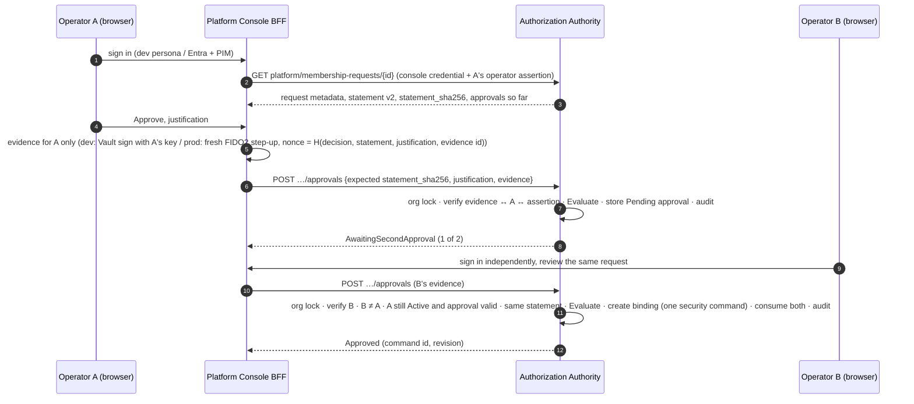

# Phase C8 M2 — Platform Operator administration and two-person operator approvals (architecture proposal)

- **Status:** **proposal, awaiting owner decisions D8-33…D8-44 (§13).** Nothing in this document is implemented. No Authority
  permission, signing mechanism, authentication method or migration may be built until the owner records the decisions.
  Not independently reviewed; work by Claude or the owner is never an independent review (C-85).
- **Date / branch:** 2026-10-31, `phase-c8/m2-user-management`, starting commit `18b471c`.
- **Audience:** the project owner (decisions), the future independent Authority reviewer (this joins the AC-5/AC-6/AC-7/AC-9
  package), implementers.
- **Scope:** replace the development CLI membership approval (`devstack.py membership approve`) with a browser workflow in
  which two distinct, individually authenticated Platform Operators each approve the exact request, and the Authority
  verifies both. Introduce a platform-scoped Platform Operator role that is strictly separate from organization roles.
- **Not in scope:** DR-C7-3 Security Administrator first appointment and recovery (they stay on the CLI), operator UI for
  other operator-plane operations, M3, any production activation.

---

## 0. Summary and recommendation

The existing two-approval machinery is sound and reusable: the Authority holds **public keys only**, verifies two ES256
approvals over a canonical statement, re-checks the request inside the organization lock and creates the binding as one
journaled security command. What it lacks is **people**. Today an "operator" is a shared HS256 workload credential with no
human identity, the two approver keys sit in one custody file, both approvals are submitted in one call by whoever holds both
keys, and the statement includes a single justification, so two independent people could not even sign the same statement.

Recommended architecture:

1. A new **Platform Operator registry** inside the Authority (platform-scoped, not an organization edge), with its own
   **platform journal stream** so suspensions and removals survive restores (G14).
2. A separate, small **Platform Console** deployable (BFF + SPA reusing `packages/ui` and the design tokens) where operators
   sign in. The business API and business web app gain **no** operator route, consistent with AC-7.4 ("never reachable from
   the business API") and CLAUDE-DESIGN.MD's screen-coverage rule (controlled operational screens "may live in a separate security-operator frontend").
3. A **two-step approval protocol**: each operator submits *one* approval, bound to *their* verified identity, the exact
   request (statement v2) and their own justification. The Authority stores the first as pending evidence and executes the
   membership only when a second, different, still-active operator approves the identical statement.
4. **Evidence is per operator and never produced in the browser.** Development/Testing: per-operator synthetic ES256 keys in
   the local Vault Transit, signed by the console only for the signed-in operator, recorded as synthetic. Production:
   **Entra transaction-bound step-up** (fresh FIDO2 authentication whose OIDC `nonce` commits to the statement and
   justification), verified by the Authority against Entra's keys — no application-held private keys at all. Production stays
   **Unavailable** (fail closed) until PB-08, PIM and the independent review exist.

---

## 1. Existing operator mechanism (verified 2026-10-31)

### 1.1 Facts

| # | Fact | Where |
|---|---|---|
| F-1 | The operator plane (`/internal/v1/operator/*`) requires the `OperatorCaller` policy: an **HS256 shared-secret bearer** with `workload_role=authority-operator`. The only identity it carries is a `workload_name` string (default `"operator"`). It names no human. | `InternalAuthentication`, `OperatorEndpoints` |
| F-2 | Approvals are compact JWS, `alg=ES256`, `kid`=`sub`=approver id, claims `iss`, `aud`, `jti`, `iat`, `nbf`, `exp`, `statement_sha256`, `operation_id`, `operation_kind`, `organization_id`, `target_authority_user_id`. Lifetime ≤ `MaxApprovalLifetimeSeconds` (default 900 s), 30 s skew. | `OperatorApprovalVerifier`, `OperatorApprovalClaims` |
| F-3 | Approver public keys come from deployment configuration (`OperatorApprovals:Approvers[]`); the Authority never holds a private key. Mode `Unavailable` (default; the only mode outside Development/Testing — startup refuses `SyntheticDevelopment` elsewhere) or `SyntheticDevelopment`. | `OperatorApprovalVerifier.Create` |
| F-4 | Exactly two approvals, from two **different approver ids**, must be submitted **together in one call**. Approvals are not stored beforehand; `jti` is not recorded. Replay is prevented only by the single-use operation id (the request id) and the idempotency key `membership-approve:{requestId}`. | `MembershipProvisioningService.ApproveAsync` |
| F-5 | `MembershipApprovalStatement` v1 = version, request id, kind, organization, requested user id, issuer, subject, initial role, requester, request expiry **and the operator's justification**. The display-name hint, the owner's reason and the AC-7.5 `RequestDigest` are not in it. | `MembershipContracts` |
| F-6 | At execution the Authority re-checks, inside the organization lock: not quarantined, request `Pending`, unexpired, requester still an enabled owner, identity not yet bound, issuer still the organization's identity issuer (`Evaluate`). Approval commits one security command (binding + optional designer edge) plus an `OrganizationMembershipApproved` audit-journal event with approver ids and approval digests. | `MembershipProvisioningService` |
| F-7 | Rejection is one operator, a 3–500 character reason, no signature; records `request_decided_by_operator_name` = the workload name. | `RejectAsync` |
| F-8 | The two synthetic approver key pairs are generated once into `%USERPROFILE%\.enterpriseforms\dev-vault\enterpriseforms-dev\operator-approvers.json` and passed (private halves) on stdin to the dev-seed container, which signs both approvals for every execution. One person holds both keys. | `devstack.py`, `OperatorMembershipTool`, `OperatorSecurityAdministratorTool.Sign` |
| F-9 | The security and audit journals are **per organization** (`JournalChain.Append(OrganizationAuthorizationState …)`), hash-chained, archived and replayable. There is no platform-scoped stream. | `JournalChain`, `AuditJournal` |
| F-10 | Business sessions are organization-bound: every development persona has an `OrganizationId`, the BFF session, Authority sessions (`SessionService.CreateAsync`) and `ActorResolver` all resolve an identity binding **inside one organization**. | `DevelopmentIdentity`, `SessionService` |
| F-11 | The operator membership list is per organization (`GET …/organizations/{id}/membership-requests`), unpaged, unaudited reads. There is no cross-organization view. | `ListAsync` |
| F-12 | Owner cancel/replace (AC-7.5) moves a request out of `Pending` under the organization lock; a replacement has a new id, so no approval for the old request verifies against it. | edit/cancel proposal §2.4 |
| F-13 | Focused baseline executed for this proposal: Authority `MembershipAdministrationTests` + `SecurityAdministratorProvisioningTests` — **41 / 41 passed** (2026-10-31). | `tests/authority` |

### 1.2 Reusable as is

- `OperatorApprovalVerifier`'s JWS verification (signature, `alg`, issuer/audience, claim binding, lifetime, skew, distinct
  approvers) and its mode/startup guard pattern.
- `MembershipProvisioningService.Evaluate` and the execution path that creates the binding as one journaled command.
- Canonical JSON + SHA-256 statement digests; the dry-run "consequences" list.
- The per-organization hash-chained audit journal and its archive/replay path (G14).
- The AC-7.5 request digest and the cancel/replace state machine.
- `packages/ui`, `packages/design-tokens`, `packages/work-queue`, the generated-client pattern (PB-06/PB-07).
- Local Vault Transit (already in the dev and security-test stacks).

### 1.3 Gaps that must be addressed

| # | Gap | Consequence if unaddressed |
|---|---|---|
| G-1 | No human operator identity; the operator credential is a shared secret | Two "operators" cannot be told apart; the dev CLI credential is **not** suitable for browser authentication |
| G-2 | No operator registry, role, suspension or removal (only redeploy with changed config) | Cannot revoke one operator quickly; no link between an approval key and a person |
| G-3 | Both approvals submitted in one call by one caller | One person holding both keys is indistinguishable from two people |
| G-4 | Statement v1 contains one shared justification | Two independent operators with their own justifications cannot sign the identical statement |
| G-5 | No persisted pending approval; `jti` not recorded | Asynchronous approval impossible; a stolen approval could be replayed within its lifetime if an operation id were reused |
| G-6 | No platform journal stream | Operator suspension/removal would not be replayable; a restore could resurrect a suspended operator |
| G-7 | Organization-bound sessions and identities | An operator persona does not fit the business session model; operator rights must never become organization rights |
| G-8 | Per-organization, unaudited, unpaged operator reads | No cross-organization queue; operator viewing is not evidenced |
| G-9 | Rejection unsigned, recorded with a workload name | No attributable, non-repudiable rejection |
| G-10 | No conflict-of-interest rule | An operator who is also an owner/member of the organization could approve their own organization's request |

---

## 2. Five distinct layers

| Layer | Question it answers | Development/Testing | Production (blocked) |
|---|---|---|---|
| **Development authentication** | How does a person get a console session locally? | Synthetic operator persona login in the console (no password), only when `PlatformOperators:Mode=SyntheticDevelopment` in a Development/Testing host | Not present (startup refuses) |
| **Operator identity** | Who is this person? | Synthetic `(issuer, subject)` under a dedicated platform issuer, distinct from every organization issuer | Entra workforce identity `(tid, oid)` in the **platform's own** Entra tenant (never a customer tenant) |
| **Operator authorization** | May this identity act as a Platform Operator now? | Authority registry entry `Active` | Authority registry entry `Active` **and** an active Entra PIM assignment claim **and** fresh PB-08 session |
| **Approval signing (evidence)** | Did *this* operator decide *this exact* request? | ES256 JWS from the operator's own synthetic key in Vault Transit (console signs only for the signed-in operator) — **synthetic, never two-human evidence** | Entra-signed ID token from a forced fresh FIDO2 sign-in whose `nonce` commits to decision + statement + justification; no app-held private key |
| **Authority verification** | Is the evidence valid and does current state allow the effect? | Authority verifies evidence, binds it to the registry entry and the session identity, records it, and executes only with two distinct operators | Same verifier contract, Entra evidence kind |

An ordinary application session is **never** treated as approval evidence. The session establishes *who is asking*; the
evidence establishes *what that person decided*; the Authority checks that both name the same registered operator.

---

## 3. Platform Operator identity and permission model

### 3.1 Registry (Authority-owned)

A `platform_operators` row is the only source of the role. Fields (§8): stable `platform_operator_id`, verified
`(operator_issuer_uri, operator_subject_identifier)`, display name (display only), status `Active | Suspended | Removed`,
evidence kind, and (Development/Testing) the id of the operator's synthetic approval key. One row per human identity; an
identity can never be registered twice, and a removed identity is never reused.

### 3.2 Permission catalogue (platform scope)

| Permission | Allows |
|---|---|
| `platform.membership_requests.review` | Cross-organization list and detail of membership-request metadata (§9) |
| `platform.membership_requests.decide` | Record an approval, withdraw one's own pending approval, reject |
| `platform.operators.view` | List operators and their status |
| `platform.operators.manage` | Participate in operator add/suspend/reinstate/remove (§4) |

In V1 every `Active` operator holds all four (one role); the catalogue lets a later decision split read-only reviewers
without a contract change. Checks run in the Authority on every call; the console's hidden buttons are convenience only.

### 3.3 Separation invariants

| # | Invariant | Enforced by |
|---|---|---|
| S-1 | Never inherited from `organization_owner`, `system_administrator` (Security Administrator), `designer` or membership; never written as a SpiceDB edge | Registry is a separate table; no planner rule creates it from organization state |
| S-2 | Confers **no** organization permission: no records, documents, search, roster, branding, sessions | Operator identity is presented with a different header, key and scheme (§7.1); `ActorResolver` resolves only organization identity bindings; organization endpoints never accept the operator assertion |
| S-3 | No self-grant: no operator can add, reinstate or change themself, and adding/reinstating needs a second operator | Registry commands (§4) |
| S-4 | No self-approval through multiple sessions: distinctness is by **registry id and verified identity**, never by session | Approval rules (§5.3) |
| S-5 | Conflict of interest: an operator cannot decide a request for an organization in which their identity is bound, nor one where they are the requester or the requested identity | Approval rules (§5.3) |
| S-6 | Read endpoints return only the metadata in §9; no record, document, team, share or audit content | Response contracts |
| S-7 | Operators cannot change request identity, organization or requested role — the Authority builds the statement from its own row; the console only echoes its digest | Statement v2 (§5.1) |

---

## 4. Provisioning, suspension, removal and recovery

| Operation | Who | Evidence | Effect |
|---|---|---|---|
| **Initial provisioning / quorum recovery** | Operator-plane ceremony (existing `OperatorCaller` credential) with **two DR-C7-3 custodian approvals** (existing verifier, existing custodian keys) | Two ES256 custodian approvals over a `PlatformOperatorBootstrap` statement | Registers named operators. Allowed only while fewer than two operators are `Active`. Critical alert; platform journal |
| Add an operator | Operator A proposes, operator B (≠ A, ≠ target) confirms | Each with their own evidence | Target becomes `Active` |
| Suspend | Any one `Active` operator (including self) | Evidence | Immediate. Invalidates the target's pending approvals in the same transaction; revokes their console sessions. Alert |
| Reinstate | Two operators, neither the target | Evidence | `Active` again; earlier invalidated approvals stay invalid |
| Remove | Two operators, neither the target | Evidence | Terminal; identity never reusable; history kept |

Rules: at least **three** operators should be provisioned so one suspension does not stop approvals; the console shows a
warning below three. Suspension is deliberately single-operator (fast containment beats availability); its abuse is a
denial of service that the bootstrap ceremony repairs. All registry changes are events on the **platform journal stream**
(hash-chained, archived, replayed during G14 recovery), so restoring AuthorityDb from before a suspension does not
reactivate the operator.

Production: the Entra PIM *eligible* assignment ("EnterpriseForms Platform Operator") is managed by platform identity
administrators; activation is time-boxed and justified in PIM. The Authority registry is still required — PIM membership
alone never registers an operator, and registry membership alone never suffices without the active PIM claim. Staged:
Development/Testing Stage 1 implements bootstrap + suspend + reinstate on the Authority; the operator-management UI can
follow once the approvals page is accepted (§14).

---

## 5. Authenticated two-person approval workflow



### 5.1 Statement v2 (built by the Authority from its own rows)

```json
{
  "statement_version": 2,
  "operation_kind": "MembershipApproval",
  "operation_id": "<membership request id>",
  "organization_id": "…", "organization_display_name": "…",
  "target_authority_user_id": "…", "target_issuer_uri": "…", "target_subject_identifier": "…", "target_display_name_hint": "…",
  "initial_role_name": null,
  "requested_by_authority_user_id": "…", "requested_by_issuer_uri": "…", "requested_by_subject_identifier": "…",
  "request_reason_sha256": "…",
  "request_created_on": "…", "request_expires_on": "…",
  "request_digest": "<AC-7.5 digest>",
  "replaces_membership_request_id": null
}
```

No justification and no operator: both operators sign the **identical** statement. Every approval-relevant immutable
field — including what the operator actually reads (display-name hint, organization name, requester identity) — is
committed. v1 stays readable for history; new approvals require v2.

### 5.2 Per-approval evidence

| Kind | Content | Binding |
|---|---|---|
| `SyntheticDevelopmentJws` (Development/Testing) | Existing JWS format plus claims `platform_operator_id`, `decision` (`approve`/`reject`), `justification_sha256`, `statement_version=2`; `kid`/`sub` = that operator's registered synthetic key id; lifetime ≤ 10 min | Authority checks `kid` belongs to the registry entry of the asserted operator |
| `EntraTransactionStepUp` (production, not implemented) | Entra ID token from an authorization request with `max_age=0`, the FIDO2 authentication-context `claims` challenge, and `nonce = base64url(SHA-256("EnterpriseForms/OperatorDecision/v1" ‖ 0x00 ‖ decision ‖ 0x00 ‖ statement_sha256 ‖ 0x00 ‖ justification_sha256 ‖ 0x00 ‖ evidence_id))` | Authority validates signature against the pinned platform-tenant keys, `iss`/`aud`/`tid`, `oid` = registry entry = asserted operator, required `acrs`, `auth_time` ≤ 5 min, PIM claim, recomputed `nonce` |

Both kinds: the evidence id (`jti` / `evidence_id`) and the evidence SHA-256 are **single use** (unique in the database).
Stored: digests, evidence kind, verified claim summary (issuer, operator id, key id or `oid`, `acrs`, `auth_time`, times).
The raw JWS is stored for synthetic evidence (no personal data); whether a raw Entra token is archived in Restricted
evidence storage for independent re-verification is part of D8-35.

### 5.3 Submission rules (inside the organization lock)

1. Operator resolved from the operator assertion → registry entry `Active` (else 403 `PLATFORM_OPERATOR_NOT_ACTIVE`).
2. Evidence verifies and names the **same** registry entry (else `OPERATOR_EVIDENCE_IDENTITY_MISMATCH`); unused evidence id.
3. `expected_statement_sha256` equals the freshly built statement (else 409 `APPROVAL_STATEMENT_CHANGED`).
4. Justification 10–500 characters, its digest matches the evidence.
5. Conflict of interest (S-5) → 403 `OPERATOR_CONFLICT_OF_INTEREST`.
6. `Evaluate` (F-6) passes.
7. No valid pending approval → store this one as `Pending` → **AwaitingSecondApproval**.
8. A valid pending approval by **this** operator → 409 `OPERATOR_ALREADY_APPROVED`.
9. A valid pending approval by a **different** operator whose registry entry is still `Active`, whose evidence key is still
   registered, within its pending window, over the identical statement digest → execute the existing approval path with both
   approval records in the command payload, mark both `Consumed` → **Approved**.

Two operators submitting at the same moment are serialized by the organization lock: one becomes the first approval, the
other the completing one; a late third gets `MEMBERSHIP_REQUEST_NOT_PENDING`. Each submission carries an idempotency key
`(operator, request)`; a retry returns the recorded outcome.

### 5.4 Rejection and withdrawal

- **Reject:** one `Active` operator, mandatory justification (10–500), `decision=reject` evidence, same statement check.
  The request becomes `Rejected`; any pending approval is invalidated (`RequestRejected`). Grants nothing.
- **Withdraw:** an operator may withdraw their own pending approval (`Withdrawn`), with a reason. Nobody can withdraw
  another operator's approval.

---

## 6. Pending approval persistence, expiry and invalidation

A pending approval is evidence, not authorization: it grants nothing, changes no revision and is never projected to
SpiceDB. It is stored in `platform_operator_approvals` and recorded on the **organization's** audit stream
(`OperatorMembershipApprovalRecorded`), so it is archived and replayable with the rest of that organization's history.

| Rule | Value |
|---|---|
| At most one `Pending` approval per request | Partial unique index (§8) |
| Pending window | 24 h from recording (configurable 1–72 h), never beyond the request's expiry. Expiry is a time comparison, as for owner proposals |
| Evidence freshness at submission | JWS `exp − iat` ≤ 10 min; Entra `auth_time` ≤ 5 min |
| Invalidated, in the same transaction, when | the request is cancelled, replaced, rejected or recorded expired; the approving operator is suspended or removed; (synthetic) the operator's approval key is deregistered; the organization is quarantined |
| Also checked at completion (defence in depth) | approving operator still `Active`; statement digest unchanged; request still `Pending` |
| After a restore | A lost pending approval only means a further approval is needed (fails safe). A suspension is replayed from the platform journal before the console is readmitted |

Closure states: `Consumed`, `Withdrawn`, `Invalidated` (reason: `RequestCancelled`, `RequestReplaced`, `RequestRejected`,
`RequestExpired`, `OperatorSuspended`, `OperatorRemoved`, `EvidenceKeyRevoked`, `OrganizationQuarantined`). A closed row
never changes again (check constraint).

---

## 7. Authority commands and API contracts

### 7.1 Platform plane authentication

- New route group `/internal/v1/platform/*`, policy `PlatformConsoleCaller`: a **new** credential scheme `PlatformConsole`
  (own issuer, audience, key; `workload_role=platform-console`), validated like the verifier and reconciler schemes —
  complete-or-absent, distinct from every other credential, fail closed when absent. Production: Entra workload identity
  + mTLS (same existing gap as all internal credentials).
- Every call also carries `X-Platform-Operator-Assertion`: Development/Testing an HS256 assertion signed with a separate
  `Identity:OperatorAssertion` key (distinct from the business user-assertion key, so the business API cannot mint one);
  production the operator's Entra token validated by the Authority itself.
- The existing `OperatorCaller` plane is unchanged and is **not** accepted on `/platform/*`; the business workload
  credential is accepted on neither.

### 7.2 Endpoints

| Method and path | Permission | Purpose |
|---|---|---|
| `GET /internal/v1/platform/operator/me` | Active operator | Own profile, status, evidence kind, mode, capabilities |
| `POST /internal/v1/platform/membership-requests/search` | `review` | Cross-organization page: `q`, `status`, `cursor`, `limit` (default 15, max 50); opaque keyset cursor bound to operator and filter |
| `GET /internal/v1/platform/membership-requests/{requestId}` | `review` | Detail, statement v2 + SHA-256, consequences, recorded approvals, my eligibility. Audited (platform stream, view event) |
| `POST /internal/v1/platform/membership-requests/{requestId}/approvals` | `decide` | §5.3 |
| `POST /internal/v1/platform/membership-requests/{requestId}/approvals/withdraw` | `decide` | Own pending approval |
| `POST /internal/v1/platform/membership-requests/{requestId}/reject` | `decide` | §5.4 |
| `GET /internal/v1/platform/operators` | `operators.view` | Registry (identity, status) |
| `POST /internal/v1/platform/operators/{id}/suspend` · `/reinstate` · `/remove`, `POST /internal/v1/platform/operators/proposals` | `operators.manage` | §4 |
| `POST /internal/v1/operator/platform-operators/bootstrap` | existing `OperatorCaller` + two custodian approvals | §4 initial / recovery |

Commands (platform kinds, journaled on the platform stream): `ProvisionPlatformOperator`, `SuspendPlatformOperator`,
`ReinstatePlatformOperator`, `RemovePlatformOperator`, `BootstrapPlatformOperators`. Approval/rejection reuse the
organization security-command pipeline (`ApproveOrganizationMembership` command; rejection and pending approvals as
organization audit events).

### 7.3 Contracts (wire names)

```json
// POST …/approvals
{ "idempotency_key": "…", "expected_statement_sha256": "…", "justification": "Verified with the requesting owner by phone.",
  "evidence_kind": "SyntheticDevelopmentJws", "evidence": "<compact JWS or Entra ID token>" }

// response
{ "request_id": "…", "organization_id": "…", "outcome": "AwaitingSecondApproval | Approved",
  "approvals_recorded": 1, "approvals_required": 2, "my_approval_id": "…",
  "security_command_id": null, "command_status": null, "authorization_revision": 57,
  "approval_assurance": "SyntheticDevelopment (development-only operator keys; not two-human approval evidence)", "correlation_id": "…" }
```

List item: `request_id, organization_id, organization_display_name, display_name_hint, target {issuer_uri,
subject_identifier}, initial_role_name, requested_by {authority_user_id, issuer_uri, subject_identifier}, requested_on,
expires_on, request_state, approval_status {recorded, required, approved_by_me, awaiting_other_operator,
pending_approval_expires_on}, available_actions[]`. Detail adds `request_reason`, `statement_json`, `statement_sha256`,
`consequences[]`, `approvals[] {operator_display_name, operator_identity, recorded_on, justification, state}`,
`my_eligibility {can_approve, can_reject, can_withdraw, refusal_code}`. No record, document, team or share data.

### 7.4 New error codes

`PLATFORM_OPERATORS_UNAVAILABLE` (403, mode Unavailable), `PLATFORM_OPERATOR_NOT_ACTIVE` (403),
`OPERATOR_EVIDENCE_INVALID` (403), `OPERATOR_EVIDENCE_IDENTITY_MISMATCH` (403), `OPERATOR_EVIDENCE_REPLAYED` (409),
`APPROVAL_STATEMENT_CHANGED` (409), `OPERATOR_ALREADY_APPROVED` (409), `OPERATOR_CONFLICT_OF_INTEREST` (403),
`OPERATOR_QUORUM_UNAVAILABLE` (409, fewer than two active operators). Reused: `MEMBERSHIP_REQUEST_NOT_PENDING`,
`MEMBERSHIP_REQUEST_EXPIRED`, `OPERATOR_APPROVALS_NOT_INDEPENDENT`, `IDEMPOTENCY_CONFLICT`.

### 7.5 Changes to existing endpoints

- Owner cancel/replace commands also close pending approvals (`Invalidated`) in their transaction.
- AC-7.3 roster: each pending membership request gains `operator_approval_count` (0 or 1) — a count only; owners never see
  operator identities.
- The single-call two-JWS `…/operator/organizations/{id}/membership-requests/{id}/approve` endpoint and the CLI `membership
  approve` path are **retired** once the console's real-stack tests pass (D8-42); DR-C7-3 CLI operations are unchanged.

---

## 8. Database changes and migration strategy

AuthorityDb only (the console has no database; BusinessDb unchanged). One additive EF migration
`PlatformOperatorApprovals`; UUIDv7 keys; descriptive multiword snake_case columns.

| Table | Columns (abridged) | Constraints |
|---|---|---|
| `platform_operators` | `platform_operator_id`, `operator_issuer_uri`, `operator_subject_identifier`, `operator_display_name`, `operator_status_name`, `operator_evidence_kind_name`, `synthetic_approval_key_identifier` (null in production), `operator_provisioned_on`, `provisioned_by_platform_operator_id` (null for bootstrap), `operator_status_changed_on`, `operator_status_reason_text`, `operator_row_revision` | unique `(operator_issuer_uri, operator_subject_identifier)` forever; unique key identifier; status check |
| `platform_operator_approvals` | `platform_operator_approval_id`, `organization_id`, `organization_membership_request_id`, `platform_operator_id`, `approval_statement_sha256`, `approval_statement_version`, `approval_justification_text`, `approval_evidence_kind_name`, `approval_evidence_sha256`, `approval_evidence_identifier`, `approval_evidence_claims_json`, `approval_recorded_on`, `approval_valid_until`, `approval_state_name`, `approval_closed_on`, `approval_closure_reason_name`, `consumed_by_security_command_id` | FKs to request and operator; unique evidence sha256 and identifier; partial unique `(organization_membership_request_id) WHERE approval_state_name = 'Pending'`; closed rows immutable (check + trigger) |
| `platform_journal_entries`, `platform_journal_heads` | same envelope as `security_journal_entries` with domain `DynamicForms/PlatformJournal/v1`, stream revision, previous digest, archive delivery state | hash chain; archived by the existing forwarder |
| `organization_membership_requests` | + `request_decided_by_platform_operator_id` (nullable FK) | set for decisions made through the console |

Runtime grants: `SELECT, INSERT` on the new tables; column-level `UPDATE` only on status/closure columns; no `DELETE`.
Replay (G14): registry state is rebuilt from the platform journal; pending approvals from the organization audit stream.
Migration is additive and reversible on a disposable database; no existing row changes; existing operator-plane
behaviour is untouched until the retirement step.

---

## 9. Platform Console and the Operator Approvals UI

### 9.1 Deployment shape (D8-33)

| | **A. Separate Platform Console (recommended)** | B. Inside the business app |
|---|---|---|
| Runtime | New `EnterpriseForms.PlatformConsole` (.NET 10 minimal-API BFF) + `apps/platform-console` SPA; own container, origin, cookie | New `/api/v1/platform/*` in the business API; `platform-operations` feature in `apps/web` |
| Business compromise | No path to platform plane or cross-organization metadata | Compromised business API reads every organization's pending requests and controls what operators see (substitution attack on both operators) |
| Pipeline (PB-11) | Security pipeline, separately approved | Business deployers ship operator UI |
| Conformance | AC-7.4 "never reachable from the business API"; CLAUDE-DESIGN.MD screen-coverage rule (separate security-operator frontend) | Reverses AC-7.4 |
| Cost | One more host and Vite app; shares `packages/*` | Smaller |

### 9.2 Console BFF

Features: `Session` (dev persona login, logout; HttpOnly, Secure, SameSite=Strict cookie; CSRF token; 15 min idle,
2 h absolute), `OperatorApprovals` (proxy of §7.2 with generated client), `Evidence` (Development/Testing: Vault Transit
`transit/sign/platform-operator-approval-<key>` with `marshaling_algorithm=jws`, Vault policy limited to those keys,
signs only for the session's operator; production: Entra step-up redirect). It holds no private key in its own memory or
configuration, no business credential and no database. Startup refuses to run outside Development/Testing until the Entra
mode exists. Dev port proposal: `:8092` (Vite `:5174`), so Playwright isolation rules extend to it.

### 9.3 Navigation and list page — PG-070 "Operator approvals" (D8-43)

Navigation: **Platform administration → Operator approvals** (later: Operators). Route `/platform/approvals`.

- Header: "Operator approvals", one-line description; signed-in operator name with verified identity beneath.
- Environment banner in Development/Testing: "Development operators — approvals here are synthetic and are not two-person
  evidence."
- Toolbar: search (40 px input, "Search organization, person or identity"), status select — *Needs a decision*
  (default: pending with 0 or 1 approvals), Awaiting first approval, Awaiting second approval, Approved, Rejected, Expired,
  Cancelled or replaced, All.
- Table (12 px card, 14 px control text, sentence-case headers): Organization · Requested person (display name, verified
  identity `subject · issuer` beneath, as on People) · Requested role · Requested by (verified identity) · Requested ·
  Expires · Approval status · Actions.
- Approval status chips: "0 of 2", "1 of 2 · awaiting another operator", "1 of 2 · you approved", Approved, Rejected,
  Expired, Cancelled, Replaced.
- Actions: **Review details** button (8 px radius); overflow menu: Copy request ID.
- Server-side pagination, 15 per page, "Showing 1–15 of N", Previous/Next; cards instead of rows below 768 px.

### 9.4 Review details page

Route `/platform/approvals/:requestId` (deep-linkable; more robust than a dialog at 400 % zoom).

1. **Request** — organization, requested person, verified identity, issuer, requested role, requested by, owner's reason,
   requested, expires, request ID, replaced-request link.
2. **What approval does** — the Authority's consequences list (including "Membership is not sign-in until PB-08").
3. **Approvals** — each recorded approval: operator, verified identity, time, justification, state; "You" marked.
4. **Exact statement** — collapsible canonical JSON and a short SHA-256 fingerprint (first 16 hex, full on expand).
5. **Decision** — mandatory justification (textarea, 10–500, live count); primary **Approve** (black `#111111`, white
   label) and secondary **Reject**; **Withdraw my approval** when applicable. Disabled controls always state why (already
   approved by you; conflict of interest; request no longer pending; fewer than two active operators).
   Approve and Reject open a confirmation dialog repeating the organization, person, role and fingerprint; in production
   the step-up follows. Outcome announced in an `aria-live` region and the page refreshes from the Authority.

### 9.5 States, accessibility, responsiveness

Loading, empty ("No requests need a decision"), error (safe code + correlation id), stale (`APPROVAL_STATEMENT_CHANGED`
reloads with an explanation), unavailable (mode Unavailable). WCAG 2.2 AA; keyboard-only flow; visible focus; labels
match accessible names (axe `label-content-name-mismatch`); justification text rendered as text, never HTML; 320 / 768 /
1440 px and 200 % / 400 % zoom with no horizontal scroll.

### 9.6 Owner side (business app)

People → Membership requests shows "Awaiting operators (1 of 2)" from the roster count. Nothing else changes.

---

## 10. Threat model and security tests

### 10.1 Threats

| # | Threat | Control | Residual |
|---|---|---|---|
| T-1 | One person approves twice with two sessions | Distinctness by registry id + verified identity (S-4); one pending approval per operator | — |
| T-2 | One operator submits evidence of another (stolen JWS/token) | Evidence identity must equal the session's operator assertion; single-use evidence id; short lifetime | Theft of both a session and the other's evidence |
| T-3 | One human registered as two operators ("sock puppet") | Registration needs two operators or the custodian ceremony; production identities are Entra workforce accounts under PIM, one per person | Procedural: cannot be proven cryptographically — documented |
| T-4 | Console compromise | Production: console holds no key and cannot forge Entra evidence; it could show one request and obtain step-up for another only if **both** operators are deceived, and the Authority-built statement is shown with its fingerprint. Development: console can sign as any synthetic operator — accepted, labelled synthetic | WYSIWYS substitution (production) |
| T-5 | Business API or BusinessDb compromise | No platform route, credential or data on the business side (option A) | — |
| T-6 | Stale approval after owner edit/cancel | Statement includes request id and digest; pending approvals invalidated in the cancel/replace transaction; completion re-checks | — |
| T-7 | Replay across requests, organizations or decisions | Evidence binds operation id, organization, target, decision, statement and justification digests; single-use ids | — |
| T-8 | Suspended/removed operator completes or keeps an approval | Suspension invalidates pending approvals; completion re-checks both operators `Active` | — |
| T-9 | Race of two second approvals | Organization lock; partial unique index; exactly one command | — |
| T-10 | Restore resurrects an operator or an approval | Platform journal replay of registry state; lost approvals fail safe | Depends on G14 recovery being executed |
| T-11 | Operator reads confidential data | No organization permission (S-2); metadata-only contracts (S-6); detail views audited | Metadata (names, identities) is visible by design |
| T-12 | Self-escalation | No self add/reinstate; no route grants organization roles | — |
| T-13 | Operator colludes with the requesting owner, or is a member | Conflict-of-interest rule (S-5); second independent operator | Collusion of two operators |
| T-14 | CSRF / session fixation on the console | SameSite=Strict, CSRF token, session rotation at sign-in, short sessions | — |
| T-15 | Denial of service by rejection or suspension | Rejection grants nothing (owner can re-request); suspension alerts; bootstrap recovery | Availability |
| T-16 | Non-operators probe platform endpoints | Separate credential; 401/403 with no counts | — |
| T-17 | Markup injection via justification or display name | Rendered as text; length bounds | — |

### 10.2 Tests (to implement after approval; real Authority, both PostgreSQL databases, SpiceDB, Vault)

| Test | Scenario | Expected |
|---|---|---|
| PO-T01 | Business workload credential, business user assertion, `OperatorCaller` credential on `/platform/*` | 401/403 |
| PO-T02 | Operator assertion on organization endpoints (roster, records, search, documents) | 401; no data |
| PO-T03 | Organization owner / Security Administrator / designer identity presented as operator | `PLATFORM_OPERATOR_NOT_ACTIVE` |
| PO-T04 | Same operator approves twice (same and different sessions) | `OPERATOR_ALREADY_APPROVED`; still 1 of 2 |
| PO-T05 | Operator A's session submits operator B's evidence | `OPERATOR_EVIDENCE_IDENTITY_MISMATCH` |
| PO-T06 | Evidence replay (same `jti`), evidence for another request/organization/decision | refused; nothing recorded |
| PO-T07 | Wrong or stale `expected_statement_sha256` | `APPROVAL_STATEMENT_CHANGED` |
| PO-T08 | Owner replaces/cancels after the first approval; then B approves old and new | old refused; first approval `Invalidated`; new needs two fresh approvals |
| PO-T09 | A suspended after approving; B approves | refused; A's approval `Invalidated(OperatorSuspended)` |
| PO-T10 | Pending window or request expiry passes | refused; state recorded |
| PO-T11 | Two concurrent completing approvals | exactly one binding and one command |
| PO-T12 | Conflict of interest (operator bound in the organization; requester; target) | `OPERATOR_CONFLICT_OF_INTEREST` |
| PO-T13 | Reject with one approval pending; approve afterwards | request `Rejected`; approval invalidated; approve refused |
| PO-T14 | Withdraw own approval; withdraw another's | own `Withdrawn`; other refused |
| PO-T15 | Successful two-operator approval | binding + optional designer edge Effective; both `Consumed`; command payload and archived audit body name both operators and evidence digests; owner roster shows the member |
| PO-T16 | Operator self-add/reinstate; add with one operator | refused |
| PO-T17 | Fewer than two active operators | `OPERATOR_QUORUM_UNAVAILABLE`; bootstrap ceremony works only then |
| PO-T18 | G14: restore AuthorityDb from before a suspension | operator remains suspended after replay |
| PO-T19 | `PlatformOperators:Mode=SyntheticDevelopment` or console start in Staging/Production | startup refused |
| PO-T20 | Console credential absent or reusing another key/issuer | Authority startup refused / policy denies |
| PO-T21 | Search and detail never return record/document/team/share data; non-operator gets no counts | contract snapshot + negative test |
| PO-T22 | Cursor tampering, cursor reuse by another operator or filter | refused |
| PO-T23 | Owner roster shows `operator_approval_count` only | no operator identities in business responses |
| PO-T24 | Retired single-call endpoint after D8-42 | refused |
| PO-T25 | Console: CSRF missing/invalid, session fixation, idle/absolute expiry | refused / rotated / signed out |
| PO-UI | Vitest for list/detail states; Playwright (isolated stack only): two operators in separate browser contexts approve, keyboard-only flow, axe, 320/768/1440 px, 200 %/400 % zoom, narrow cards, 15-row paging | pass |

---

## 11. Development/Testing restrictions

- `PlatformOperators:Mode` = `Unavailable` (default; the only accepted value outside Development/Testing) or
  `SyntheticDevelopment` (Development/Testing hosts only; startup refuses elsewhere). The console refuses to start outside
  Development/Testing.
- Synthetic operators under a dedicated issuer (proposal `https://platform-operators.dev.enterpriseforms.invalid/`) that
  can never equal an organization issuer; three personas so suspension can be exercised.
- Synthetic keys: non-exportable ECDSA P-256 keys in the local Vault Transit, one per operator; the console's Vault policy
  can only sign with those keys. Every recorded approval carries `approval_assurance = SyntheticDevelopment (…not
  two-human approval evidence)`.
- Banner on every console page. Synthetic approvals are never PB-12 release evidence.
- Playwright and adversarial tests run only against the isolated security-test stack, never the dev stack (`:8091`, `:8092`,
  `:5173`, `:5174`).

---

## 12. Outstanding production dependencies

| Dependency | Needed for |
|---|---|
| PB-08 Entra OIDC sign-in for the console (platform tenant), session rules | Operator identity |
| PB-08 authentication-context step-up mapped to a FIDO2-only authentication strength; staging proof of which token carries `acrs`/`auth_time` and that `nonce` binding works as specified | `EntraTransactionStepUp` evidence |
| Entra PIM eligible role for Platform Operators, activation policy, claim in tokens (G26) | Operator authorization |
| Entra workload identity + mTLS for console → Authority (existing internal-credential gap) | Platform plane authentication |
| Separate security deployment pipeline and approvers for the console (PB-11), PB-12 evidence | Release |
| Canadian residency of console, logs and evidence (PB-10) | Release |
| Independent review of AC-7 + this design (C-85 rule) | Any production claim |
| Executed G14 replay test of the platform journal | T-10 |

Until all are met, production mode is `Unavailable` and every platform endpoint returns `PLATFORM_OPERATORS_UNAVAILABLE`.

---

## 13. Owner decisions required

| ID | Decision | Recommendation |
|---|---|---|
| D8-33 | Deployment shape: separate Platform Console (A) or inside the business app (B) (§9.1) | **A** |
| D8-34 | Introduce the Platform Operator registry and the four platform permissions (§3), one role in V1 | Approve |
| D8-35 | Evidence: Development/Testing per-operator synthetic ES256 keys in Vault Transit signed by the console for the signed-in operator; production Entra transaction-bound FIDO2 step-up; archive raw Entra evidence in Restricted evidence storage? | Approve; archive digests + verified claims, raw token only in Restricted evidence storage |
| D8-36 | Statement v2 (§5.1) with per-approval justification outside the statement; v1 kept for history | Approve |
| D8-37 | Pending window 24 h (1–72 h, never beyond request expiry); evidence freshness 10 min (JWS) / 5 min (`auth_time`) | Approve |
| D8-38 | Rejection by one operator with justification and evidence; operators may withdraw their own pending approval | Approve |
| D8-39 | Operator lifecycle (§4): add/reinstate/remove by two operators, suspend by one, bootstrap/recovery by the custodian ceremony only below two active operators; three operators recommended | Approve |
| D8-40 | Conflict of interest (S-5) | Approve |
| D8-41 | Visibility: operators see the §7.3 metadata including the owner's reason and other operators' justifications; owners see only the approval count | Approve |
| D8-42 | Retire the single-call two-JWS membership approval endpoint and CLI `membership approve` after the console's real-stack tests pass (keep `membership list` and all DR-C7-3 CLI operations) | Approve |
| D8-43 | New page PG-070 "Operator approvals" (console, feature `operator-approvals`); later PG-071 "Operators" | Approve |
| D8-44 | Platform journal stream (§8) for registry events | Approve |

Rejected alternatives, for the record: a WebAuthn relying party in the Authority for transaction signing (conflicts with
PB-08: no parallel WebAuthn RP for Entra-managed identities); signing in browser JavaScript (forbidden); treating the
console session as approval evidence; reusing the `OperatorCaller` credential for browser sessions. A possible later
production fallback is an operator-held hardware key (PIV/FIDO) signing the existing JWS offline, which the same verifier
accepts as another evidence kind.

---

## 14. Implementation sequence (after approval)

| Stage | Work | Model |
|---|---|---|
| 1 | Authority: registry entities, platform journal stream, `PlatformOperatorApprovals` migration + runtime grants, `PlatformConsole` scheme + operator-assertion validator + startup guards, bootstrap ceremony, suspend/reinstate; unit tests | **Opus** |
| 2 | Authority: statement v2, evidence verifier abstraction (`SyntheticDevelopmentJws`; `EntraTransactionStepUp` registered but refusing), pending approvals, completion reusing the existing execution path, withdraw, reject, invalidation hooks in cancel/replace, search/detail reads with cursors, roster count; unit + security tests | **Opus** (security logic, adversarial tests); Sonnet for test fixtures/builders |
| 3 | Platform Console BFF: host, session/CSRF, dev operator login, Authority client, Vault Transit synthetic signer, OpenAPI artifact | **Opus** for session, evidence and credential code; **Sonnet** for endpoint plumbing, OpenAPI and client generation |
| 4 | `apps/platform-console`: shell, navigation, Operator approvals list, Review details page, dialogs, states | **Sonnet** (established design system); Opus review of security-relevant UI states |
| 5 | Compose/devstack wiring (console service, Vault keys, three synthetic operators, sectest overlay), People "1 of 2" | **Sonnet** |
| 6 | Real-stack PO-T01…T25 (Stage B project), Playwright two-operator flow, axe, viewports/zoom | **Opus** for adversarial tests; **Sonnet** for Playwright/visual |
| 7 | Retire the single-call endpoint and CLI path (D8-42); docs, status, decision log, ownership matrix, OpenAPI snapshots | **Sonnet** |

Stages 1–2 can be reviewed on their own before any console code. Each stage ends with its focused tests executed; no full
Stage B/SEC-P run is implied.

---

## 15. What this task did not do

No code, permission, signing mechanism, authentication method or migration was implemented. Executed: inspection of the
operator plane, verifier, membership provisioning, journals, sessions and the dev tooling, and the focused Authority unit
tests in F-13. Not run: Stage B, SEC-P, Playwright, hosted CI. Nothing merged, deployed or started for M3.
