# Phase C8 — Organization onboarding and owner recovery (architecture and security assessment)

- **Status:** **Proposal (C-103). Nothing is implemented.** No Authority command, migration, permission, console page or recovery
  function exists for this design. Awaiting owner decisions D8-45…D8-61 (§14). Development/Testing only when implemented; production
  stays closed. Not independently reviewed; work by Claude or the owner is never an independent review (C-85).
- **Date / branch:** 2026-11-01, `phase-c8/m2-user-management`, starting commit `c6105c2`.
- **Audience:** the project owner (decisions), the future independent Authority reviewer (this joins the AC-7 / AC-9 / Platform
  Operator package), implementers.
- **Scope:** (1) creating a new organization from the Platform Console with at least two verified initial owners and two-operator
  approval; (2) restoring the owner quorum of an existing organization that has fewer than two eligible owners; (3) what the current
  code means for one identity belonging to several organizations; (4) the Platform Console pages for these.
- **Not in scope:** an organization switcher, organization suspension/offboarding (PB-13), Security Administrator recovery (DR-C7-3,
  unchanged), operator-management UI (PG-071, reserved by D8-43), M3, retiring the legacy CLI, any production activation.
- **Builds on:** `PHASE_C8_M2_PLATFORM_OPERATOR_APPROVALS.md` (registry, platform journal, rollback checkpoint, per-operator evidence,
  Platform Console), `PHASE_C8_M2_AC7_SECURITY_CONTRACT.md` (owner and membership rules), DR-C7-3 (operator recovery pattern).

---

## 0. Summary and recommendation

The Platform Operator infrastructure already does the hard parts: a registry of individually authenticated operators, per-operator
evidence bound to an Authority-built statement, a hash-chained platform journal with an archive rollback checkpoint, conflict-of-interest
rules, and a separate console with its own session, CSRF and signing path. Onboarding and recovery should be **two new platform-plane
workflows on that infrastructure**, not new mechanisms.

What exists for creating organizations today is a Stage A stand-in: `POST /internal/v1/operator/organizations` accepts **one** owner,
caller-chosen organization and user ids, no approvals, no dry run, no alert and no platform journal event, and it answers "success" for a
different request that reuses an existing organization id (§1.4). It is fit for the development seed only.

Recommended:

1. **Onboarding** (§2–§3): `PendingApproval → Approved → AwaitingKeyCustody → Initialized → Active`. One operator creates the request
   (their evidence is approval 1), a different operator approves (approval 2). The statement the Authority builds covers the
   organization, every owner identity and the request revision; any edit is a new revision and voids every approval. The
   organization id and every user id are generated by the Authority. Two to ten owners, three recommended, one identity issuer.
   The organization's integrity key is provisioned by a **separate custody step** (today's bootstrap creates it with the Authority's
   own identity, which only works in development because the Vault policy is widened by hand), then a single AuthorityDb transaction
   creates the organization, bindings, owner roles and first security command. Nothing is usable until that command is Effective.
2. **Owner recovery** (§4): stronger than onboarding because it acts on an organization that already holds data. Three distinct
   operators (initiator plus two), an incident reference, a cooling-off period during which every enabled owner and Security
   Administrator is notified and **any one of them can object and stop it**, add-only scope (owner role, plus a binding for a new
   identity — nothing revoked, nothing on records, teams or shares), and a probation period for recovered owners because of
   finding OB-F8: today an organization owner can add themselves to any team, and teams can own records.
3. **Multi-organization identity** (§5): the Authority's data model already supports it — bindings are unique per
   `(organization, issuer, subject)`, roles are per-organization edges, sessions and disabling are per binding. What is missing is
   sign-in-time organization discovery and switching (PB-08 work), and the single-issuer-per-organization rule limits which
   organizations one identity can join. These are documented as separate changes MO-1…MO-6.
4. **Console pages** (§6): PG-072 Organizations, PG-073 New organization, PG-074 Onboarding request, PG-075 Owner recovery.

---

## 1. Existing capabilities and gaps (verified 2026-11-01)

### 1.1 Facts

| # | Fact | Where |
|---|---|---|
| F-1 | Organization creation is `POST /internal/v1/operator/organizations` (`OperatorCaller` policy: shared HS256 operator workload credential, no human identity). Callers: dev seed (`Program.cs`, `AcceptanceOrganizationTool`), Stage B and security-test harnesses. | `OperatorEndpoints`, `OrganizationBootstrapService` |
| F-2 | The request carries a caller-chosen `organization_id`, display name and 1–100 identities with caller-chosen `authority_user_id`, issuer, subject and roles (`organization_owner`, `system_administrator`, `designer`). **At least one** owner is required. No approval, dry run, alert or platform journal event. | `OrganizationBootstrapService.BootstrapAsync` |
| F-3 | If the organization id exists, the call returns the existing organization's revision and key **without comparing the request** (no idempotency digest). | same |
| F-4 | One AuthorityDb transaction creates the organization state, identity bindings, key registration, organization resource and revision-1 command (`BootstrapOrganization`, owner and role edges, projection outbox, security journal). Before commit it creates the integrity key in the MAC provider and initializes the SpiceDB cursor marker (both idempotent). The actor binding of the command is the first owner; the operator workload name is in the payload. | same |
| F-5 | The Authority runtime creates the organization's HMAC key itself (`ProvisionKeyAsync`, idempotent in Vault). In the development stack the Authority's Vault policy is **pinned to exact key paths**; `devstack.py seed-acceptance` temporarily grants create on one new key with root custody, then re-pins and proves create/rotate/config are denied again. CLAUDE.md §4P requires a separate provisioning identity in production. | `VaultTransitHmacProvider`, `devstack.py` `pin_authority_policy`, `cmd_seed_acceptance` |
| F-6 | Identity bindings: unique `(organization_id, issuer, subject)` and `(organization_id, authority_user_id)`; nothing is unique across organizations. Membership requests generate the new user id server-side (`Guid.CreateVersion7()`). | `IdentityBindingConfiguration`, `CommandPlanner.MembershipRequests` |
| F-7 | The organization's identity issuer is **derived**: the single distinct issuer of its enabled owners; if owners have two issuers it is `null`, and membership requests are then refused (issuer must equal it). | `CommandPlanner.OrganizationIdentityIssuer`, `MembershipProvisioningService.Evaluate` |
| F-8 | Owner grant/revoke/disable/enable need a pending proposal by one owner and execution by a **different** owner, neither being the target; the last enabled owner can never be removed. Consequences (verified by `TheLastEnabledOwnerIsNeverRemovedEvenWithAProposal`, `OwnerGrantNeedsAProposalFromAnotherOwner`): with exactly two owners neither can be revoked or disabled; with one owner **no owner can ever be added**; if one of two owners is unavailable, no owner change is possible. | `CommandPlanner.Membership` |
| F-9 | `organization_owner` maps only to `manage_configuration` in SpiceDB; no record, field or document permission derives from the organization object. | `authority.schema.zed` |
| F-10 | Team membership changes need an owner or a Security Administrator; a Security Administrator cannot add themselves, **an owner can**. Teams can own records (`form_record.owner: user \| team#participant`). | `CommandPlanner.TeamMembershipAsync`, schema |
| F-11 | The platform plane (`/internal/v1/platform/*`, Platform Console credential + operator assertion) offers: registry, two-operator propose/confirm, single-operator suspension, per-operator evidence (`PlatformOperatorEvidenceVerifier`, operation kinds `MembershipApproval`, `PlatformOperatorChange`, `PlatformOperatorSuspension`), pending approvals with invalidation, conflict of interest by exact `(issuer, subject)`, platform journal + archive probe at head+1. Lock order in the approval path: organization row, then platform journal head. | `PlatformOperators/*` |
| F-12 | The custodian ceremony (two DR-C7-3 custodian approvals on the operator plane) registers operators only while fewer than two are active. | `PlatformOperatorRegistryService.BootstrapAsync` |
| F-13 | DR-C7-3 Security Administrator recovery: operator plane, two approvals, mandatory incident reference, explicit scope, single-use operation id, refusals journaled, critical alert. | `SecurityAdministratorProvisioningService` |
| F-14 | The Authority has no organization lifecycle state and no list of organizations (only per-id reads and `GetOrganizationsWithPendingWorkAsync`). | `IAuthorityStore` |
| F-15 | Business side: the tenant row is a projection created lazily at first sign-in with a placeholder name; `users.user_id` is the primary key across all tenants, with unique `(tenant_id, issuer, subject)`; the projection looks a user up by `user_id` alone. The business API holds no platform credential. | `BusinessStore.EnsureTenantAndUserProjectionAsync`, `IdentityEntityConfigurations` |
| F-16 | Sessions: business BFF sessions carry one organization (`org` claim from the development persona); Authority sessions are bound to one identity binding; `ActorResolver` resolves only inside the path organization; disabling a binding revokes that binding's sessions only. There is no endpoint mapping an identity to its organizations. | `SessionEndpoints`, `SessionService`, `ActorResolver` |
| F-17 | Development data: the main organization has **one** owner (memory C-95); the acceptance organization has three. | `devstack.py`, `AcceptanceOrganizationTool` |
| F-18 | Focused baseline executed for this proposal: Authority `MembershipAdministrationTests`, `PlatformOperatorTests`, `SecurityAdministratorProvisioningTests` — **63 / 63 passed** (2026-11-01, Release). | `tests/authority` |

### 1.2 Reusable as is

- Platform Operator registry, `PlatformOperatorAccess.ResolveActiveAsync`, justification rules, evidence verifier and single-use
  evidence table (new operation kinds only), propose/confirm pattern, pending-approval invalidation pattern, `CloseStale`.
- Platform journal (envelope, chain, archive delivery, head+1 rollback probe, replay) and the organization audit stream for mirrors
  and audited reads (PF-8 policy: commit the audit event before disclosure).
- The bootstrap transaction shape (F-4) and `SecurityCommandService.ApplyPlan`, projection barrier and `RequiredBeforeEffective`
  checkpointing — so a new organization is unusable until its first command is projected and anchored.
- `CommandPlanner.IsValidSubject` / `IsEntraIssuer`, the owner-change rules (F-8) as the steady state after onboarding/recovery.
- DR-C7-3 structure for recovery (incident reference, explicit scope, refusals journaled, alerts).
- Platform Console BFF: sessions, CSRF/origin, Vault Transit signer, dry-run-then-sign flow (`OperatorDecisionService`), generated
  client, `packages/ui`, shell and design tokens.

### 1.3 Gaps

| # | Gap |
|---|---|
| G-1 | No human-attributed, dual-approved way to create an organization |
| G-2 | No minimum of two owners at creation; no single-issuer check among owners (F-7) |
| G-3 | Caller-chosen organization and user ids (F-2) |
| G-4 | No content-bound idempotency for creation (F-3) |
| G-5 | Key creation by the Authority runtime (F-5) conflicts with separate key provisioning |
| G-6 | No organization lifecycle or directory (F-14) |
| G-7 | No path to restore an owner quorum (F-8); the development main organization is already in that state (F-17) |
| G-8 | No sign-in-time organization discovery (F-16) |

### 1.4 Findings in existing code (recorded, not fixed by this proposal)

| # | Finding | Severity (development) | Proposed handling |
|---|---|---|---|
| OB-F1 | Legacy bootstrap needs one owner, no approval, no journaled operator attribution beyond a workload name (F-1, F-2) | Medium (dev/test only; the Authority refuses to start outside Dev/Testing) | Keep for seed and harnesses only (D8-60); never exposed through the console |
| OB-F2 | Bootstrap returns success for a different request reusing an existing organization id (F-3) | Low | New onboarding uses a digest-bound idempotency key; legacy left unchanged unless approved |
| OB-F3 | Caller-supplied `authority_user_id`: the same id could be bound in two organizations; the business `users` primary key is global and the projection looks up by id alone (F-15), so a collision would either fail the second organization's projection or touch another tenant's display row. **Not reproduced**; RLS behaviour on `users` was not verified in this task | Medium | New onboarding and recovery generate ids in the Authority; add a test and, if confirmed, a tenant-scoped lookup in the projection (separate change) |
| OB-F4 | The Authority runtime creates integrity keys; in development this works only while root custody widens the pinned policy (F-5) | Medium (production blocker by §4P) | Separate custody step (§3.4) |
| OB-F5 | Bootstrap does not apply `IsValidSubject`, issuer format, display-name bounds or the single-issuer rule; owners with two issuers make every later membership request fail (F-7) | Low | Enforced by the new statement validation |
| OB-F6 | No organization lifecycle state or list (F-14) | — | §8 |
| OB-F7 | Two-owner floor (F-8): two owners can be changed by nobody; one unavailable owner of two blocks all owner changes; one owner can never add another | By design (AC-7), but drives recovery demand | Three owners recommended; recovery (§4) |
| OB-F8 | An organization owner can add themselves to any team, and team-owned records then grant full owner access (F-10). Organization ownership therefore **indirectly confers record access** | **High for recovery** (a fraudulently recovered owner could read team-owned records at once) | Recovery probation (§4.6, D8-57); a general rule change is a separate decision |
| OB-F9 | Conflict of interest compares exact `(issuer, subject)` (F-11): the same human with a different identity is not detected | Procedural | Production: compare Entra `(tid, oid)` and refuse platform-tenant identities (§3.3, MO-6) |

---

## 2. Proposed organization onboarding lifecycle

### 2.1 States

```mermaid
stateDiagram-v2
    [*] --> PendingApproval: operator A creates (evidence = approval 1 of 2)
    PendingApproval --> PendingApproval: edit = new revision (all approvals void; editor = approval 1)
    PendingApproval --> Approved: operator B (not A) approves the same statement
    PendingApproval --> Rejected: any eligible operator, justification
    PendingApproval --> Withdrawn: the operator who holds approval 1
    PendingApproval --> Expired: 7 days
    Approved --> AwaitingKeyCustody: automatic
    AwaitingKeyCustody --> Initialized: initialize (key verified, one transaction)
    AwaitingKeyCustody --> Cancelled: any operator, justification
    AwaitingKeyCustody --> Expired: 72 h without initialization
    Initialized --> Active: first command Effective (projected and anchored)
    Rejected --> [*]
    Withdrawn --> [*]
    Expired --> [*]
    Cancelled --> [*]
    Active --> [*]
```



| State | Meaning | Organization exists in the Authority? |
|---|---|---|
| `PendingApproval` | One approval (the creator's) over the current revision | No |
| `Approved` / `AwaitingKeyCustody` | Two distinct operators approved revision *n*; waiting for the organization key to be provisioned by custody | No (the key may exist; it is unused and non-exportable) |
| `Initialized` | Organization, bindings, owner roles and revision-1 command committed; gate closed until projection and archive anchoring | Yes, unusable (sessions refused by the gate) |
| `Active` | Revision-1 command Effective; owners can sign in | Yes |
| `Rejected`, `Withdrawn`, `Expired`, `Cancelled` | Terminal; nothing was created; the reserved organization id and name are released | No |

`Approved` is a transition, not a resting state; the request rests in `AwaitingKeyCustody`. `Initialized → Active` is not an operator
action: it is the existing projection processor and archive forwarder, observed by the directory.

### 2.2 Failure and retry

| Failure | Effect | Retry |
|---|---|---|
| Crash or error before the initialization commit | Nothing in AuthorityDb changes; the SpiceDB cursor marker may exist (idempotent `MUST_NOT_MATCH`); the custody key may exist | Initialize again; same idempotency key `onboarding:{request id}` |
| Crash after commit, before the response | `Initialized` is recorded | Initialize again returns the recorded outcome (`Replayed`) |
| Key missing, exportable, wrong name, or the Authority lacks sign/verify on it | `ORGANIZATION_KEY_NOT_PROVISIONED` (409); request stays `AwaitingKeyCustody`; refusal on the platform journal | Fix custody, initialize again |
| Projection or archive backlog after commit | `Initialized`, gate closed (fails closed) | Existing processors retry; the directory shows "Activating" |
| Archive unreachable / AuthorityDb behind archive | `PLATFORM_JOURNAL_UNVERIFIABLE` (503) / `PLATFORM_JOURNAL_BEHIND_ARCHIVE` (423) before anything is read or written | After the archive returns / after replay |
| Concurrent initialize calls | Serialized on the platform head lock and the unique organization id; one commits, the other replays | — |
| Approval and edit race | Serialized on the request row (`FOR UPDATE`); the approval names the revision's statement digest, so an approval of the old revision fails with `APPROVAL_STATEMENT_CHANGED` | — |

There is never an active organization without its owners: owners, bindings and the organization are written in the same transaction,
and the gate stays closed until revision 1 (which carries the owner edges) is Effective.

### 2.3 Duplicates and conflicts

| Conflict | Rule |
|---|---|
| Same organization twice | Organization id generated by the Authority at creation; unique in AuthorityDb. A retried *create* uses a client idempotency key `(operator, key)` bound to the request digest, so a double-click creates one request |
| Same name | `organization_normalized_name` (NFKC, case-folded, whitespace collapsed, trimmed) unique among non-terminal onboarding requests and existing organizations: exact match refused `ORGANIZATION_NAME_CONFLICT` (D8-50). No fuzzy matching in V1 |
| Same owner identity twice in one request | Refused (`ORGANIZATION_OWNER_IDENTITY_INVALID`) |
| Owner identity already bound in another organization | Allowed (multi-organization, §5); the review page shows "also a member elsewhere: yes/no" to operators only (D8-61) |
| Owner identity pending in another non-terminal onboarding request | Allowed; shown as a warning |
| Owner identity equals any registered Platform Operator identity (any status, ever) | Refused (`ORGANIZATION_OWNER_IS_OPERATOR`) |
| Owners with different issuers | Refused (`ORGANIZATION_OWNER_ISSUER_MISMATCH`) — required by F-7 |

---

## 3. Initial-owner bootstrap security model

### 3.1 Statement (built by the Authority from its own request row)

```json
{
  "statement_version": 1,
  "operation_kind": "OrganizationOnboarding",
  "operation_id": "<onboarding request id>",
  "request_revision": 2,
  "organization_id": "<Authority-generated UUIDv7>",
  "organization_display_name": "Example Crown Office",
  "organization_normalized_name": "example crown office",
  "identity_issuer_uri": "https://login.microsoftonline.com/<tid>/v2.0",
  "initial_owners": [
    { "authority_user_id": "<Authority-generated>", "issuer_uri": "…", "subject_identifier": "…", "display_name_hint": "…",
      "verification_method": "SupportCallback", "verification_reference": "CASE-2026-0412" }
  ],
  "owner_count": 3,
  "integrity_key_name": "org-<organization id N>-row-integrity-v1",
  "request_reason_sha256": "…",
  "created_by_platform_operator_id": "…",
  "request_created_on": "…", "request_expires_on": "…"
}
```

Owners are sorted by `(issuer, subject)`. No justification and no approving operator in the statement, so two operators sign the
identical bytes (as statement v2 for memberships). Everything an operator reads on the review page is in it.

### 3.2 Approvals

- Approval 1 is the creator's `propose` evidence; approval 2 is a different active operator's `approve` evidence over the same
  `statement_sha256` (D8-46: the initiator counts as one of the two; the initiator can never give both).
- Evidence: the existing `PlatformOperatorEvidenceVerifier` with operation kind `OrganizationOnboarding`, binding operator id,
  decision, operation id, organization id, statement and justification digests; single use; 10-minute lifetime.
- At completion the Authority rechecks: request `PendingApproval`, unexpired, revision unchanged, approval 1 still `Pending`, its
  operator still `Active`, conflicts (§2.3) still clear, name still free.
- Conflict of interest: an operator cannot approve if their own identity is one of the owners (already refused by §2.3) — and in
  production if the operator's Entra `oid` equals an owner's `oid` (MO-6).
- Edits (D8-49): any active operator may submit a new revision while `PendingApproval`; every pending approval is closed
  `Invalidated(RequestRevised)` in the same transaction; the editor's evidence becomes approval 1 of the new revision.
- Rejection: one operator, justification, evidence. Withdrawal: the holder of approval 1. Cancellation after approval (before
  initialization): one operator, justification, evidence — safe direction, nothing has been created.

### 3.3 Owner identity verification

Verification is layered; the Authority enforces the first three, the fourth needs PB-08 (D8-48):

| Layer | Check | Development/Testing | Production |
|---|---|---|---|
| V0 Syntax | Issuer absolute https; subject per `IsValidSubject` (Entra issuer ⇒ subject is the `oid` GUID); never an email address; display-name hint 1–200 characters, display only | Enforced | Enforced |
| V1 Issuer allow-list | Issuer is in the deployment's approved organization-issuer list, never the operator issuer | Test IdP issuer only | Entra issuers of contracted customer tenants, maintained through the security pipeline (PB-11); platform tenant excluded |
| V2 Operator attestation | Each owner carries a `verification_method` (`SupportCallback`, `ContractSignatory`, `CustomerAdministratorAttestation`) and a reference, both inside the signed statement; two operators approve it | Enforced (synthetic) | Enforced |
| V3 Proof of control | Each owner signs in once and accepts ownership; the acceptance token's `nonce` commits to `statement_sha256`; `Active` requires every owner (or at least two — D8-48) to have accepted | **Not implemented** (no IdP) | Required before production; PB-08 |

Without V3 a typo or a fraudulent identifier is caught only by the two operators' review. That is acceptable for a **new, empty**
organization in Development/Testing (nothing to steal), and it is why recovery (§4) is held to a higher standard.

### 3.4 Organization key custody (OB-F4)

Initialization **verifies** the key; it never creates it.

| | Development/Testing | Production |
|---|---|---|
| Who creates the key | `devstack.py organization provision-key <request id>`: root custody creates the non-exportable HMAC key named in the statement, extends the Authority policy to read/hmac/verify on exactly that key, then proves create/rotate/config/delete are still denied (the `seed-acceptance` pattern made per request). Security-test harness does the same | Managed HSM provisioning identity creates the `oct-HSM` key and assigns the Authority signing identity Sign/Verify on that key only (§4P) |
| What the Authority checks | Key exists under the exact name, not exportable, current version readable, a test HMAC verifies | Same through its own identity |
| When | Only for a request in `AwaitingKeyCustody` (the command reads the request through the console credential's read endpoint; it does not decide anything) | Same |

### 3.5 Atomic initialization

One operator triggers `initialize` (evidence, justification; it decides nothing new — it executes exactly the approved digest). Inside
one AuthorityDb transaction, lock order **platform journal head → (new) organization row**:

1. Re-verify: request `AwaitingKeyCustody`, approvals `Consumed`-ready, digest unchanged, name and id still free, owners not
   operators, archive probe clean.
2. Verify the key (§3.4).
3. Insert organization state (revision 0), one identity binding per owner (with `created_by_onboarding_request_id`), key registration,
   organization resource.
4. Commit revision 1 through `SecurityCommandService.ApplyPlan`: command kind `InitializeOrganization`, payload = statement digest,
   owner identities, both approvals (operator ids, evidence digests), assurance label; edges `organization_owner` for each owner and
   nothing else (no Security Administrator, no designer — owners grant those afterwards with their normal commands).
5. Organization security journal entry (revision 1) and organization audit event `OrganizationInitialized`.
6. Request → `Initialized`; approvals → `Consumed`; evidence uses; platform journal event `OrganizationOnboardingInitialized` with the
   resulting rows.
7. Commit; then raise alert `OrganizationOnboarded` (High).

The SpiceDB cursor marker is initialized before step 7 (idempotent, as today). The business tenant row is still created lazily at the
first owner sign-in (F-15): the platform plane never writes to BusinessDb and the console holds no business credential.

---

## 4. Owner recovery authorization model

### 4.1 When recovery applies

The Authority can only see bindings and edges. It cannot know that an Entra account was deleted or a person left. Eligibility is
therefore **Authority-verifiable count plus explicit declaration** (D8-55):

- `enabled_owners` = owners whose binding is enabled.
- `declared_unavailable` = owners named in the case as unavailable, each with a reason (`LeftOrganization`, `AccountDeleted`,
  `Deceased`, `LostAuthenticator`, `Unresponsive`) — counted as ineligible **for the precondition only**; they keep their role
  (add-only, §4.4) and receive the objection notice like everyone else.
- Precondition: `enabled_owners − declared_unavailable < 2`. Checked at open and again inside the organization lock at execution.

The directory flags organizations with `enabled_owners < 2` (detection); declared unavailability exists only inside a case.

### 4.2 Why recovery is stronger than onboarding

| | Onboarding | Owner recovery |
|---|---|---|
| Target | New, empty organization | Existing organization with records, documents, shares |
| Takeover value | None | High (OB-F8: owners can reach team-owned records) |
| Operators | 2 distinct (initiator counts) | **3 distinct** (initiator + 2), none bound in the organization |
| Reason | Justification | Justification **and** incident reference |
| Waiting period | None | **Cooling-off** (production 72 h; Development/Testing configurable, minimum 5 min) from opening |
| Veto | — | Any enabled owner or Security Administrator may object (step-up); an objection ends the case |
| Notification | — | Organization audit event + in-app notice to enabled owners and Security Administrators at opening; production also out-of-band (§12) |
| Alert | High | **Critical** at open, objection, execution and refusal |
| After execution | — | Recovered owners on probation (§4.6) |

### 4.3 Case lifecycle

```mermaid
stateDiagram-v2
    [*] --> Open: operator A opens (incident, scope; evidence = approval 1 of 3); notice + critical alert
    Open --> Open: approvals 2 and 3 by distinct operators (not A, not bound in the organization)
    Open --> Objected: an enabled owner or Security Administrator objects (step-up)
    Open --> Rejected: any eligible operator, justification
    Open --> Withdrawn: operator A
    Open --> Expired: 7 days after cooling-off ends
    Open --> Executed: 3 approvals AND cooling-off elapsed AND no objection AND precondition still true (one transaction)
    Executed --> Effective: recovery command projected and anchored
    Objected --> [*]
    Rejected --> [*]
    Withdrawn --> [*]
    Expired --> [*]
    Effective --> [*]
```



Any change of scope (replacement owners, declared-unavailable owners, incident) is a new case. A case is invalidated in the same
transaction if the organization's owner set changes (e.g. a returning owner and another owner restore the quorum through normal
commands), if the organization is quarantined, or if an approving operator is suspended or removed (existing hook).

### 4.4 Scope (add-only, D8-56)

Allowed per case: 1–3 **replacement owners**, so that eligible owners afterwards ≥ 2 (recommended 3). Each replacement is either

- an existing **enabled** member of the organization (receives `organization_owner`), or
- a **new identity** (new binding with an Authority-generated user id, then `organization_owner`), same issuer as the organization's
  existing owner bindings (enabled or not; if those bindings have more than one issuer the case is refused for manual handling).

Never in a recovery command: revoking or disabling anyone, Security Administrator or designer edges, team, record, share, form or
protection-policy changes, session revocation, key operations. Record ownership, shares and data are untouched by construction (the
command's plan holds only binding inserts and owner-edge inserts; a planner test asserts the plan shape). Removing the unavailable
owners afterwards is done by the restored quorum with the normal two-owner commands (F-8; needs three owners to remove one).

Refused replacements: any registered Platform Operator identity (any status, ever); the identity of any operator who acted on the
case; a disabled member; an identity already an owner.

### 4.5 Operator self-grant prevention

1. Platform plane routes create no organization edge other than through these two workflows, each requiring 2 or 3 operators.
2. Replacement or initial owners can never be a registered operator identity (exact `(issuer, subject)`; production also Entra
   `oid`, and the platform's own Entra tenant is refused as an organization issuer — MO-6).
3. Operators bound in the organization cannot act on its case (existing conflict rule extended to cases).
4. An operator who is a replacement owner in the case cannot approve it; a sock-puppet second identity remains procedural (PF-6),
   which is why recovery needs three operators and the organization's own veto.

### 4.6 Recovery probation (OB-F8 mitigation, D8-57)

For 14 days after a recovery command is Effective (configurable 1–30 days), the Authority refuses, with `OWNER_RECOVERY_PROBATION`:

- `AddTeamMember` where the actor is a recovered owner and the member is themselves or another recovered owner of the same case;
- `GrantOrganizationRole` of `designer` by a recovered owner to another recovered owner of the same case (a designer cannot read
  records, but designing plus team self-add is the combination to slow down).

Probation is visible on People (owners see "Recovered owner — probation until …") and on the organization's audit stream. Alternative
for D8-57: change the general rule so that an **owner adding themselves to a team** needs a second owner (two-owner proposal), for every
organization; that closes OB-F8 permanently but changes accepted AC-7 behaviour, so it is a separate decision.

### 4.7 Objection

New organization-plane security command `ObjectToOwnerRecovery` (business API → Authority, owner or Security Administrator actor,
step-up, reason 10–500). Inside the organization lock: case `Open` → `Objected`, approvals `Invalidated(Objected)`, platform journal
event and organization audit event, critical alert. The business roster read (AC-7.3) gains `open_owner_recovery` for owners and
Security Administrators only: case id, opened on, executable after, replacement identity summaries, declared-unavailable owners,
incident reference. No operator identities are shown to the organization (as for membership approvals).

---

## 5. Multi-organization identity

### 5.1 Intended architecture (to confirm, D8-59)

One verified identity `(issuer, subject)` may be bound in several organizations, with an independent binding, user id, roles,
sessions and enabled state in each.

### 5.2 What the current code supports (verified by reading, not by a multi-organization test)

| Aspect | Status |
|---|---|
| Identity uniqueness | Per organization only (F-6): the same `(issuer, subject)` can be bound in many organizations |
| User id | Generated per binding (F-6), so the same person has a **different** `authority_user_id` in each organization — pairwise ids; no cross-organization correlation in BusinessDb or SpiceDB |
| Roles | Organization edges with per-organization user ids; an owner role in A says nothing about B |
| Owner in several organizations | Supported by the model; owner rules are evaluated per organization |
| Authority context | `ActorResolver` binds inside the path organization; unbound ⇒ 403 without revealing resources |
| Sessions | Authority session = one binding; business session = one organization |
| Revocation | Disabling binding A revokes A's sessions only; B unaffected |
| Business projection | One `users` row per tenant (unique `(tenant, issuer, subject)`), keyed by the per-organization user id |

### 5.3 Required changes (separate; none implemented here)

| # | Change | When |
|---|---|---|
| MO-1 | Sign-in organization discovery: an Authority read `(issuer, subject)` → organizations with an enabled binding (workload credential + verified user assertion; returns ids and names only; audited). The business BFF then asks which organization to enter when there is more than one | With PB-08 OIDC callback |
| MO-2 | Organization switching: new BFF session per organization; cancel queued work, clear tenant-scoped caches and step-up grants (PB-08, ADR-PB-007) | With PB-08; no switcher now |
| MO-3 | Single issuer per organization (F-7): an identity can join several organizations only if they share its issuer; Entra B2B guests have a different identity per tenant. Keep for V1; multi-issuer organizations would need an explicit issuer set instead of the derived one | Decision later |
| MO-4 | OB-F3: tenant-scoped user lookup in the business projection and a test with the same identity in two organizations | Before multi-organization use |
| MO-5 | Development personas: `dev-personas.json` maps one persona to one organization; an identity in two organizations needs two personas (not verified whether the provider accepts duplicate subjects) | With onboarding Stage 2 (dev persona registration for onboarded organizations) |
| MO-6 | Conflict-of-interest and operator-identity checks on Entra `(tid, oid)`, refusing the platform tenant as an organization issuer | Production (PB-08) |

---

## 6. Platform Console pages

All pages: separate site, development banner, approved design system (`packages/ui`, tokens), keyboard operable, axe WCAG 2.2 AA,
320/768/1440 px and 200 %/400 % zoom, cards below 768 px, 15-row server paging, decisions only through dry run → fingerprint review →
confirmation dialog with "I have reviewed…" → BFF signs for the signed-in operator. No record, document, team, share or audit
content anywhere; operators see organization metadata and owner identities only. PG-071 stays reserved for Operators (D8-43).

| Page | Route | Content |
|---|---|---|
| **PG-072 Organizations** (feature `organizations`) | `/platform/organizations`, `/platform/organizations/{org}` | Directory: name, created on, lifecycle (Activating / Active / Quarantined), enabled owners (number, warning below 2, advisory below 3), Security Administrators (number), members (number), open recovery case. Filters: name search, "needs owners". Details (audited read on the organization audit stream): owner identities and binding state, onboarding provenance (request link, approving operators), recovery history, actions "Open owner recovery" (only when the precondition can be met). |
| **PG-073 New organization** (feature `organization-onboarding`) | `/platform/onboarding/new` | Form: organization name (live duplicate check), owner rows (issuer from allow-list, subject, display-name hint, verification method and reference; add/remove; 2–10; warning below 3), justification. "Preview" = Authority dry run showing the statement, generated organization id, fingerprint and refusal reasons; "Create and approve" records approval 1. |
| **PG-074 Onboarding request** (feature `organization-onboarding`) | `/platform/onboarding`, `/platform/onboarding/{id}` | Queue (status filter: Pending, Awaiting key custody, Initialized, terminal) and details: statement content, revision, owners with "member elsewhere" flag, approvals with justifications ("You" marked), state timeline, key custody status, eligibility. Actions: Approve, Edit (new revision), Reject, Withdraw, Cancel, Initialize. Disabled actions say why. |
| **PG-075 Owner recovery** (feature `owner-recovery`) | `/platform/recovery`, `/platform/recovery/{case}`, opened from PG-072 details | Open-case form: incident reference, declared-unavailable owners with reasons, replacement owners (existing member picker or new identity), justification; dry run. Case details: precondition evaluation, approvals 1–3 of 3, cooling-off countdown and "executable after", objection state, consequences ("adds owner role only; no record, team or share changes; probation until …"). Actions: Approve, Reject, Withdraw, Execute. |

Business app (owner side, not a console page): People shows a recovery banner to owners and Security Administrators with
"Object to recovery" (reason, step-up), and probation badges.

---

## 7. Proposed Authority commands and contracts

### 7.1 Platform plane (Platform Console credential + operator assertion)

| Method and path | Purpose |
|---|---|
| `POST /internal/v1/platform/organization-onboarding` | Create (dry run → statement; then with evidence = approval 1). Body: `idempotency_key`, `organization_display_name`, `initial_owners[]`, `justification`, `dry_run`, `expected_statement_sha256`, `evidence_kind`, `evidence` |
| `POST /internal/v1/platform/organization-onboarding/search` | Queue page (status, `q`, cursor bound to operator and filter) |
| `GET /internal/v1/platform/organization-onboarding/{requestId}` | Details, statement + SHA-256, approvals, eligibility, key custody state |
| `POST …/{requestId}/revisions` | New revision (dry run, then evidence = approval 1 of the new revision) |
| `POST …/{requestId}/approvals` · `/approvals/withdraw` · `/reject` · `/cancel` · `/initialize` | Decisions; each `{expected_statement_sha256, justification, evidence_kind, evidence, dry_run}` |
| `POST /internal/v1/platform/organizations/search` · `GET /internal/v1/platform/organizations/{org}` | Directory and audited details (§6) |
| `POST /internal/v1/platform/organizations/{org}/owner-recovery` | Open a case (dry run, then evidence = approval 1 of 3) |
| `POST /internal/v1/platform/owner-recovery/search` · `GET /internal/v1/platform/organizations/{org}/owner-recovery/{caseId}` | Queue and details |
| `POST …/owner-recovery/{caseId}/approvals` · `/approvals/withdraw` · `/reject` · `/execute` | Decisions |
| `GET /internal/v1/platform/organization-onboarding/{requestId}/key-custody` | Read-only key name and state for the custody tool (no decision) |

Operation kinds (evidence binding): `OrganizationOnboarding`, `OrganizationOwnerRecovery`. Decisions: `propose`, `approve`, `reject`,
`withdraw`, `cancel`, `initialize`, `execute`. Recovery statement v1 mirrors §3.1 with `incident_reference`, `declared_unavailable[]`
(user id, identity, reason), `replacement_owners[]` (existing user id or new identity), the organization's current owner set and
authorization revision (so any owner change voids it), `cooling_off_ends_on`, `required_approvals: 3`.

### 7.2 Organization plane

- Security command `InitializeOrganization` (written only by the onboarding transaction; actor binding = first owner as today, operators
  in the payload).
- Security command `RecoverOrganizationOwners` (written only by recovery execution; actor binding = first replacement owner, operators
  in the payload; plan restricted to binding inserts + owner edges).
- Security command `ObjectToOwnerRecovery` (business API, owner or Security Administrator, step-up).
- Roster read: `open_owner_recovery`, `recovered_owner_probation_until` per member.
- Planner: probation refusals (§4.6).

### 7.3 Console BFF (`/console-api/v1`)

Mirrors §7.1 (`/organizations`, `/organization-onboarding`, `/owner-recovery`), same rules as Stage 3: unknown JSON members refused, the
browser sends only form fields plus `expectedStatementSha256` and `justification`; the BFF runs Authority dry run → compares the reviewed
fingerprint → signs with the session operator's Vault key → submits. Contract `platform-console-v1.json` extended additively.

### 7.4 New error codes

`ORGANIZATION_NAME_CONFLICT` (409), `ORGANIZATION_OWNER_IDENTITY_INVALID` (400), `ORGANIZATION_OWNERS_INSUFFICIENT` (400),
`ORGANIZATION_OWNER_ISSUER_MISMATCH` (400), `ORGANIZATION_OWNER_IS_OPERATOR` (403), `ORGANIZATION_ONBOARDING_NOT_PENDING` (409),
`ORGANIZATION_KEY_NOT_PROVISIONED` (409), `OWNER_RECOVERY_NOT_APPLICABLE` (409), `OWNER_RECOVERY_COOLING_OFF` (409),
`OWNER_RECOVERY_APPROVALS_INCOMPLETE` (409), `OWNER_RECOVERY_OBJECTED` (409), `OWNER_RECOVERY_NOT_OPEN` (409),
`OWNER_RECOVERY_PROBATION` (403). Reused: `APPROVAL_STATEMENT_CHANGED`, `OPERATOR_ALREADY_APPROVED`, `OPERATOR_CONFLICT_OF_INTEREST`,
`OPERATOR_EVIDENCE_*`, `PLATFORM_OPERATOR_NOT_ACTIVE`, `PLATFORM_OPERATORS_UNAVAILABLE`, `PLATFORM_JOURNAL_*`, `IDEMPOTENCY_CONFLICT`,
`INTEGRITY_QUARANTINE`.

---

## 8. Database and migration requirements

AuthorityDb only; one additive EF migration `OrganizationOnboardingAndOwnerRecovery`; BusinessDb unchanged; no existing row changes;
existing development organizations are not touched. UUIDv7 keys; descriptive multiword snake_case columns.

| Table | Key columns (abridged) | Constraints |
|---|---|---|
| `organization_onboarding_requests` | `organization_onboarding_request_id`, `reserved_organization_id`, `organization_display_name`, `organization_normalized_name`, `identity_issuer_uri`, `onboarding_request_revision`, `onboarding_state_name`, `request_reason_text`, `created_by_platform_operator_id`, `onboarding_statement_sha256`, `integrity_key_name`, `request_created_on`, `request_expires_on`, `onboarding_approved_on`, `onboarding_initialized_on`, `onboarding_closed_on`, `onboarding_closure_reason_name`, `initialized_by_security_command_id`, `last_failure_code_name` | unique `reserved_organization_id`; partial unique `organization_normalized_name` where state is non-terminal; state check; terminal rows immutable (trigger, as `trg_platform_operator_approvals_keep_closed`) |
| `organization_onboarding_owners` | `organization_onboarding_owner_id`, request id, `request_revision_number`, `reserved_authority_user_id`, `owner_issuer_uri`, `owner_subject_identifier`, `owner_display_name_hint`, `owner_verification_method_name`, `owner_verification_reference_text` | unique `(request, revision, issuer, subject)`; unique `reserved_authority_user_id` |
| `organization_owner_recovery_cases` | `organization_owner_recovery_case_id`, `organization_id`, `recovery_state_name`, `incident_reference_text`, `recovery_reason_text`, `opened_by_platform_operator_id`, `recovery_statement_sha256`, `expected_authorization_revision`, `cooling_off_ends_on`, `case_expires_on`, `executed_by_security_command_id`, `objected_by_authority_user_id`, `objection_reason_text`, closure columns | at most one non-terminal case per organization (partial unique); state check; terminal immutable |
| `organization_owner_recovery_subjects` | `organization_owner_recovery_subject_id`, case id, `recovery_subject_role_name` (`Replacement` / `DeclaredUnavailable`), `subject_authority_user_id`, issuer, subject, `unavailability_reason_name`, `is_new_identity` | unique `(case, role, issuer, subject)` |
| `platform_workflow_approvals` | as `platform_operator_approvals` but generic: `platform_operation_kind_name`, `platform_operation_id`, `approval_ordinal`, statement digest/version, justification, evidence kind/sha256/identifier/claims, state, closure | unique evidence sha256/identifier; unique `(operation_kind, operation_id, platform_operator_id)` among non-closed; closed immutable. (Alternative for D8-51 review: two workflow-specific tables) |
| `organization_authorization_states` | + `organization_created_on`, + `created_by_onboarding_request_id` (nullable FK) | nullable; existing rows keep null (legacy bootstrap) |
| `identity_bindings` | + `created_by_onboarding_request_id`, + `created_by_owner_recovery_case_id` (nullable FKs) | at most one of them, and not with `organization_membership_request_id` |
| `organization_recovered_owner_probations` | `organization_recovered_owner_probation_id`, `organization_id`, `authority_user_id`, case id, `probation_ends_on` | unique `(organization, user, case)` |

Runtime grants: `SELECT, INSERT, UPDATE` (state/closure columns only where column grants are practical), no `DELETE`. Replay: onboarding
and recovery rows travel in platform journal event bodies (as Stage 2 rows do), so `ReplayPlatformJournal` restores them; the
organization rows travel in the organization's security journal (existing G14 path). `Down` drops the new objects and columns on a
disposable database. Directory reads need an index on `organization_authorization_states (organization_display_name)`.

---

## 9. Audit and journal requirements

| Event | Stream | Notes |
|---|---|---|
| `OrganizationOnboardingProposed`, `…Revised`, `…Approved`, `…Rejected`, `…Withdrawn`, `…Cancelled`, `…Expired`, `…InitializationRefused`, `…Initialized` | Platform journal | Body carries the resulting request, owner and approval rows, evidence digests, operator ids; refusals carry the error code only |
| `OrganizationInitialized` + revision-1 `InitializeOrganization` command | New organization's audit stream / security journal | First events of the organization; payload names both operators, statement digest, assurance |
| `OwnerRecoveryOpened`, `…Approved` (per approval), `…Objected`, `…Rejected`, `…Withdrawn`, `…Expired`, `…ExecutionRefused`, `…Executed` | Platform journal + organization audit-stream mirror | Mirror omits operator identities only where owners can read it (AC-7.3 shows counts) |
| `RecoverOrganizationOwners` command | Organization security journal | Grant-direction: Effective only after projection **and** archive anchoring (`RequiredBeforeEffective`) |
| `OrganizationDirectoryDetailViewed` | Organization audit stream | PF-8 rule: committed before disclosure |
| Alerts | Security alert sink | `OrganizationOnboarded` High; `OwnerRecoveryOpened` / `Objected` / `Executed` / `ExecutionRefused` Critical |

Rules carried over: grant-direction platform decisions (create, approve, initialize, open case, approve case, execute) require every
earlier platform event to be anchored; a journal behind the archive fails closed; replay never chooses state. Logs carry ids and codes,
never justifications, reasons or identities beyond ids.

---

## 10. Threat model

| # | Threat | Control | Residual |
|---|---|---|---|
| OT-1 | Unauthorized organization creation | Platform plane only; two distinct active operators with per-operator evidence; legacy bootstrap only on the operator plane in Dev/Testing (Authority refuses to start elsewhere) | Collusion of two operators (procedural) |
| OT-2 | Fraudulent initial-owner identity | V0–V2 (§3.3); identities inside the signed statement; production V3 proof of control | Without V3, review-only (Dev/Testing) |
| OT-3 | One operator impersonating another | Evidence must name the asserted operator's registered key; single-use evidence; console signs only for the session operator (existing PO-T05) | PF-1/PF-2: development console holds all synthetic keys |
| OT-4 | Operator self-grants ownership | Owners never an operator identity (any status, ever); operators acting on a case cannot be its replacements; no other route creates organization edges | Same human with an unrelated identity (MO-6, procedural) |
| OT-5 | Duplicate organizations | Authority-generated id; normalized-name uniqueness; create idempotency key | Near-duplicate names (no fuzzy match) |
| OT-6 | Approval replay | Statement binds request id, revision, organization id, owners; evidence binds kind, decision, statement and justification digests; single use | — |
| OT-7 | Concurrent onboarding / double completion | Request row lock, platform head lock, unique ids; idempotency key `onboarding:{id}` | — |
| OT-8 | Edit after first approval | New revision voids all approvals in the same transaction; completion checks the revision digest | — |
| OT-9 | Organization takeover through recovery | Three operators, incident reference, cooling-off, organization veto, add-only scope, critical alerts, probation | Organization with no reachable owner or Security Administrator cannot object; out-of-band notice is a production dependency |
| OT-10 | Recovered owner reads records via team self-add (OB-F8) | Probation (§4.6) | After probation the general owner capability remains unless D8-57 alternative is chosen |
| OT-11 | Stale or revoked owner identities | Precondition re-evaluated inside the organization lock; case voided by any owner-set change; disabled members refused as replacements | Authority cannot see IdP account state (production: Entra lookup) |
| OT-12 | Journal / archive failure | Archive probe before every platform call; grant-direction needs anchoring; organization command Effective only after anchoring | PF-3 (unanchored event lost on restore → fails safe: request reverts, organization command never Effective) |
| OT-13 | Database rollback and replay | Platform journal replay restores requests/cases; an `Initialized` organization restored from before initialization: its security journal replay (G14) | PF-4/PF-5 (WORM archive, organization G14 recovery) |
| OT-14 | Partial initialization | Single transaction; key verified, not created; gate closed until Effective | Orphan custody key after cancel (non-exportable, unused; recorded) |
| OT-15 | Cross-organization authorization errors | Ids generated server-side (OB-F3 avoided); bindings per organization; console has no organization credential; directory metadata only | OB-F3 in legacy data until MO-4 |
| OT-16 | Key custody abuse | Custody tool creates only the key named in an `AwaitingKeyCustody` request; Authority policy re-pinned and denials proven | Dev root custody is one person |
| OT-17 | Objection abused to block legitimate recovery | Objection needs an enabled owner or Security Administrator with step-up — exactly the people who can then restore the quorum themselves; objection reason journaled | A malicious remaining owner can block indefinitely (by design; escalate procedurally) |
| OT-18 | Wrong issuer makes the organization unusable for membership requests (OB-F5) | Single-issuer rule at onboarding and recovery | — |
| OT-19 | Metadata disclosure to operators | Names, owner identities and counts only; detail views audited | Metadata visible by design |
| OT-20 | Console compromise | Production: no keys in the console (Entra step-up); Authority-built statements; Development: accepted, labelled synthetic | WYSIWYS substitution (production, existing) |

---

## 11. Test scenarios (to implement after approval)

Real Authority, both PostgreSQL databases, SpiceDB and Vault for real-stack tests; Playwright only on the isolated stack (never
`:8091`, `:8092`, `:8095`, `:5173`, `:5195`).

| Test | Scenario | Expected |
|---|---|---|
| OB-T01 | Create with 1 owner; 11 owners; duplicate identity; two issuers; operator identity as owner; email as subject | refused with the specific code; nothing stored |
| OB-T02 | Create with 2 and 3 owners | `PendingApproval`, 1 of 2; warning below 3 |
| OB-T03 | Creator approves again (same / other session) | `OPERATOR_ALREADY_APPROVED` |
| OB-T04 | Second operator approves | `AwaitingKeyCustody`; organization does not exist yet |
| OB-T05 | Edit after approval 1; approve the old fingerprint | old refused `APPROVAL_STATEMENT_CHANGED`; approvals `Invalidated(RequestRevised)` |
| OB-T06 | Name conflict with an active organization and with another pending request (case/space variants) | `ORGANIZATION_NAME_CONFLICT` |
| OB-T07 | Initialize without key; with exportable key; with key the Authority cannot use | `ORGANIZATION_KEY_NOT_PROVISIONED`; nothing created |
| OB-T08 | Initialize successfully | one organization, N bindings with generated ids, owner edges only, revision 1; gate closed until Effective; then owners can create sessions |
| OB-T09 | Crash injected before / after commit; concurrent initialize | nothing / replay; exactly one organization |
| OB-T10 | Reject, withdraw, cancel, expire (pending 7 d, approved 72 h) | terminal; name released; no organization |
| OB-T11 | Suspended creator before approval 2 | approval 1 invalid; completion refused |
| OB-T12 | Archive outage / database behind archive during create, approve, initialize | 503 / 423, nothing recorded |
| OB-T13 | G14: restore AuthorityDb from before approval 2; replay | request state restored from the platform journal |
| OB-T14 | Same identity owner in two onboarded organizations | two bindings, different user ids; owner in each; disabling in A leaves B (MO checks) |
| OB-T15 | Business API and business cookies on platform routes; console credential on organization routes | 401/403 |
| OR-T01 | Open case where enabled owners ≥ 2 and none declared | `OWNER_RECOVERY_NOT_APPLICABLE` |
| OR-T02 | Open with declared-unavailable owner making eligible < 2 | `Open`, 1 of 3, notice + critical alert |
| OR-T03 | Approvals by initiator twice, by an operator bound in the organization, by a replacement | refused |
| OR-T04 | Three approvals before cooling-off ends | `OWNER_RECOVERY_COOLING_OFF` |
| OR-T05 | Owner objects (step-up) during cooling-off | `Objected`; execute refused |
| OR-T06 | Security Administrator objects; member without role objects | accepted; refused |
| OR-T07 | Owner set changes during the case (normal two-owner grant) | case invalidated |
| OR-T08 | Successful execution | plan = binding inserts + owner edges only; record, team, share, Security Administrator, designer edges unchanged (graph diff); existing owners keep the role; Effective after anchoring |
| OR-T09 | Replacement is an operator identity / disabled member / existing owner / different issuer | refused |
| OR-T10 | Recovered owner self-adds to a team, adds co-recovered owner, grants designer to co-recovered owner during probation; after probation | `OWNER_RECOVERY_PROBATION`; allowed afterwards |
| OR-T11 | Concurrent execute; crash after commit | one command; replay |
| OR-T12 | G14: restore from before execution; replay | case and command restored; no double grant |
| OR-T13 | Organization quarantined | refused |
| MO-T01 | Same identity in two organizations signs in to each (dev personas) | separate sessions; actions in A refused in B |
| UI | Vitest for every page state; Playwright two/three operators in separate contexts, objection flow in the business app, keyboard-only, axe, 320/768/1440 px, 200 %/400 % zoom | pass |

---

## 12. Production dependencies

PB-08 (operator Entra sign-in and transaction-bound step-up; owner proof-of-control acceptance V3; organization discovery MO-1;
switching MO-2; `(tid, oid)` comparisons MO-6), Entra PIM for operators, Managed HSM provisioning identity and per-key Sign/Verify role
assignment (§3.4, §4P), approved organization-issuer allow-list maintained through PB-11, **out-of-band notification** of owners and
Security Administrators when a recovery case opens (an unavailable owner never sees an in-app notice; channel and content need privacy
review, PB-10), WORM archive storage (PF-4), executed G14 replay of platform and organization journals including onboarding and
recovery, PB-10 residency of console, journal and evidence, PB-11 separate security pipeline, PB-12 evidence, PB-13 interplay
(offboarding must refuse an organization with an open recovery case and vice versa), and an independent security review. Until then
production mode stays `Unavailable`.

---

## 13. Implementation stages (after approval)

| Stage | Work | Model |
|---|---|---|
| 1 | Authority onboarding: migration (onboarding tables, generic approvals, nullable provenance columns), statement v1, create/revise/approve/reject/withdraw/cancel, conflicts, key verification, atomic initialization, directory reads, platform journal events, unit tests | **Opus** |
| 2 | Development key custody (`devstack.py organization provision-key`), harness support, dev persona registration for onboarded organizations (MO-5), real-stack OB tests | Opus for custody/policy; Sonnet for harness plumbing |
| 3 | Console BFF + PG-072/073/074, OpenAPI, generated client, Vitest, Playwright on the isolated stack | Opus for BFF decision flow; Sonnet for pages |
| 4 | Authority recovery: cases, three approvals, cooling-off, objection command, execution, probation rule, roster fields, unit tests | **Opus** |
| 5 | Business People banner/objection and probation badges; console PG-075; real-stack OR tests; Playwright | Opus for objection security; Sonnet for UI |
| 6 | G14 replay tests (OB-T13, OR-T12), docs, status, decision log, ownership matrix (PG-072…075), legacy-bootstrap restriction per D8-60 | Sonnet; Opus review |

Onboarding (Stages 1–3) is independent of recovery (Stages 4–5) and can be reviewed and accepted first. Repairing the development main
organization's single owner (F-17) through recovery requires its own owner approval at that time; nothing here changes it.

---

## 14. Decisions requiring owner approval

| ID | Decision | Recommendation |
|---|---|---|
| D8-45 | Onboarding lifecycle §2.1 (Pending → Approved → AwaitingKeyCustody → Initialized → Active; Rejected/Withdrawn/Expired/Cancelled) | Approve |
| D8-46 | Onboarding approvals: two distinct operators, the initiator counts as one (alternative: two approvers besides the initiator) | Initiator counts as one |
| D8-47 | Initial owners: 2–10, warning below 3, one issuer, distinct, never an operator identity; organization and user ids generated by the Authority | Approve |
| D8-48 | Owner verification V0–V2 in Development/Testing; V3 proof of control required before production, with all owners (or at least two) accepting before `Active` | Approve; all owners accept |
| D8-49 | Any edit is a new revision voiding all approvals; the editor's evidence becomes approval 1 | Approve |
| D8-50 | Duplicate names: exact normalized match refused; no fuzzy matching in V1 | Approve |
| D8-51 | Key custody separated: initialization verifies, never creates, the key; dev custody command; production HSM provisioning identity. Also: one generic `platform_workflow_approvals` table vs per-workflow tables | Approve; generic table |
| D8-52 | Lifetimes: onboarding pending 7 days, awaiting custody 72 h, evidence 10 min (existing), recovery case 7 days after cooling-off | Approve |
| D8-53 | Onboarding metadata limited to name, owners, verification data and justification; locale/branding stay with the owners in the business app | Approve |
| D8-54 | Recovery authorization: initiator + two operators (three distinct), incident reference, cooling-off 72 h production / ≥ 5 min Development/Testing, objection by any enabled owner or Security Administrator ends the case | Approve |
| D8-55 | Recovery precondition: enabled owners minus declared-unavailable owners < 2; declared owners keep their role | Approve |
| D8-56 | Recovery scope add-only: 1–3 replacements reaching ≥ 2 eligible owners (3 recommended); nothing revoked; no record, team, share, Security Administrator or designer change | Approve |
| D8-57 | OB-F8 mitigation: 14-day recovered-owner probation (§4.6) — or, alternatively, a general rule that an owner adding themselves to a team needs a second owner | Probation now; general rule as a separate later decision |
| D8-58 | New pages PG-072 Organizations, PG-073 New organization, PG-074 Onboarding request, PG-075 Owner recovery (features `organizations`, `organization-onboarding`, `owner-recovery` in `apps/platform-console`); PG-071 stays reserved for Operators | Approve |
| D8-59 | Confirm the multi-organization architecture (§5.1); MO-1…MO-6 are separate later changes; single issuer per organization retained in V1 | Approve |
| D8-60 | Legacy `POST /internal/v1/operator/organizations` kept only for the dev seed and test harnesses, never exposed in the console; existing development organizations unchanged | Approve |
| D8-61 | Operator visibility: organization metadata, owner identities, counts, "member elsewhere" yes/no; directory details audited; owners never see operator identities | Approve |

---

## 15. What this task (C-103) did and did not do

Done: inspection of the organization bootstrap, dev seed and `devstack.py` key custody, identity bindings and owner rules, SpiceDB schema,
team rules, the Platform Operator registry/approval/journal/evidence code, Security Administrator recovery, Authority and business
sessions and the business user projection; focused Authority unit tests (F-18, 63/63). Not done: any implementation, migration,
permission, page or command; no change to development data; no Stage B, SEC-P, Playwright or hosted CI run; nothing merged or deployed;
no M3; the legacy CLI is unchanged.
