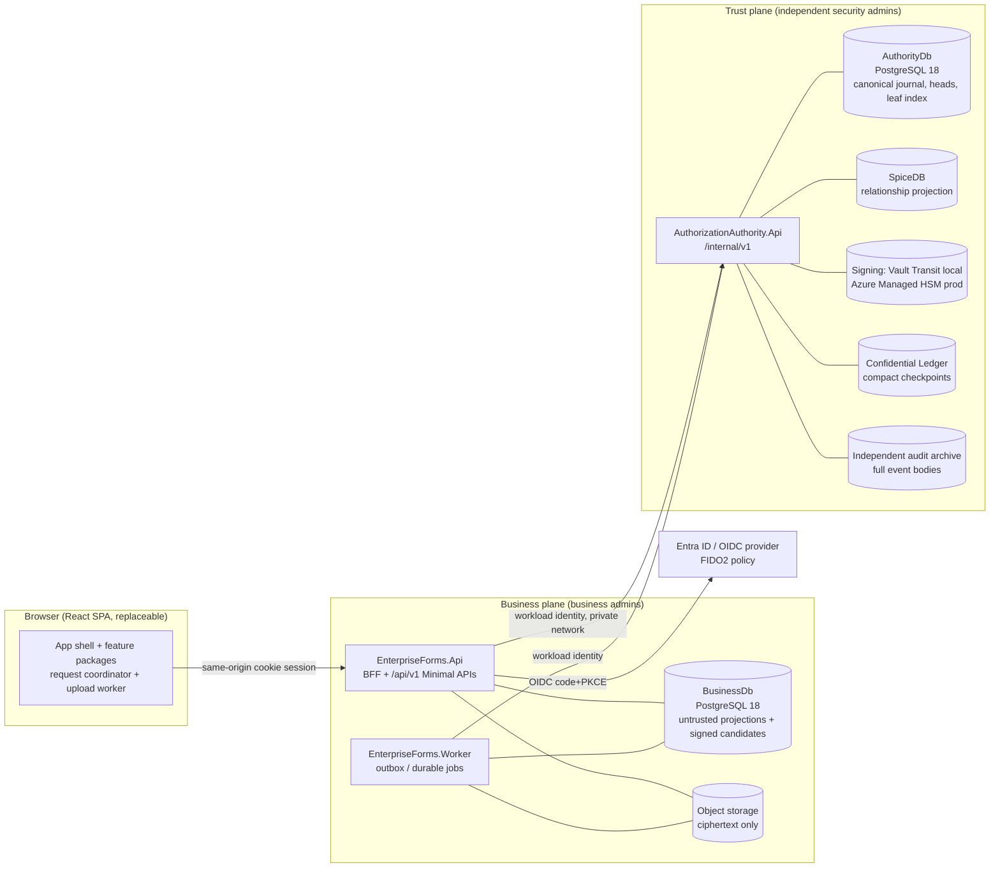
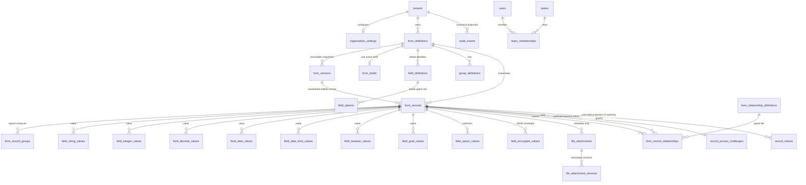
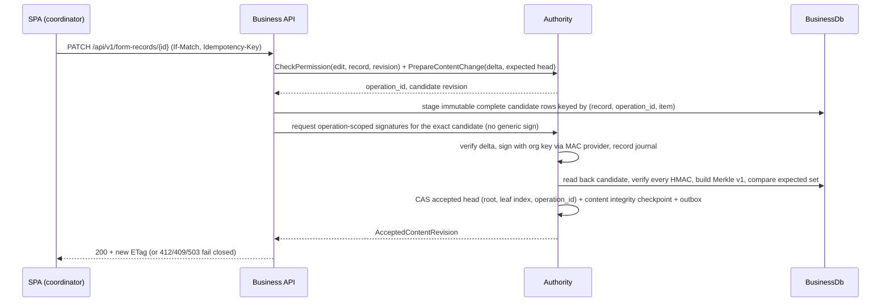

# Enterprise Forms — System Architecture (Phase 0 baseline)

**Status:** Gate 0 deliverable (BUILD-01). Describes the architecture as scaffolded in this repository and the data
flows the later phases implement. Everything marked *planned* is specified, not implemented; see
`docs/PHASE0_STATUS.md` for what actually builds and passes today. No production readiness is claimed.

Governing documents: `CLAUDE.md` (core behaviour and Level 2 invariants), `CLAUDE-DESIGN.MD` §8/§17 (layout and
ownership), ADR-PB-001…014, `trust_authority/*` and `security_hardening/*` protocols. On conflict those documents win
and the conflict is reported, never resolved silently.

## 1. System context and trust boundaries

Invariants carried by every slice (CLAUDE.md §4K–§4N):

1. **BusinessDb is never a source of permission or signing approval.** Owner, share, team and role rows there are
   untrusted projections. Decisions come from the Authority at a verified revision.
2. **No signing oracle.** The business plane holds no integrity keys and cannot request arbitrary HMACs. It submits
   revision-bound content/security commands; the Authority validates, signs, and commits.
3. **Fail closed.** Unavailable authority, stale projection, invalid HMAC, missing manifest leaf, missing checkpoint
   or audit intake ⇒ deny, quarantine, alert. Never auto-repair, never fall back to local decisions.
4. **Presentation is replaceable.** The React app consumes only the generated `/api/v1` contract.
5. **Canada-first residency** for every store above (ADR-PB-010); local Compose is a development emulation only.

## 2. Deployable units and repository layout

| Unit | Location | Image | Admin scope |
|---|---|---|---|
| Business API/BFF | `src/backend/EnterpriseForms.Api` | `infrastructure/docker/Dockerfile.api` | business |
| Business worker | `src/backend/EnterpriseForms.Worker` | `Dockerfile.worker` | business |
| Web | `src/frontend/apps/web` | `Dockerfile.web` (nginx unprivileged) | business |
| Authorization Authority | `src/authority/AuthorizationAuthority.Api` | `Dockerfile.authority` | **trust/security only** |
| Shared integrity library | `src/shared/EnterpriseForms.Integrity` | referenced by Authority (sign+verify) and business Application (verify) | reviewed by security owners |

Business assemblies: `Domain ← Application ← Infrastructure / Api / Worker`, plus `Contracts` (wire DTOs). Authority
assemblies mirror this. Business code never references any `AuthorizationAuthority.*` assembly and vice versa; the
only shared code is the provider-free `EnterpriseForms.Integrity` library. These rules are compiled into
`tests/architecture` (csproj graph + NetArchTest) and fail the build.

Feature organization follows `Features/<Feature>/<UseCase>/` in every assembly (CLAUDE.md §4U). Phase 0 contains
only the composition roots and probes; the first business features arrive with Stage A/B as complete vertical
slices (endpoint, contract, validation, handler, persistence, authority integration, audit, UI, tests).

## 3. Module ownership

The canonical owner catalog is `CLAUDE.md` §4U.2; frontend page ownership is `CLAUDE-DESIGN.MD` §17 and is
cross-checked against `docs/architecture/FEATURE_OWNERSHIP_MATRIX.md` by `FeatureOwnershipMatrixTests`. Table
ownership (one EF mapping owner per table) is assigned in Phase 1 when tables exist; the matrix lists the planned
owner for each table family from `CLAUDE.md` §2.

| Backend feature | Owns (planned tables) | Public port(s) |
|---|---|---|
| `Organizations` | tenants, organization_settings, catalogs (countries, regions, divisions, languages, time zones), list definitions/options/dependencies, catalog option policies, branding, authentication policy | organization settings/catalog read contracts |
| `Identity` | users, user_system_roles projection, identity provider configurations | verified principal/session bootstrap |
| `Teams` | teams, team_memberships (projection of authority state) | team directory read model |
| `FormDefinitions` | form_definitions, form_versions, field_definitions, field_concepts, field_options, group_definitions, form_relationship_definitions, translations | published form read contracts |
| `FormDesigner` | form_drafts | publish/restore commands |
| `FormRecords` | form_records, form_record_groups, field_*_values, field_encrypted_values, value history, record challenges/unlocks | authorized record projection |
| `RelatedForms` | form_record_relationships | child-link lifecycle |
| `Documents` | upload_sessions, file_attachments, file_attachment_versions | authorized document projection |
| `Sharing` | record_shares, recipients, fields, documents, share events (projections) | share commands → authority |
| `Search` | search projections (verified) | trusted completeness API |
| `Audit` | audit_events, audit_event_types, audit_field_changes, outbox, retention, checkpoints | investigation API |
| `UserPreferences` | user_preferences, format presets | effective presentation resolver |
| `Dashboard`, `Jobs`, `Exports`, `SecurityOperations`, `Imports`, `OrganizationOffboarding` | job/export/import/offboarding state | per ADRs PB-012/013 |

The Authority owns (in **AuthorityDb**): organization authorization states and revisions, security command journal
and outbox, desired relationships, record registry, accepted content heads, complete leaf index snapshots, content
integrity checkpoints, key catalog references, recovery epochs (`trust_authority/*.reference.sql`).

## 4. Core data model (business plane)

Entity-relationship sketch of the record engine (`CLAUDE.md` §2). PK/FK naming: `<singular_entity>_id`; every
non-key column has at least two words; all enforced by `ModelNamingValidator` in CI.

Every protected row additionally carries `row_signature`, `row_signature_key_version`,
`row_signature_schema_version`, `row_revision` (CLAUDE.md §4L.1) and is encoded per
`docs/dynamic-forms/row-integrity-format.md`.

## 5. Key data flows

### 5.1 Authentication and session (PB-08)

Browser → BFF `/auth/login` → OIDC authorization code + PKCE at Entra → BFF validates issuer/audience/nonce/state,
maps immutable issuer+subject (never email) to an app principal, asks the Authority for organization membership and
capabilities, issues a Secure/HttpOnly/SameSite cookie with CSRF protection. Tokens never reach the browser.
Organization switch: new context revalidation, session rotation, cancellation of queued work and scoped caches.
FIDO2 assurance is checked against configured Conditional Access authentication strength, not a generic `mfa` claim.

### 5.2 Protected record write (G02/G03 commit protocol)

### 5.3 Protected record read

Discover via the Authority (never by enumerating BusinessDb) → authority returns accepted head and the expected
authorized leaf key set → API fetches exactly those staged rows → verifies every `row_signature`, recomputes root
and index digest → projects only authorized fields/documents → decrypts `ApplicationEncrypted` values through the
KMS-backed service only after challenge unlock where required → emits access audit → responds with `no-store`.
Missing/extra/stale rows ⇒ 503/quarantine, never partial data.

### 5.4 Document upload (PB-07, §4A/§4C.4)

Initiate session → chunks via dedicated Web Worker, resumable across SPA navigation → finalize → worker job:
quarantine, scan (fail closed if scanner unavailable), encrypt (ciphertext-only object), attachment leaf into a new
accepted manifest, audit → `Ready`. Downloads are backend-mediated with per-document authorization; encrypted
attachments never receive direct blob URLs.

### 5.5 Search (PB-04)

Only approved Public/Internal typed fields are plaintext-indexed. V1 complete search enumerates the authorized
candidate set through the Authority, verifies rows, evaluates approved predicates within bounded limits and returns a
typed failure with no partial results when completeness cannot be proven. Confidential/Restricted predicates are
unsupported in V1.

### 5.6 Audit

One canonical `AuditEvents` projection fed by business transactions (change + audit + outbox atomically) and by the
Authority journal for security commands; denial/read evidence goes to an independently administered intake;
Confidential Ledger anchors compact checkpoints. `AuditEvents` is a timeline index, not the sole tamper evidence.

## 6. Decisions taken in Phase 0

Recorded in `docs/decisions/PHASE0_DECISION_LOG.md`. Highlights: feature-first modular monolith with the fixed
assembly set (ADR-ARCH-001); shared provider-free integrity library referenced by both planes; `RowHmac/v1` byte
format; build-time OpenAPI from compiled endpoints with committed contract snapshots; TanStack Router + TanStack
Query; npm workspaces; Docker Compose base + three override files emulating four networks; `--probe` health mode for
shell-less images; xUnit v3 on Microsoft.Testing.Platform; central NuGet version pinning.

## 7. Assumptions

- Local Compose isolation (networks, separate credentials) is a development emulation; Level 2 isolation is proven
  only in Azure staging with separate identities, HSM and ledger (ADR-PB-003 Level B, ADR-PB-005 §4).
- `LocalDevelopment` and `VaultTransit` signing providers are test providers; Production refuses them at host start.
- ICU is present in every runtime that normalizes text (chiseled-extra images).
- Stage A implements the Authority store, SpiceDB projection, MAC providers and the business authority client
  adapter; none exist yet beyond ports and configuration guards.

## 8. Migration plan (Phase 1 onward)

1. **Phase 1 schema:** single `BusinessDbContext` migration stream; feature-owned `IEntityTypeConfiguration<T>`; snake_case
   naming via explicit `ToTable`/`HasColumnName` or a reviewed naming-convention package (decision deferred to Phase 1
   with the first entity); `ModelNamingValidator` in CI; UUID v7 keys generated in .NET.
2. **Authority store:** EF migrations derived from `trust_authority/authority-store.reference.sql`,
   `consistency-schema-additions.reference.sql`, `record-manifest.reference.sql`, `recovery-control-plane.reference.sql`
   under a separate migration identity and pipeline.
3. **Privileges:** apply `trust_authority/business-postgres-privileges.reference.sql` /
   `authority-postgres-privileges.reference.sql`; run `postgres-privilege-inventory.sql` in CI after every migration.
4. **Signing registry:** register every protected table's signed columns (`row-integrity-format.md` §7) with a CI
   inventory test before any protected endpoint is exposed.
5. **Backfill rule:** no unsigned legacy rows in production; signature columns become NOT NULL only after audited
   backfill (CLAUDE.md §4L.6).

## 9. Executable checklist

`docs/dynamic-forms/control-traceability.csv` tracks SEC-01..SEC-42, G01..G18, SIM-01..SIM-42 and the six
ADR-SEC-2026-10-16-01 decisions with status ∈ {Designed, Implemented, Tested, Waived}, owner, evidence path and
gate. It is regenerated by `scripts/integrity/generate_control_checklist.py` and reviewed with each phase.
