# Level 2 — Coordinated Disaster Recovery and Anti-Rollback Protocol (G14)

> **Security simplification cross-reference:** For duplicate audit-writer consolidation, confidentiality defaults, trusted search completeness, high-assurance step-up and future HMAC/Merkle optimization, see `security_hardening/SECURITY_SIMPLIFICATION_STANDARD.md` (ADR-SEC-2026-10-16-01). This document remains normative for its own trust boundary and state machine; no prior anti-rollback/recovery requirement is weakened.

**Status:** Normative design and required acceptance criteria; **not deployed or tested**.
**Threat model:** Hostile Business PostgreSQL DBA and compromised Business PostgreSQL credentials. The independent Authorization Authority, its administrators, its protected journal/recovery evidence and HSM remain outside that compromise. Compromise of all administrative planes is out of Level 2 scope.
**Dependencies:** `TRUST_AUTHORITY_ARCHITECTURE.md`, `CROSS_SYSTEM_CONSISTENCY_PROTOCOL.md`, `MERKLE_RECORD_MANIFEST_PROTOCOL.md`, `CRYPTOGRAPHIC_SIGNING_AUTHORITY.md`, `PRIVILEGED_POSTGRESQL_ACCESS.md`. These remain normative. No recovery document permits bypassing their checks.

## 1. Recovery objectives and threat assertions

1. **Security RPO = zero accepted security-state rollbacks.** No *effective* authority command, revocation, team removal, mandatory encryption floor, irreversible FIDO2 setting, approved grant, delegated-share lineage or key-security policy may be discarded by a restore. This is a logical safety guarantee, **not** a claim that a third-party cloud service gives zero physical data loss. If independent evidence/event bodies are unavailable, keep affected tenants quarantined; never resurrect older authorization.
2. **Content recovery to the latest independently accepted manifest when bytes exist.** Trusted content heads identify exact immutable content/attachment revisions. If authoritative metadata exists but the bytes were lost, **quarantine affected records** until exact bytes are recovered or a distinctly authorized, audited data-loss remediation is approved. Never silently serve an older record as current or invent the lost content from hashes.
3. **Fresh identity/policy:** Revalidate OIDC issuer/subject bindings, current Entra enforcement and FIDO2 assurance; no restored app settings can weaken immutable security floors. No old unlock sessions, refresh/session cookies, download grants or previously cached Allow results survive cutover.
4. **No unauthorized cloud identity reuse:** Restore produces fresh deployment and recovery epochs; rotate workload credentials where needed, verify separate management and key permissions, compare policy-as-code to approved baseline. A recovered business DB may not carry authority signing credentials.
5. **Recovery is fail closed by default.** The public API stays in maintenance/quarantine until independent security, data, key and audit attestations pass. Per-tenant release only if that tenant has all dependencies validated.
6. **RTO and business-data RPO must be measured**, not invented. Customer tiers set target RTO/RPO after measured full-stack drills. Azure PostgreSQL PITR and geo recovery can have nonzero RPO and variable RTO; test actual platform configuration.
7. **Recovery does not grant plaintext access to recovery operators.** Operators may restore encrypted blobs and test cryptographic availability through scoped probes, but are not granted record-reader permissions. Break-glass access requires an independent, approved and audited workflow.

### Most important caveat: independently protected hashes alone are insufficient

An HMAC, Merkle root, ZedToken, content-head digest or Confidential Ledger receipt can prove that a candidate differs from the accepted state but cannot reconstruct deleted journal event *bodies*, form/record data or object bytes. Recovery therefore requires **replayable independent security-command events**, retained immutable business-content revisions, and recoverable key versions. The external append-only journal is the authority for replay; an ACL root is a verification/rollback anchor, not a backup.

## 2. Component recovery sources and authority ordering

| Component | Recovery source | Required verification | Never do |
|---|---|---|---|
| Independent authorization desired state and commands | Authority DB backup PLUS an independently administered immutable, replayable security-event archive | Reconstruct per-org accepted authorization revision, ordered event hash chain, identity/approval evidence, resulting relationship graph; compare independently attested receipts | Trust restored PostgreSQL's `authorization_revision` just because it exists |
| SpiceDB + relationship projection | Rebuild deterministically from validated authority state/schema (preferred) | Compare organization relationship-set digest, current applied revision, schema digest; issue new trusted consistency tokens | Treat an old restored SpiceDB ZedToken as fresh, or read relationships as authority |
| Business PostgreSQL | PITR/backup into quarantined target, supplemented by recoverable immutable content revisions | Confirm exact content head, complete manifest leaf set, HMAC/key/schema versions, accepted revision, typed data and format | Update trusted manifest root to match old SQL content |
| Encrypted and standard attachments | Immutable, versioned object archive/replica and catalog of immutable object IDs + hashes | Full ciphertext digest, size, AEAD metadata/tag and logical attachment identity/version; authorized decrypt probe on non-sensitive known-answer fixture | Assume geo-replicated blob version IDs equal source version IDs |
| Managed HSM | Original HSM continuity or protected full/key backups plus Security Domain and quorum holders | Enumerate all referenced key IDs and historic versions; sign/verify known-answer probes, authorized decrypt key unwrap tests, key status | Destroy current HSM with a destructive full restore; retire historical keys early |
| Azure Confidential Ledger / checkpoint journal | Independently operated ledger and verified service identity/receipts | Verify accepted anchor, receipt inclusion, event-digest chain; check service-identity endorsements after recovery | Treat an unverified copied receipt or old local checkpoint as current |
| Audit history | Independently administered WORM/append-only archive + local searchable projection | Event continuity, anchor receipts, redaction, retention/legal holds and actor attribution | Rewrite history or relabel a restored timeline as uninterrupted without proof |
| Search, exports and caches | Rebuild from **verified** approved content and current authority | Recreate version-scoped searchable values with current field ACL and search authorization; invalidate all old cache/index revisions | Serve restored search results before current authorization and content checks |

**Product-specific notes:** Azure Database for PostgreSQL Flexible Server restores into a *new server*; networking, monitoring and identity configuration must be checked on the new resource. Azure Managed HSM full restore is destructive, needs the same Security Domain, and carries keys and role assignments from the selected backup; prefer recovery to a new isolated HSM and explicit review of permissions. Managed HSM security-domain holders must be protected by a multiperson quorum. Azure Confidential Ledger replicates internally; operators must validate service identity and transaction receipts, not assume that choosing an application checkpoint controls the ledger's physical restore. SpiceDB's ZedTokens are datastore-specific causal consistency positions, **not portable external revision proofs**. See URLs in section 13.

## 3. Durable commit contract: close the journal replay gap

### Security commands

1. Authenticate actor and authority workload; validate authorized command, expected organization revision, approvals, policy floors and idempotency.
2. In authority PostgreSQL atomically append immutable command envelope (with full **replayable sanitized semantic effects**, not just a digest), desired-state mutation, next revision, and durable export outbox; mark `CommittedAwaitingRecoveryEvidence` (internal extension to prior protocol). On this commit, immediately close the authorization gate for the organization.
3. Export the authoritative event envelope to a **separately administered WORM-capable security-event archive**, keyed by (organization, stream epoch, revision) with content digest and unique operation ID. Acquire durable acknowledgement and verify archive read-back when mandated. Anchor event hash / resulting state digest (and archive object reference hash) into the Confidential Ledger and verify its receipt. The archive must be independently recoverable with intact immutable payload, not a DB-local outbox alone.
4. Only after externally durable evidence exists, project ordered relationships to SpiceDB with external fencing as specified by G02. Compare independent desired-state relationship digest, capture trusted newly produced consistency token; record acknowledged projection revision. A protected **Allow** can be issued only after the verified projection and required ledger/archive status are current.
5. If archive/ledger cannot be committed or verified, the event stays committed-but-not-effective, protected access remains blocked, and the worker retries idempotently. The recovery source can be used to replay *effective* events; unresolved pending events must be reconciled by the trusted authority before any release.
6. Treat irreversible security floors (FIDO2, encryption minima), revocations and key-disabling as monotonic constraints. After disaster, old snapshots cannot erase the latest accepted floor even if it was published after a backup.

**Important:** This is a **state-machine refinement** of G02, not a separate contradictory transaction protocol. Do not mark a command Effective before protected archive+ledger evidence is complete. Log and alert prolonged closed gates; never auto-expire a committed revocation to reopen stale permissions. The independent archive/ledger form the durable security replay record; the database remains the authority's online materialization. Exact outcome semantics under loss of acknowledgement need deterministic idempotency and reconciliation tests.

### Content commits and object bytes

1. Stage complete immutable candidate field/group/document bytes and manifest index; require object-store write durability and sufficient replication for the chosen data-loss target. Assign immutable storage references, content hashes, key versions and a unique operation ID.
2. Authority validates current actor, current security revision and row/manifest inputs. It accepts a content head only if the new canonical leaf set, signed root and durable data-object catalogue can be independently verified.
3. Persist a protected replayable commit descriptor containing the full object/version catalogue, content revision, manifest membership digest, key catalog versions and operation dependency; anchor the resulting latest head externally before presenting it as current. A digest is not replacement content.
4. If the business DB is lost, replay accepted immutable candidate bytes into restored data tables; verify the same canonical HMAC/Merkle root. Never recreate a missing data row from form schema defaults or silently promote a Prepared candidate.
5. If accepted bytes are irrecoverably missing, quarantine the affected record; preserve the authority head/history and create a separately approved incident/remediation operation. Disabling a record is preferable to accepting a forged or stale version.

## 4. Trustworthy checkpoint model

An independently evidenced recovery checkpoint includes: `organization_id`, `checkpoint_id`, immutable `recovery_epoch_id`, latest accepted **security revision** and trusted authorization digest, latest accepted **content integrity revision** and aggregate accepted manifest index digest, matching independently replayable event archive identifiers, last accepted event hash(es), object catalogue digest, required key-reference inventory digest, encryption-policy/FIDO floor digest, approved form-schema/security-schema digests, `ledger_transaction_reference`, `ledger_receipt_digest`, and UTC creation time.

**What is checkpointed:** a **verified high-water mark**, not necessarily the current point-in-time of every mutable database. It must attest to event replay availability and to a validated recovery dependency set. For large systems, checkpoints may be per tenant, but tenant isolation, shared global roles, identity-provider policies and key dependencies need explicit global recovery dependencies. Keep checkpoint snapshots and their replayable deltas separately from application Business PostgreSQL and authority online PostgreSQL.

**Selection rule:** on restore select the greatest *cryptographically verified, independently accepted* revision for each protected stream and then replay subsequent accepted archived events to the current independently trusted head. Do **not** let an operator pick an older security revision because the business database restored at that timestamp. If later accepted events are detectable but their bodies are unavailable, quarantine instead of rolling back.

**Anti-split-brain:** recovery controller holds an independently durable monotonic `recovery_epoch` / fencing token and closes old writer identities before new writes are admitted. Merely checking a database row epoch is insufficient if DBA can alter the DB; the epoch gate must be outside Business PostgreSQL and integrated into the authority/egress enforcement points. Verify that all stale projector, file writer, search/export workers and old deployment instances have lost credentials/routes before lifting maintenance.

## 5. Recovery orchestration state machine

```mermaid
stateDiagram-v2
    [*] --> Normal
    Normal --> Isolated: Disaster / security incident declared
    Isolated --> RestoreCandidate: Freeze egress/writes; fence previous epoch
    RestoreCandidate --> VerifySecurity: Restore authority + replay archived security events
    VerifySecurity --> VerifyKeys: Validate independent checkpoint and identity floors
    VerifyKeys --> VerifyContent: Verify HSM historic key versions and blob/data availability
    VerifyContent --> RebuildProjection: Compare all accepted content manifests
    RebuildProjection --> ReadyForApproval: Rebuild SpiceDB, RLS, search; prove freshness
    ReadyForApproval --> Active: Two-person release approval + attestation
    RestoreCandidate --> Quarantined: Evidence unavailable/invalid
    VerifySecurity --> Quarantined: Replay mismatch or latest accepted event missing
    VerifyKeys --> Quarantined: Key version or identity floor invalid
    VerifyContent --> Quarantined: Missing accepted bytes
    RebuildProjection --> Quarantined: Index/ACL consistency failure
    Quarantined --> RestoreCandidate: Authorized remedial action
```

Any mismatch is **deny**, no implicit database `RowSignature` repair or automatic downgrade. Per-tenant release is allowed only if shared global dependencies are verified, other tenants remain quarantined, and proven tenant isolation on routing/recovery exists.

## 6. Step-by-step runbook and sign-off

1. **Declare + evidence:** Security incident commander opens an immutable recovery operation, records affected organizations/components, incident reason, target restore point, evidence snapshots and two distinct recovery approvers. Do not log secrets or PINs.
2. **Quiesce:** Disable all protected egress; fence old app/authority deployments and writers using independent recovery epoch and rotate/revoke affected workload credentials, deny stale download URLs, invalidate active PIN unlocks. Preserve forensic material before cleanup.
3. **Isolated recovery network:** Build new isolated Business/Authority PostgreSQL targets with fresh runtime identities and restricted private access; restore from chosen backups/PITR. Do not route public traffic. Audit roles, migrations, FORCE RLS, schema digests, and security-definer functions. Do not let restored authority DB alone define what is latest.
4. **Independent journal replay:** Recover latest verified independent WORM event archive and receipt chain, find highest accepted authorization revision, replay missing authority commands deterministically, and match resulting current authorization root/digest to ledger evidence. Ensure historical grant/revoke order and no missing event body. Quarantine unresolved pending events.
5. **Key custody:** Verify existing Managed HSM first. If disaster requires HSM reconstruction, recover to *separate replacement* HSM using offlined Security Domain and quorum shares plus recent protected HSM backup; ensure the security domain matches. Inventory all accepted current/historic key references; test operations with non-sensitive fixtures. Never full-restore an active production HSM without separate authorization for destructive replacement. Reapply/review RBAC/identity boundaries and purge protection.
6. **SpiceDB projection:** Rebuild from authoritative relationships, not from old SpiceDB or business database projections. Validate schema/relationship digest, outbox sequence and projection barrier; acquire fresh consistency tokens scoped to new projection/recovery epoch. All old cached ZedTokens considered stale.
7. **Content and attachments:** Enumerate all accepted record content heads from authority, obtain the exact immutable field/group/attachment versions, restore/rehydrate objects as needed. Verify HMAC with versioned keys, canonical leaf identities, manifest completeness, Merkle roots and ciphertext digests. For geo-replicated blobs map source logical object IDs to destination object/version IDs only after hash/content verification; destination version IDs may differ. Missing accepted bytes => quarantine record.
8. **System settings, audit, search:** Verify independently controlled irreversibility floors, tenant options, user identity bindings, translations/form versions, audit archive continuity and legal holds. Rebuild searchable projections from verified accepted data only; enforce field ACL for search terms and results. Do not count a rebuilt search index as cryptographic proof of completeness unless independently checked.
9. **Functional validation:** Run negative SQL tampering tests, revoked member search/download checks, wrong-tenant checks, encrypted-file decryption known-answer tests, past-version record render, signing verify, delegation graph consistency, and timing of revocation. Check that requests referencing old recovery epochs/leases are rejected.
10. **Release:** Two independent security/recovery approvers inspect the machine-readable verification report and sign the recovery attestation. Authority records a trusted new recovery epoch, current security/content heads and fresh keys/receipts. Switch routing atomically. Resume tenant(s) only when all critical gates pass. Continue monitoring for drift.
11. **Follow-up:** Retain forensic snapshots and complete timeline in independent archive; publish measured RTO/RPO, remediation notes, unresolved quarantines and postmortem. Never auto-resolve a security mismatch by changing the accepted root.

## 7. Component-specific failure scenarios

| Failure | Correct safety decision | Recovery completion evidence |
|---|---|---|
| Business DB restored to 2 PM; owner revoked at 3 PM | Replay 3 PM revocation from trusted archive; do not grant through old DB owner | Current authority revision/digest + denied owner read |
| Authority DB restored before revocation | Replay accepted journal event bodies; rebuild SpiceDB; no old permission granted | Ledger-validated event chain reaches current accepted revision |
| Ledger current, archive loses event payload | Fail closed/quarantine; hashes cannot reconstruct grant/revoke | Independent exact payload recovered with verifiable digest or distinct approved remediation |
| HSM backup predates new active integrity key | Do not verify or re-sign against a substitute key | Required key version restored/available or quarantine affected records |
| Object restore missing committed PDF | Quarantine affected attachment/record, never silently use old PDF | Accepted immutable version bytes + hashes + AEAD validated |
| Blob version IDs remapped by replication | Verify logical immutable ID/hash then update scoped storage-location mapping without changing content commitments | Object hash and audit mapping proof |
| SpiceDB data store lost | Recreate from verified authority graph and schema | Graph digest matches; fresh token; revision gate opens only after projection |
| Two recovery leaders start | Only independent fenced recovery epoch may commit; second rejected | Duplicate candidate cannot lift maintenance |
| Old app comes back online | Credentials and egress routes revoked, stale leases invalid | Old instance cannot write, release ciphertext or authorize access |
| FIDO2 enforced after selected DB backup | Preserve current irrevocable organization auth floor | Provider assurance checks and independent floor matches checkpoint |
| Restore process attempts mass re-sign | Reject; sign only independently authorized committed content bytes | No new valid signatures for tampered/unknown bytes |
| Search index contains attacker forged/omitted items | Keep search disabled until rebuilt and authorization verified | Search tests, index hash/count reconciliation as applicable |
| Regional outage affects ledger verification | Keep gated pending trusted receipt/identity validation | Valid receipt and service identity chain verified; no bypass |
| Backup includes plaintext-sensitive history | Restrict backup and access, preserve legal hold and data classification | Backup inventory, retention and operator access audit |

## 8. Production prerequisites, availability, retention and performance

- Authoritative event/archive and object-content durability must be measured end-to-end. Set a *named* target RTO/RPO and verify backup/geo replica replication lag. Do not advertise zero data loss without synchronous durable independently retained bytes and tested failure semantics.
- Managed HSM full backup is not automatically scheduled; schedule backup via controlled service identity, prove restore with security-domain quorum, preserve all historical signature/decryption key versions for accepted snapshots. Confirm HSM endpoint changes after replacement.
- Enable Azure PostgreSQL backup retention (7–35 days where available) and choose supported geo redundancy at deployment. PITR is not coordinated across the two independent PostgreSQL clusters. Azure geo-redundancy and read replicas can lag.
- Object storage: enable soft delete/container protection, immutable backup copies, versioning, appropriate replication; monitor replica lag and verify exact ciphertext bytes. Test interaction of WORM/replication/retention; some blob object-replication changes fail against immutable destination objects.
- Confidential Ledger has platform-provided resiliency, but application verifies **transaction receipts and service identity endorsements** and maintains independently retrievable event bodies. Service identity can rotate during disaster recovery.
- Authorization Authority independent management-plane backups must be protected from BusinessDb administrators and protected from mutually dependent keys. Key custodians (quorum) must be available without relying on credentials stored solely inside the system being recovered.
- Define tenant-isolated DR regions/data-residency rules and restore access approval. Avoid blanket raw SQL access for recovery operators; use automation with narrowly scoped identities.
- Use game days at least quarterly in staging for core failures and scheduled full regional/rebuild exercises at a cadence set by risk/compliance. Require RTO/RPO metrics, lag and proof artifacts in CI / release governance; do not invent pass results.

## 9. Minimal internal API and evidence contract

An independent `IRecoveryCoordinator` manages: `OpenRecoveryOperation`, `FenceRecoveryEpoch`, `SelectTrustedCheckpoint`, `RestoreComponentCandidate`, `VerifyAuthorityReplay`, `VerifyReferencedKeys`, `VerifyContentHeads`, `RebuildAuthorizationProjection`, `VerifySearchAndAudit`, `ApproveRelease`, and `ActivateRecoveryEpoch`.

Each call is authenticated with a distinct recovery workload identity, **not the business API identity**. No public restore, change-trusted-head, disable-policy or unlock-decrypt endpoints. Require idempotency, expected epoch/revision CAS and an immutable audit reason. `ApproveRelease` requires two distinct privileged human identities and verified mandatory evidence; back-end logic enforces separation of duties. The service must not accept a caller-provided "validated=true" boolean in place of independently executed verifications.

Evidence bundle: recovery operation ID, trusted epoch, selected archive/ledger receipt hashes, security/content high-water revisions, command replay count + digest, manifest-verification counts and exceptions, key inventory and provider attestation, object missing list, rebuilt graph digest, identity/policy floor digest, privilege-audit results, isolation tests, reviewer identifiers, measured RTO/RPO, new infrastructure resource identifiers and release time. Keep this evidence outside Business PostgreSQL under audit retention.

## 10. Known limitations and explicit release blockers

1. Confidential Ledger transaction receipts verify contents/inclusion; they are **not** standalone data recovery. Recoverable event bodies are mandatory.
2. Without immutable committed content/object copies, signed Merkle roots detect data loss but cannot repair it. Document and alert nonzero data-loss exposure or maintain genuinely durable replicas.
3. Revocation cannot recall already downloaded plaintext. A long-running stream may have emitted bytes before quarantine; follow existing stream-recheck/lease rules.
4. Default PostgreSQL RLS and ordinary DB backups cannot protect against a superuser controlling all databases; Level 2 assumes independent authority/security administration.
5. Trust boundary is only as strong as HSM access control, journal archival custody, and recovery approval implementation. A recovery service permitted to reset trusted heads arbitrarily defeats all anti-rollback guarantees.
6. Restored SQL data might be incomplete, Byzantine or deliberately doctored. Quarantine mismatches; never substitute old data or forge recovery proofs to pass a release gate.
7. Verifying all returned search rows still does not establish search completeness against a hostile index (G06). Rebuild search from recovered trusted leaves and keep broader completeness assurances separately assessed.
8. Old SpiceDB revision tokens/caches must be discarded after rebuild. The projection must be verified from desired authoritative relationships before protected access resumes.
9. References and scripts are *design and validation artifacts*, not tested Azure deployment. The production finding remains open until full real cloud DR exercise and third-party review.

## 11. Acceptance criteria and release gate

See `DISASTER_RECOVERY_TEST_PLAN.md`: DR-01 through DR-36. All mandatory critical tests must pass with logs, trusted receipt/evidence bundle and measured RTO/RPO. At minimum, prove restored business/authority snapshots older than an effective revocation cannot reinstate access; loss of journal payload fails closed; missing committed data blobs do not become old valid records; historical HSM keys remain available after recovery; dual recovery leader is fenced; identity/FIDO floor is not downgraded; full authority graph and manifests verify; newly rebuilt search follows field sharing; independent human approval is enforced.

**Status:** G14 architectural design complete; release gate remains **P0 OPEN** until those tests and an independently reviewed disaster-recovery exercise pass.

## 12. Implementation order

A. Implement external replayable immutable security-command archive + receipt verification in the existing G02 state machine; do not just export hashes. B. Implement trusted recovery control plane and fencing epochs. C. Implement content-archive/replay catalogue and recovery inventory. D. Implement HSM key-preservation and restore probes. E. Implement quarantined staged recovery and deterministic SpiceDB rebuild. F. Implement evidence/reporting and two-person cutover. G. Automate negative DR-01..DR-36 tests and measured full-stack Azure game day.

## 13. Platform references (verify deployed region/SKU/features)

- Azure Database for PostgreSQL business continuity: https://learn.microsoft.com/en-us/azure/postgresql/backup-restore/concepts-business-continuity
- PostgreSQL restore new server: https://learn.microsoft.com/en-us/azure/postgresql/backup-restore/how-to-restore-latest-restore-point
- Managed HSM resilience/security domain: https://learn.microsoft.com/en-us/azure/reliability/reliability-managed-hsm
- Managed HSM backup/restore: https://learn.microsoft.com/en-us/azure/key-vault/managed-hsm/backup-restore
- Managed HSM DR procedure: https://learn.microsoft.com/en-us/azure/key-vault/managed-hsm/disaster-recovery-guide
- Azure Confidential Ledger overview: https://learn.microsoft.com/en-us/azure/confidential-ledger/overview
- Ledger certificate / receipt chain handling: https://learn.microsoft.com/en-us/azure/confidential-ledger/authenticate-ledger-nodes
- Azure Storage immutable blobs: https://learn.microsoft.com/en-us/azure/storage/blobs/immutable-storage-overview
- Azure Storage replication caveats: https://learn.microsoft.com/en-us/azure/storage/blobs/object-replication-overview
- SpiceDB ZedToken semantics: https://authzed.com/docs/spicedb/concepts/consistency
