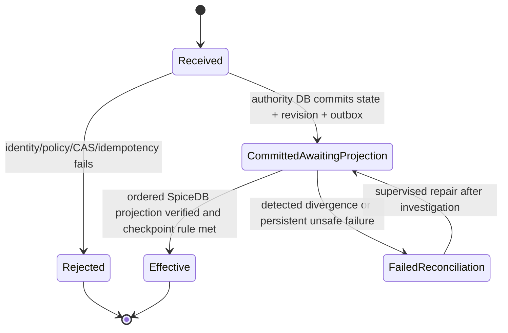
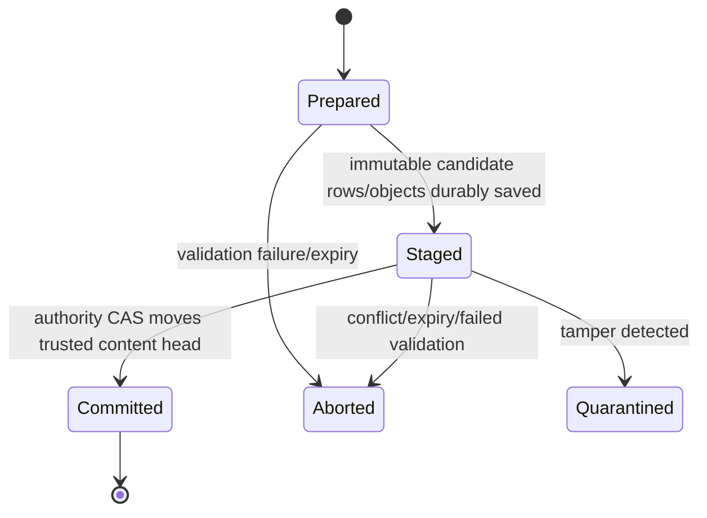

# Level 2 — Cross-System Consistency and Revocation Protocol

**Status:** Normative architecture and implementation contract; **not yet deployed or tested**. Applies to the trust model in `TRUST_AUTHORITY_ARCHITECTURE.md`. This document resolves the *design* portion of critical finding **G02**; it does **not** close the production assurance finding until real crash/chaos tests and IAM review pass.

## 0. Scope and selected trade-off

- **Untrusted:** business PostgreSQL including privileged DBA writes/rollback, its owner/share/team projections, its indexes, background-job state, and unverified client parameters.
- **Trusted but separately administered:** Authority .NET API, independently protected authority PostgreSQL, its SpiceDB writer and datastore, verified IdP identity, cryptographic signing services, external security journal. Business API execution is trusted against code compromise for Level 2 but is **not** permitted to impersonate arbitrary people to the authority.
- **Availability trade-off:** Begin with a **per-organization authorization gate**. Any committed authority revision not fully applied to SpiceDB suspends protected access for that organization. This intentionally sacrifices availability during slow projections in exchange for a simple, provable stale-grant barrier. A per-resource dependency graph is a possible later optimization only after formal analysis and dedicated tests.
- **No distributed ACID transaction** spans authority DB, SpiceDB, business DB, object storage or Confidential Ledger. Authority DB provides durable commit intent and serial revision history. All other systems are verified projections/candidates.
- **Assurance boundary:** This protects against unauthorized business DB writes and rollback. It cannot prevent data exfiltration of plaintext already stored in the business DB or bytes already transmitted to a client; it does not defend against total authority or business runtime compromise.

## 1. Invariants (mandatory; test each)

**A1: Authority-only grants.** Neither business SQL ownership nor a signed row gives access; a grant is effective only after validated authority mutation and projection confirmation. No public raw SpiceDB write, arbitrary-sign, or revision-set endpoints.

**A2: Monotonic authoritative revision.** For each organization, `authorization_revision` advances exactly once per committed security mutation; the authority holds the ordered normalized state, immutable command history and deltas. `projection_applied_revision <= authorization_revision` always. Every outbox revision is contiguous with no gaps.

**A3: Gate on lag.** A protected `Allow` is prohibited when `projection_applied_revision != authorization_revision`, during reconciliation/quarantine, or when a policy-required external checkpoint is not yet confirmed. Both grants *and* revocations close the gate until the latest state is in SpiceDB. The gate is checked before and after every SpiceDB permission check.

**A4: Strict projection order.** The projection worker applies revision `r = projection_applied_revision + 1` only. It serializes the per-organization worker, applies the exact validated delta, verifies expected scoped relationships, records a fresh **authority-held** ZedToken, and atomically advances `projection_applied_revision`. Out-of-order workers never open the gate.

**A5: Idempotency.** Idempotency uniqueness is scoped to (organization, principal, command namespace, idempotency key); the same key + canonical body yields the original command/operation status. Same key + different body is `409 IdempotencyConflict`. A retry after network timeout must *query status*, not assume an operation was never committed. Reserve and commit command/idempotency record atomically, never in a separate best-effort transaction.

**A6: Stale proposals rejected.** Every mutation uses the current authority revision (and, for record content, the current content-head revision). Expected-revision mismatches return `409` with no security effect. Command authorization is computed from independently maintained **latest desired** state under row locks, not stale SpiceDB or business projections. Cross-resource invariants (one owner, active tenant, delegation chain, mandatory floors) must be checked in that transaction or a serialization-safe equivalent.

**A7: No phantom authority.** Creating a new record requires an authority resource registration with authorized initial owner before a corresponding business record becomes accessible. Recovery cannot invent records or owners from business table rows.

**A8: No incomplete content reads.** Readers use the independent authority's `(form_record_id, committed_content_revision, committed_operation_id, manifest_root)` and retrieve *only* immutable items staged under that operation. Missing/mismatched rows, signatures, roots, or object hashes => quarantine/fail closed. Business `status = Published` or `current_revision` is not trusted.

**A9: No signing oracle.** New HMAC(s) and manifests are signed only for a validated `PrepareContentChange` operation and approved exact candidate delta. Signature/version is bound to organization, record, item IDs, content revision, operation ID, key version, type, and canonical bytes. An invalid or unexpected candidate is never auto-resigned.

**A10: Protected policy supersedes restored form JSON.** Mandatory org policy, form security floor, field disclosure/encryption, PIN, and identity assurance are checked against independently accepted revisions, not editable form JSON or business DB flags.

**A11: No silent success.** Submit responds `202` with `command_status` until `Effective`; if an outage persists, return `503` or a visible pending state. A client never treats `Pending`, `CommittedAwaitingProjection`, `FailedReconciliation`, timeout, or unknown status as an access grant.

**A12: Audit is correlated and durable.** Each approved/denied command and transition records actor binding, tenant, canonical digest, expected/committed revisions, idempotency key hash, timestamps, outcome and correlation identifier in independently controlled authority audit/outbox. Never log PIN, decrypted payloads, encryption keys, sensitive field values or bearer credentials.

## 2. Security-command state machine

`Received` is a transient execution state; stored `Pending` is only used if a durable asynchronous admission/review workflow exists and **must not** be mistaken for a committed revision. Committed commands are never rolled back by deleting their journal row. Any reversal is a *new authorized command with a new revision*. `FailedReconciliation` keeps the gate shut until operator-approved, audited repair. If a revision already committed, retries return the same command and revision.

### Command sequence (normative)

1. Authenticate **workload** and **delegated end user** independently; map `(issuer, subject)` to authority identity. Evaluate FIDO2/session/policy/record PIN proof as appropriate. Validate resource ownership, tenant and exact typed payload. Client-provided `organization_id` is an *assertion to check*, not a source of truth.
2. Start authority PostgreSQL transaction; lock `organization_authorization_states` row `FOR UPDATE` (or equally strong serialized org stream). Verify expected revision, caller's current capability from authoritative normalized state, revocation/delegation preconditions and approvals. Resolve duplicate idempotency keys under unique constraint and canonical body hash.
3. Apply normalized desired-state mutation, write immutable security command and rev `r+1`, audit, projection outbox and security journal hash chain in **one** authority PostgreSQL transaction. Commit. This is the **authoritative security-commit point**. The gate becomes closed since desired revision exceeds applied revision. No synchronous call to SpiceDB or ledger is part of this DB transaction.
4. Respond `202 CommittedAwaitingProjection` (or wait within a bounded budget for `Effective`); status may remain unknown to the caller after a timeout—retry with same key.
5. Single ordered projection worker locks next outbox revision; apply exact delta using atomic SpiceDB relationships update (or multiple bounded batches behind the **closed** gate), with narrow preconditions and an **external SpiceDB revision/step-marker CAS** encoded in the same atomic relationship write; a worker with an obsolete revision/step cannot apply a delayed stale write. On ambiguous timeout, read and compare expected relationship set and reapply idempotently. Never acknowledge a partial batch. Record `zed_token`, verified revision and `Effective` in the authority DB under CAS lock. If revision `r+1` committed meanwhile, the gate stays closed.
6. Independent journal checkpoint worker exports the committed digest/sequence to the configured immutable external ledger. If policy requires ledger anchoring before effective access, the gate stays closed until receipt and verified checkpoint; otherwise keep a bounded retry queue and alert on lag. A ledger receipt does not replace DB transaction/outbox.
7. Business PostgreSQL owner/share/team projection is updated asynchronously via an independent outbox or event consumer. Its write failure may affect UI metadata but **cannot grant or deny access** in lieu of the authority. Repair by reconstructing from the authority journal; never reverse authority decisions to match business SQL.

### Authorization check (normative)

1. Load authoritative `authorization_revision`, `projection_applied_revision`, latest trusted authority ZedToken, policy version and quarantine/anchoring flags; if any gate is closed return `503 AUTHORITY_NOT_READY` or appropriate safe deny (do not return `Allowed=true`).
2. Check permission against SpiceDB using `at_least_as_fresh` with an **authority-held** ZedToken for the latest applied state (or `fully_consistent` for a supported high-sensitivity path). SpiceDB `minimize_latency` default is forbidden on protected checks. Handle conditional/unknown as deny.
3. Re-read authority state; return `Allow` only if the observed revision, applied revision, policy version and active barriers are still consistent with step 1 and caller identity/session/challenge is still valid. On movement retry at most a configured bounded count and otherwise fail closed.
4. Bind allowed decision to tenant, user, action, item IDs, policy, and authority revision. Normal API reads must revalidate for each independent sensitive response; batch checks are allowed only with verified membership/field scope.
5. **Race caveat:** a change can commit just after step 3. These checks prevent returning a knowingly stale projection but are **not a strict linearizable lock on ongoing egress**. For strict revocation boundaries, use the separately specified egress admission/lease barrier below; a received byte cannot be recalled.

### Long streams and strict revocation

- **Baseline:** Each new request/stream admission checks current authority gate. Downloads/exports use short, bounded chunks and an independent authority recheck at documented maximum interval (choose SLO in deployment configuration, e.g. <=5 seconds) before more plaintext is transmitted. Terminate when a revision changes or the authority is unavailable. There remains a race/finite exposure window.
- **Strict security profile:** To guarantee that **no new bytes are emitted after the revocation's effective point**, put all protected egress behind an independently controlled streaming gateway that grants short leases per resource/revision; the authority atomically closes new admissions, forces a stop/ack from outstanding gateways, and only then reports revocation `Effective`. A gateway with an expired lease must drop egress. Timeouts must block `Effective`, not silently bypass stuck gateways. Already delivered bytes remain unrecoverable. Build this only if the business requires this stronger promise; otherwise explicitly document the baseline window.
- Cached clients, screenshots, previously downloaded documents and offline exports cannot be revoked. Prevent long-lived plaintext signed URLs and caches for protected files.

## 3. Immutable content-change protocol

1. **Prepare:** Verify current edit rights/field scope against accepted authority state; bind operation ID, idempotency key, old root and expected revisions, exact canonical changed-item digest, actor and expiry. A new operation does *not* change visible content. Concurrent preparations may exist for the same expected revision; only one may win CAS commit.
2. **Sign and stage:** The trusted content worker canonicalizes proposed items, validates schema and encryption policy, obtains operation-scoped signatures through the controlled signing workflow, stages immutable rows keyed by `(form_record_id, operation_id, item_id)` with candidate revision and complete membership manifest. Staged file ciphertext and scanner verdict must be durable first. Database attacker cannot modify signed candidate bytes without detection. No partial candidate is visible.
3. **Commit:** The authority verifies that the candidate and its full signed item set are exactly what was prepared, their object identities/hashes and manifest match, no item was inserted/removed and key versions are approved. It rechecks *current* actor permission, current mandatory policy, expected authorization revision, expected content revision, and candidate expiry. In **one** authority DB transaction, CAS record head to `(revision+1, committed_operation_id, root, key_version)` and mark operation Committed; write durable audit/outbox. This is the **content-visibility commit point**. No post-commit business flag update is needed to make contents logically visible.
4. **Read:** Obtain independent accepted content head and fresh permission. Fetch immutable staged rows/objects by **committed operation ID**, verify full inclusion/completeness proof and signatures, apply field-scope projection, decrypt only allowed fields/docs. If candidate missing or altered, return integrity error/quarantine and alert; **never fall back to an older content revision** after the authority advances its head.
5. **Cleanup:** Expire uncommitted staging only after checking authority status. Preserve all authority-referenced revisions/objects for required retention and recovery. A cleanup worker has no access to mutate authority heads. If authority commit response is lost, read current content head/status before cleanup or retry.

**Key correction to prior drafts:** A local business DB candidate's `Prepared` or `Published` flag is not authoritative. The independent `committed_operation_id` is necessary to distinguish simultaneous candidates with the same proposed revision and to survive a crash after authority commit but before local publication. Add this ID to the authority head, API content-revision DTO and content read path.

**Share-scoped user operations (Phase C5 clarification, decision D12).** A content change by a non-owner share editor carries `current_items`: the complete accepted snapshot it was built from, bound by the authority to the accepted head before any classification or signing. The deployment switch `Content:ShareContributorWritesEnabled` (off by default, refused in Production) is checked at Prepare and again at Commit, and Commit re-authorizes against the current desired edges under the organization lock taken by every security command, so a revocation committed before Commit aborts the write. See `docs/architecture/PHASE_C5_COLLABORATION_CONTRIBUTOR_WRITES.md` and decisions C-34…C-40.

### Content concurrency examples

- Two editors prepare revisions from head `5`; the first validated commit moves head to `6`; the second gets `409 ContentRevisionConflict` and must re-prepare against `6` after resolving edits; no silent overwrite.
- Share revoked after prepare, before commit: commit rechecks latest authority revision and fails; staged candidate remains invisible and is aborted/quarantined per policy.
- Authority commits revision `6` but malicious DBA rolls business tables back to revision `5`: authority head remains `6`, content read detects missing committed operation and fails closed, not silently serves old content.
- Server crashes after durable immutable rows but before authority commit: authority still points at revision `5`; reads continue from `5`, staged candidate expires or is retried under the same idempotency key.

## 4. Failure and reconciliation matrix

| Crash / attack boundary | Durable state | Recovery and externally visible effect |
|---|---|---|
| Before authority transaction commit | No accepted revision | Safe idempotent retry; no new access |
| After authority DB commit, before HTTP reply | Revision and outbox committed | Same idempotency key retrieves same command; gate closed until projection |
| During SpiceDB write, before reply | Outcome uncertain | Query exact tuples with authoritative expected revision/delta; idempotent retry or quarantine; gate stays closed |
| After partial SpiceDB batch | Only partial projection | Gate closed; finish ordered batch or rebuild/reconcile; never acknowledge partial |
| After SpiceDB success, before authority ack | SpiceDB may be ahead of recorded applied revision | Gate closed; verify projected state then persist returned/fresh token; idempotent retry |
| After authority ack, before business projection | Authority and SpiceDB current; business projection stale | Authority controls access; repair business projection asynchronously |
| New revision committed while older projection finishes | Desired revision exceeds applied revision | Gate stays closed; project next revision in order |
| Ledger unavailable in non-strict anchoring mode | Commit/journal/outbox durable | Access may be effective if allowed by explicit policy, but outbox lag alerts; enforce bounded backlog and response plan |
| Ledger unavailable where anchoring required | Commit/journal/outbox durable | Keep gate closed until receipt verified; no fail-open override |
| DB attacker changes owner/share/team in business SQL | False projection only | No authority relationship effect; HMAC/manifest mismatch if protected; audit/quarantine |
| Business DB staged candidate erased | Authority may remain old or point to new head | If old, visible old revision; if head new, fail closed and restore exact signed candidate |
| Request times out during content commit | Head outcome unknown | Read independent head with operation ID; never blindly create a second revision |
| Duplicate content commit request | Identical idempotent operation | Return accepted head if already committed; differing digest yields 409 |
| Two different commands at same expected rev | First wins serialized authority CAS | Other gets 409 and must re-authorize/rebase before retry |
| Signature/key provider unavailable | Prepared/verified signing cannot complete | Keep previous accepted content; fail closed for checks dependent on unavailable verification |
| Authority DB rollback to earlier backup | Trusted head/revision lower than external checkpoint | Detect on startup; quarantine until independently approved forward reconciliation; never accept historic security permissions |
| SpiceDB lost/rebuilt | Authority journal intact | Close gate, rebuild relationships in revision order and validate scopes before reopening |
| Restored business DB has extra signed records | Independent registry/head does not list them | Never discover or release those records |
| Worker lease expires and stale worker resumes | New worker may own lock | Fencing/epoch checks prevent stale ack and revision advance |

## 5. PostgreSQL concurrency, idempotency and fencing

- Serialize authority writes per organization via `SELECT ... FOR UPDATE` on the authority `organization_authorization_states` row. This protects the accepted revision CAS while updating normalized state, command and outbox in one transaction; no distributed lock is required for the commit point.
- Projection workers claim an outbox revision using `FOR UPDATE SKIP LOCKED` **plus a persisted per-organization worker lease/epoch**. A stale worker may complete an external SpiceDB write even after losing its lease. Never mark the revision applied without verifying the current fencing epoch under lock. PostgreSQL worker leases are only workload-coordination hints: **they do not fence SpiceDB**. Every SpiceDB mutation MUST atomically check and advance a SpiceDB-held organization/revision/batch-step marker (or pass through an equally strong external write gateway), so an obsolete worker cannot apply a stale delayed write even after the gate reopened. Validate marker schema, exact precondition semantics and multi-batch recovery with the actual deployed SpiceDB version; without that proof, Level 2 cannot be marked ready. Any marker mismatch => keep gate closed, investigate/reconcile.
- Use precise idempotency scopes, canonical digests and uniqueness. Reject duplicate key/body mismatch. Make status lookup accessible only to the originating actor or privileged authorized administrator.
- Transient PostgreSQL serialization (`40001`), deadlocks (`40P01`) and temporary network failures can be retried with jitter only when the command idempotency key is stable; business-rule denial and stale CAS require a new decision, not blind retry.
- `security_commands` append-only for committed commands; corrective commands append new revisions. `authority_relationship_edges` is normalized desired state, so edits are controlled in the same transaction and logged in the journal. `projection_outbox_events` cannot be acknowledged by arbitrary business identities.
- Every accepted security mutation has an authenticated principal + explicit invariant checks even when invoked by a background worker (service actions require separately enumerated service permissions).

### SpiceDB marker-CAS acceptance test

Extend `spicedb.schema.zed` with a dedicated `authorization_projection_cursor` and `projection_step` relation (reference only). Each relationship batch performs, **atomically**, (a) a precondition on the expected old marker, (b) exact edge delta, (c) deletion of the old marker and (d) creation of the new marker. Ensure the marker is unique for an organization and step; SpiceDB does not automatically enforce one subject per relation. Verify competing workers cannot both pass the precondition under the chosen datastore's transaction semantics. Force a suspended worker to resume *after* the next revision has fully applied and the gate has reopened. Its stale write must be rejected with no effective permission change. If tests fail, do not deploy until an externally fenced single-writer service is implemented; a lease timeout is insufficient. The cursor is not an access permission and is never client-controlled.

## 6. Contract changes required in existing artifacts

- `ContentRevision` / C# `AcceptedContentRevision` MUST include nullable `committed_operation_id` (non-null for committed revision >0) so reader selects the exact accepted immutable candidate.
- `PrepareContentChange` must return a stable prepared-operation ID under idempotent retry; `CommitContentChange` must revalidate current permission and strict revision CAS.
- `OperationStatus` MUST expose whether a command is only **committed** or actually **effective**; `Effective` is not implied by HTTP 202.
- Authority may expose `projection_gate_state` (`Ready`, `AwaitingProjection`, `Quarantined`, `AwaitingLedger`) in operation status/health; do not expose sensitive relationship data.
- A stable `AUTHORITY_NOT_READY`, `STALE_AUTHORIZATION_REVISION`, `CONTENT_REVISION_CONFLICT`, `INTEGRITY_QUARANTINE`, `IDEMPOTENCY_CONFLICT`, `PROJECTION_DIVERGENCE` error family must be returned with existing protocol's `correlation_id` and safe retry flag.
- Expose only mTLS/internal workload-bound operations; never raw relationship writers, `SetAcceptedRevision`, or unrestricted signature endpoints.

## 7. Test plan and release criteria (must be automated)

| Test ID | Scenario | Assertion |
|---|---|---|
| CONS-01 | Revocation journal commit; pause projector | Existing permission check returns no Allow immediately after commit |
| CONS-02 | Grant journal commit; pause projector | New recipient receives no Allow until projection caught up |
| CONS-03 | Two commands with same expected authorization revision | Exactly one commits, other fails CAS; no duplicated revisions |
| CONS-04 | Same idempotency key + same body retried after response loss | One effect, same command ID, stable status |
| CONS-05 | Same key + different body | 409; never apply altered payload |
| CONS-06 | SpiceDB write succeeded but response lost | Reconciliation acknowledges only after exact projection verification |
| CONS-07 | Multi-batch SpiceDB update stops midway | Gate closed for org until complete and validated |
| CONS-08 | Projection worker crashes after external write before DB ack | Retry/reconciliation safe; no double effective grant |
| CONS-09 | Later authority revision commits during earlier projection | Gate does not reopen on stale revision |
| CONS-10 | Forge business DB owner/team/share GUIDs | No new authorization |
| CONS-11 | Duplicate or out-of-order projection worker | Only next contiguous revision can advance applied state |
| CONS-12 | Source of authority stale or wrong tenant principal | Request denied before command acceptance |
| CONS-13 | Two editors prepare same content revision | Only first commits, second gets CAS conflict |
| CONS-14 | Revoke edit right between content prepare and commit | Candidate cannot be committed after revocation |
| CONS-15 | Crash after staging business candidate | Previous authority head remains visible |
| CONS-16 | Crash after authority content commit | Accepted candidate readable by operation ID, regardless of local `Published` flag |
| CONS-17 | Malicious rollback/delete of committed candidate | Quarantine/fail closed, no fallback |
| CONS-18 | Business DB adds rows absent from signed accepted manifest | Not surfaced, root verification detects mismatch |
| CONS-19 | Content commit request/reply lost | Status/head lookup resolves; no duplicate committed revision |
| CONS-20 | Ledger outage in strict mode | Authorized changes not reported Effective until required receipt exists |
| CONS-21 | Restore authority backup older than external checkpoint | Service remains blocked until authorized recovery |
| CONS-22 | HSM/key verification outage | No signature bypass, no unauthorized plaintext release |
| CONS-23 | Revocation while document streaming | Stream terminates within documented baseline recheck bound; no stricter guarantee claimed |
| CONS-24 | Forced key rotation and old signed history | Historical signature verification still works under approved versioned keys; current revision unchanged without authorized migration |
| CONS-25 | Fault injection across every numbered transition | Re-run full suite under restarts/timeouts; no fail-open result |
| CONS-26 | Per-org backlog under high concurrent writes | Gate maintains correctness; availability/SLO degradation measured and documented |
| CONS-27 | Compromised business PostgreSQL direct role/ACL SQL changes | No new access or signing authority, audit emits incident |
| CONS-28 | Stale identity binding or passkey assurance | Command denied independent of business SQL user table |
| CONS-29 | Tenant A command attempts resource from tenant B | Reject; no cross-tenant edges or content heads |
| CONS-30 | Aborted candidate garbage collection vs ambiguous authority commit | Cleanup never destroys authority-committed content |

**Exit gate:** real Docker/container integration test with PostgreSQL+SpiceDB, a stubbed HSM/ledger that allows deterministic outages (not a claim about real cloud), then Azure staging with real managed identities, KMS, journal, full recovery drills and independent review. Record measured revocation admission/stream cutoff latency, command availability, max projection lag, reconciliation time and error budgets. Do not promote because markdown state diagrams exist.

## 8. Remaining boundaries

G02 protocol *specified*; implementation/crash proof open. G03 full graph completeness (cross-team nested groups, delegated scopes), G04 HSM actual operation/key custody, G08 DB permissions, G14 recovery/ledger checkpoints remain critical open. Search completeness is a separate risk: signing individual returned rows cannot prove omitted matches in a compromised business SQL index. Live revocation of previously downloaded files is impossible. A strict no-bytes-after-effective revocation property requires a protected egress gateway with a lease protocol and the corresponding tests.

## 9. Supporting references

- SpiceDB consistency/ZedTokens: https://authzed.com/docs/spicedb/concepts/consistency
- SpiceDB read-after-write strategy: https://authzed.com/docs/spicedb/concepts/read-after-write
- PostgreSQL explicit locking: https://www.postgresql.org/docs/current/explicit-locking.html
- PostgreSQL serializable transactions: https://www.postgresql.org/docs/current/transaction-iso.html

## 10. G03 complete committed manifests (mandatory protocol extension)

The accepted content head MUST point to the immutable trusted manifest commit and the complete independently held ordered leaf index, per `MERKLE_RECORD_MANIFEST_PROTOCOL.md`. During prepare, the authority builds a candidate expected leaf set from its *previous trusted snapshot plus the approved typed delta*, then verifies every candidate row and attachment against that set. During commit, insert immutable manifest snapshot/leaves and advance `record_content_heads.current_record_manifest_commit_id` in the **same authority database transaction** that performs content-head CAS. A mismatch, absent candidate row or unsupported signature blocks commit. Do not derive expected completeness from a business-provided row count, root or enumeration.

`VerifyRecordProjection` is required before protected rendering/download: validate the current authorization revision and resource-specific permission and compare all expected authorized manifest keys to exactly observed verified candidate items. The previous `VerifyCommittedItems` batch endpoint remains only an individual membership diagnostic and cannot establish a complete projection. Any old valid candidate not equal to authority-accepted `(operation_id, content_revision, root)` fails. Business registry reconciliation must detect extra SQL rows, though no unrequested extra row is exposed by normal reads.

Revocation consistency gate applies both before projection verification and at the protected release boundary. Search result completeness remains distinct (G06); no use of Merkle root alone proves indexed search completeness. MRK-01 through MRK-32 are required in addition to CONS-01 through CONS-30.

## G14 recovery integration (normative extension)

The G02 security state machine MUST include an independently recoverable semantic event envelope and external immutable archive acknowledgement before a command can be Effective. A checkpoint hash/ledger receipt is evidence, **not** sufficient to replay missing `authority_relationship_edges`. A committed pending command remains fail-closed if its event body has not been durably archived. After disaster, rebuild Authority desired state by replaying the highest independently accepted event stream, then derive SpiceDB with newly verified revision markers; never reuse pre-restore ZedTokens as proof. A new external recovery epoch fences old projectors, API and streaming workers. `trust_authority/COORDINATED_DISASTER_RECOVERY.md` specifies G14 DR and DR-01..DR-36; G02 remains independently open until crash testing passes.
